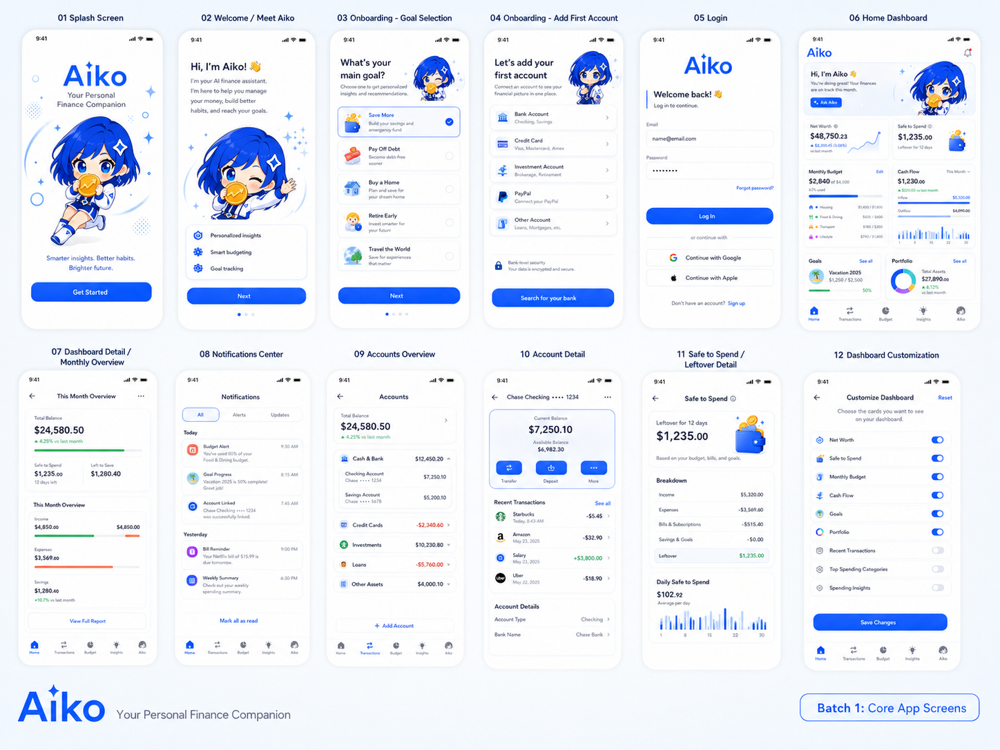
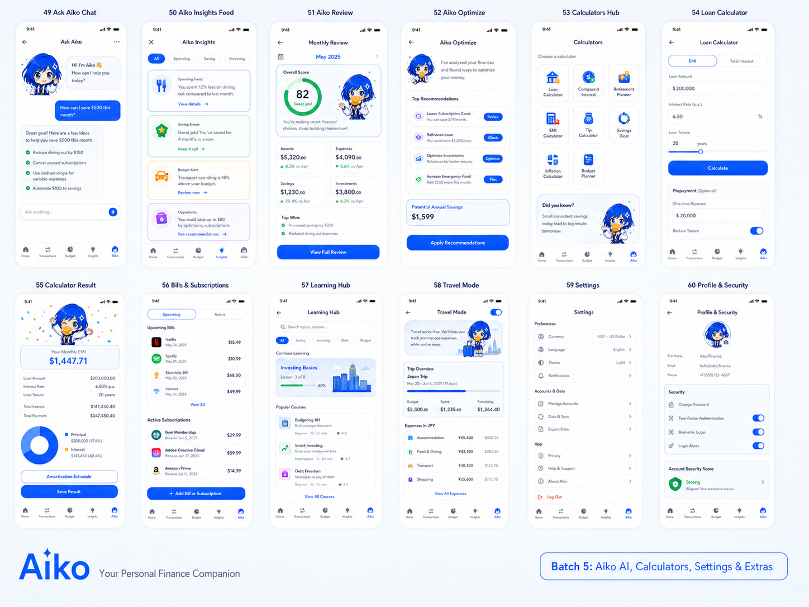
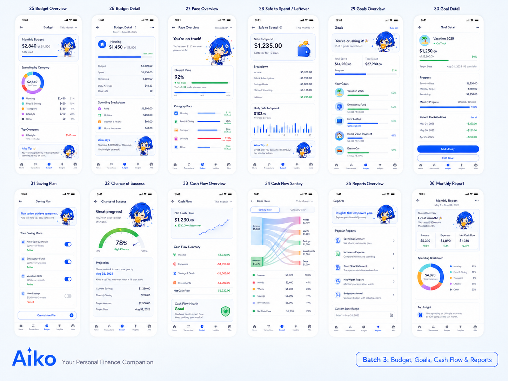
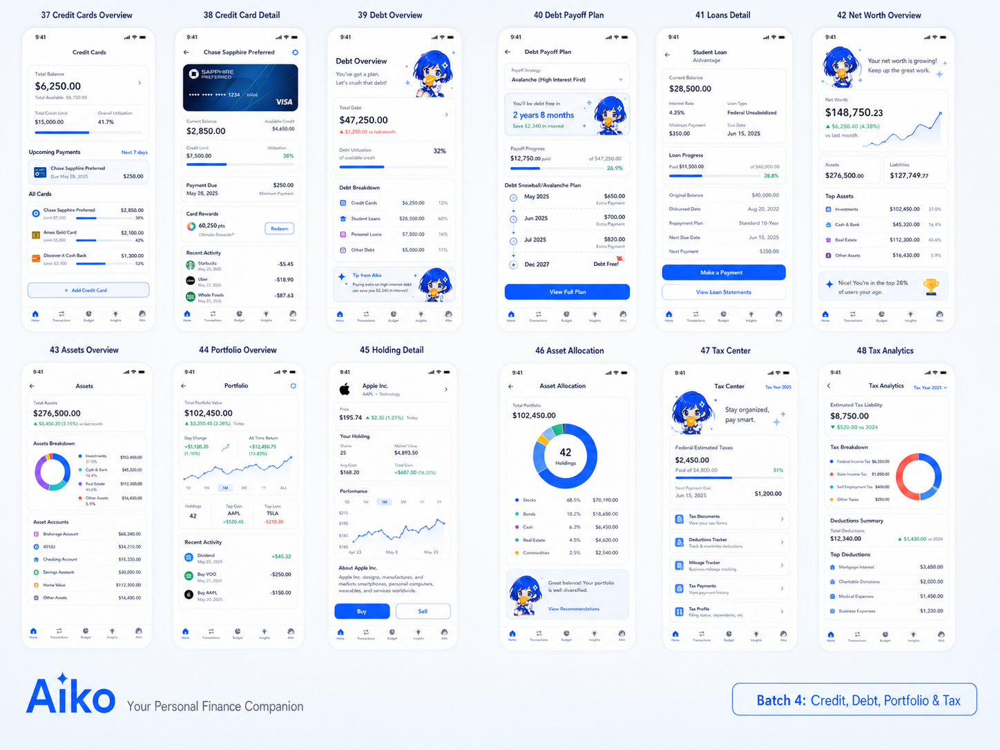
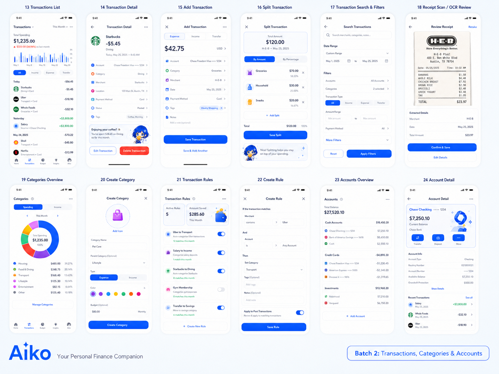

# Aiko — Personal Finance Management App

**AI-powered personal finance, guided by Aiko** — a calm, blue-haired AI companion. Track · Budget · Save · Invest · Plan.

> Canonical source of truth for contributors and coding agents — product scope, design system, implementation rules. If code conflicts with this file, fix the code (or surface the conflict).
>
> **Agents: be brief.** Concise, high-signal responses; minimal, focused diffs; skip preamble.
>
> **Keep this file current.** When a change alters architecture, design system tokens, conventions referenced from here, or the scope/ownership of a feature, update `AGENTS.md` in the same change so it stays the source of truth.

---

## What Is Aiko?

Cross-platform (iOS + Android) personal finance app built with Flutter + Supabase Cloud. At its core, **Aiko** (calm, anime-style, blue hair) gives friendly, non-judgmental money guidance. A data-first financial OS: 13 transaction types, category-owned budget limits (envelope / zero-based / 50-30-20 templates, monthly/weekly/yearly/daily periods, rollover), goal accounts (SMART target, date, priority, Monte Carlo success probability), cash flow + pace, credit/debt/loan payoff, portfolio + net worth, tax organization, ~60 calculators, AI insights, Ask Aiko chat, monthly Aiko Review, learning hub, multi-currency Travel Mode. See [Core Features](#core-features).

---

## Brand Identity & Voice

- **Name/avatar:** Aiko — blue-haired, supportive, smart, calm, non-judgmental.
- **Voice:** warm, clear, positive, solution-oriented — never shame-based. Use "Groceries are pacing high. Lower flexible spending by $18 this week to stay on track." Avoid "You overspent again."
- **Color:** Primary blue `#3B82F6` (Deep `#1D4ED8` | Soft `#93C5FD` | Pale `#EFF6FF`). Semantic: Success Green (savings/income), Warning Orange (bills/limits), Danger Red (overspending), Purple (Premium/AI), Teal (analytics/portfolio).
- **Principle — *Data first, Aiko enhanced*:** the character guides onboarding, greetings, reviews, and insights without obscuring data or charts.
- **Product register:** product UI, not a marketing site. Familiar patterns, dense-but-readable hierarchy, consistent components, explanatory motion, AI warmth only when it clarifies a decision. Avoid decorative gradients, glassmorphism, ornamental/nested cards, oversized heroes, meaningless accents, and Aiko artwork over numbers/charts/forms/actions. Category forms own budget fields (limit / period / rollover / thresholds) for non-default categories — there is no separate Budgets form.

**Design tenets:** (1) Data first, Aiko enhanced. (2) One primary action per screen region. (3) Every number needs context (period/account/category/target/status). (4) Lists compact by default; detail screens breathe. (5) Cards = real objects, metrics, or grouped tasks. (6) Forms disclose advanced controls only when the feature owns that choice. (7) Empty states teach the next action; errors explain recovery. (8) Dark mode is first-class. (9) 48px minimum touch target.

---

## Design Ideas

The May 31, 2026 reference idea boards are implemented as in-app flows and supplemental detail states — coverage targets, not a separate theme. Existing feature screens are the source of truth; idea states integrate as subroutes, menu tools, or inline actions ([Route and Idea Coverage](#route-and-idea-coverage)). **Rule:** when an idea board overlaps an existing feature, improve that flow — never build a parallel screen.

| Idea | Coverage |
| --- | --- |
| Idea 1 | Core app screens: splash, onboarding, login, dashboard, notifications, accounts, safe-to-spend, customization |
| Idea 2 | Transactions, transaction detail, add/split transaction, receipt review, search filters, categories, account detail |
| Idea 3 | Budget, pace, safe-to-spend, goals, saving plans, cash flow, Sankey, reports, monthly report |
| Idea 4 | Credit cards, debt payoff, loans, net worth, assets, portfolio, allocation, tax center, tax analytics |
| Idea 5 | Ask Aiko, Aiko insights/review/optimize, calculators, learning hub, travel mode, settings, profile security |







---

## Tech Stack

| Component | Technology |
| --- | --- |
| Mobile App | Flutter & Dart (SDK ^3.11.5) |
| State | Riverpod |
| Navigation | GoRouter |
| Backend | Supabase Cloud (Auth, Postgres, Storage, RLS) |
| Offline Store | Brick offline-first with SQLite (`sqflite`) |
| Sync | Brick request queue to Supabase after local writes |
| Attachments | Supabase Storage (per-user bucket) + client-side WebP compression (`flutter_image_compress`, JPEG fallback on iOS) |
| Money | `decimal` (no floating-point errors) |
| Charts | `fl_chart` |
| Security | `flutter_secure_storage`, `local_auth` (PIN + biometric) |
| IDs | `uuid` |
| Export | `csv`, `share_plus`, `path_provider` |
| Formatting | `intl` (locale-aware) |

---

## Getting Started

**Prerequisites:** [Flutter](https://flutter.dev/docs/get-started/install) (stable, SDK ^3.11.5), a [Supabase Cloud](https://supabase.com/) project (free tier fine for dev), the [Supabase CLI](https://supabase.com/docs/guides/cli), and Android Studio / Xcode emulators.

```bash
# 1. Install
git clone <repository-url> && cd aiko
flutter pub get
dart run build_runner build        # regenerate Brick adapters + SQLite migrations when offline models change

# 2. Configure (anon key only on the client — never a service-role key)
cp .env.example .env                # set SUPABASE_URL and SUPABASE_ANON_KEY

# 3. Push schema (all tables + RLS — see Database Schema)
supabase login
supabase link --project-ref <your-project-ref>
supabase db push
# Optional dev-only seed (never on production):
# psql <your-supabase-db-url> -f supabase/seed.sql

# 4. Run (omit env vars to run local-only/offline)
flutter run -d <android|ios> \
  --dart-define=SUPABASE_URL=https://your-project-ref.supabase.co \
  --dart-define=SUPABASE_ANON_KEY=<your-cloud-anon-key>
```

> **⚠️ Security:** Never put a Supabase service-role key in the app, `.env`, dart-defines, or any client-visible config. Without `SUPABASE_URL`/`SUPABASE_ANON_KEY` the app runs local-only (SQLite via Brick); cloud sync starts once Supabase is configured and the user is authenticated.

---

## Project Structure

```sh
lib/
├── brick/                       # Brick offline models, adapters, SQLite schema, mappers
├── main.dart                    # Entry point
├── app/                         # App wiring (router, bootstrap, providers)
├── core/                        # Framework utilities, no UI: config, errors, formatting,
│                                #   monetization (feature gating), money (Decimal-safe),
│                                #   notifications, offline, prediction, security, storage,
│                                #   supabase, sync
├── features/                    # 28 feature modules, e.g. accounting, accounts, aiko_assistant,
│                                #   aiko_character, aiko_optimize, assets, auth, budgets,
│                                #   calculators, categories, credit_cards, dashboard, debt_loans,
│                                #   devices, export, goals, insights, investments, learning_hub,
│                                #   monetization, onboarding, overview, settings, tax_center,
│                                #   transactions, travel_mode
├── shared/                      # Cross-feature widgets, state, test data
├── l10n/                        # Generated AppLocalizations (en, th) + .arb sources
└── theme/                       # Design system (colors, typography, spacing, themes)

supabase/                        # migrations/ (Postgres + RLS + functions), seed.sql, storage/
assets/                          # icons/ (aiko_*.svg), images/aiko/ (6 expression variants)
test/                            # Unit tests
```

Each feature module is layered — `application/` (services, orchestration), `data/` (repositories, DTOs, sync adapters), `domain/` (immutable models, value objects), `presentation/` (screens, widgets, controllers).

---

## Information Architecture & Navigation

GoRouter around a bottom-nav shell with 5 primary tabs:

1. **Accounts (`/accounts`)** — Bank/Cash/Wallet accounts, including credit cards.
2. **Categories (`/categories`)** — Hierarchical management with the 13 default groups + custom categories.
3. **Overview (`/home`)** — Customizable dashboard of independently managed panels (Aiko greeting, Daily spending, Safe this week, Daily summary, Net earnings, Category budgets, Spending calendar, Upcoming due dates, This Month Overview, Cash flow mapping, Aiko Goal Simulator), primary-color action icons, a scrollable in-page Edit layout action, and an app-bar Menu action.
4. **Transactions (`/transactions`)** — Unified search, filters, recurring entries, auto-categorization rules.
5. **Aiko (`/aiko`)** — Chat (`/aiko-assistant`), optimization (`/aiko-optimize`), course hub.

**Menu (`/settings`)** opens from the Overview app-bar action. Groups: **Planning** (Budget, Goals, Investments, Asset Allocation, Holding Detail, Assets and Net Worth, Travel Mode), **Insights and AI** (Learning Hub), **Tools and Data** (Calculators, Monthly Report, Export), **Settings and Security** (Notifications, Notifications Center, Profile & Security). Also exposes Profile, Appearance, Language toggles.

### Secondary Routes

| Route | Purpose |
| --- | --- |
| `/credit-cards` | Credit card limit & payment tracking |
| `/bills` | Recurring bills & subscription cancellations |
| `/goals` | SMART savings & debt payoff progress |
| `/portfolio` | Investment holdings & asset allocation |
| `/assets` | Physical asset tracking & Net Worth |
| `/tax-center` | Tax deduction logs & reports |
| `/calculators` | Built-in financial calculator hub |
| `/learning-hub` | Financial education courses & quizzes |
| `/settings` | Menu — Planning, AI, tools, security entry points |

---

## Architecture

Optimizes for low backend cost, strong offline support, fast UX, low vendor lock-in: the remote is standard Postgres behind repository interfaces, keeping a path open from Supabase Cloud → self-hosted Supabase → custom Postgres without UI changes.

### Feature Module Pattern

```sh
<feature>/
├── application/    # Feature services, orchestration, business workflows
├── data/           # Repositories, DTOs, persistence and sync adapters
├── domain/         # Immutable domain models and value objects
└── presentation/   # Screens, widgets, controllers, UI-only state
```

- Screens compose UI and consume Riverpod providers (`ref.watch`/`ref.read`); application services hold business logic and coordinate repositories.
- Repositories own persistence and sync — screens never call Supabase, Brick, or SQLite directly.
- Domain models stay framework-light. Brick models (`lib/brick/models/`) store primitives only and map to domain models via `lib/brick/offline_model_mappers.dart`.

### Offline-First & Sync

Core finance data reads/writes locally first via [Brick](https://github.com/GetDutchie/brick) (SQLite local store, Supabase Postgres remote). Brick handles mapping, local cache, the Supabase provider, the sync queue, and local query subscriptions — no hand-rolled outbox/retry/mappers.

- **Optimistic local writes:** profiles, accounts, categories, transactions, budgets, goals persist to SQLite immediately and the UI updates at once. With Supabase configured + authed, Brick queues writes and syncs in the background; when unavailable, repositories return local data or safe empty/default states — never backend errors in normal flows. Prefer `tryClient()` + offline fallback over `AikoSupabase.requireSession()` in user-facing repositories.
- **⚠️ Known gap (offline, no Supabase config):** `accountsProvider`, `transactionsProvider`, `budgetsProvider`, `goalsProvider`, `dashboardSummaryProvider`, `dashboardDueItemsProvider` (`lib/app/providers.dart`) call repositories without try/catch. If the offline store or `OfflineUserContext` (`lib/core/offline/offline_user_context.dart`) throws (typical on fresh install, or where the secure-storage platform channel is unavailable), the error reaches the screen's `AikoScreenState.error` → "X is unavailable" (message includes `$error` for diagnosis). Only `dashboardLayoutRepository.load` swallows errors today. Fix: wrap each `build()`/provider body in try/catch returning an empty list or default summary.
- **Brick `details_json` round-trip (regen-safe):** `OfflineAccount.detailsJson` is stored as a local VARCHAR and as a Supabase `jsonb` column named `details`. The Supabase round-trip is wired through `accountDetailsFromSupabase` / `accountDetailsToSupabase` on `lib/brick/models/account.model.dart` via `@Supabase(fromGenerator/toGenerator)`, and the local read tolerates legacy NULL rows via `accountDetailsFromSqlite` (`@Sqlite(fromGenerator)`), so `dart run build_runner build` is safe to re-run and a fresh or legacy install both load accounts. Regression coverage: `test/brick/account_details_json_test.dart`.
- After editing `lib/brick/models/`, run `dart run build_runner build` and commit generated adapters, schema, migrations.
- **System (default) categories:** global Supabase rows (`user_id = NULL`) injected in-memory via `CategoryDefaults` (`lib/features/categories/domain/category_defaults.dart`) — never stored per-user in Brick, not user-writable, fixed stable UUIDs (never change them). They belong to 13 global, read-only groups (`CategoryGroupDefaults.all`, same file): Income & Earnings, Investments & Savings, Food & Drink, Transport, Housing & Utilities, Health & Fitness, Shopping & Personal, Entertainment & Leisure, Education, Travel, Family & Giving, Bills & Financial, and the "Other" catch-all — each a `user_id = NULL` in-memory `category_groups` row with a fixed UUID. Groups section the Categories screen; "Other" also absorbs any unfiled custom category. Default groups aren't editable/deletable but are offerable as assignment targets for custom categories.
- Use Supabase for Auth, Postgres, RLS, structured finance data, attachment storage. By default avoid Realtime/Edge Functions (unless a feature needs server logic) and large blobs in Postgres.

### Code Conventions

- **State:** Riverpod for all state; avoid `setState` outside trivial local UI (focus, animation, ephemeral text fields). Top-level providers in `lib/app/providers.dart`; feature providers inside the module; shared state in `lib/shared/state/`.
- **Provider caching & refresh:** Long-lived list/summary providers in `lib/app/providers.dart` (`transactionsProvider`, `budgetsProvider`, `categoriesProvider`, `goalsProvider`, `dashboardSummaryProvider`, `dashboardDueItemsProvider`) call `ref.keepAlive()` *after* a successful load, so switching tabs reuses cached data instead of re-showing a loading state (Overview no longer flashes a full-screen skeleton each visit). A failed load is not cached and still retries. Trade-off: a cached screen no longer auto-refreshes on revisit, so screens that can go stale own a `RefreshIndicator` whose `onRefresh` calls `ref.refresh(<provider>.future)` per provider shown — see `_refresh` in `lib/features/dashboard/presentation/home_dashboard_screen.dart`. Panels that watch a notifier directly still update live after writes; only `dashboardSummaryProvider`-derived numbers wait for a pull-to-refresh. *Per-widget loading (future):* loading is per-provider, so it's already granular — choose which widgets cache via where `ref.keepAlive()` sits, and which show a skeleton via whether their `.when(loading:)` is gated at the screen vs inside the panel.
- **Routing:** all routes in `lib/app/app_router.dart`. Kebab-case paths (`/credit-cards`, `/debt-loans`, `/tax-center`). Idea-inspired screens belong to the existing feature owner — add subroutes/menus/inline tools, never duplicate a main screen. Accounts and Categories are primary nav tabs — don't add them as Planning or Menu cards.
- **Money:** never use `double`. Use `Money` (`lib/core/money/money.dart`, wraps `Decimal`); format via `lib/core/formatting/currency_formatter.dart` (locale-aware `intl`). Base currency lives in the profile; multi-currency supports travel and portfolio.
- **Naming:** files `snake_case.dart`, classes `PascalCase`, vars/functions `camelCase`, routes `/kebab-case`, DB tables/columns `snake_case`, feature dirs `snake_case`.
- **`super.key` convention (T-705):** every `StatelessWidget` / `StatefulWidget` constructor that takes a `Key?` parameter forwards it as `super.key`. One pattern, enforced; it lets the widget tree optimisation keys flow through every node without each call site spelling out `key: widget.key`.
- **Notifier / Service / Controller convention (T-601):** three distinct roles, each named by suffix so the call site reads as a contract.
  - `*Notifier` (e.g. `TransactionsNotifier extends AsyncNotifier<…>`) — reactive Riverpod state. Owns the in-memory snapshot, listens to repository events, calls `ref.keepAlive()` when appropriate. No business logic that doesn't need to update the UI.
  - `*Service` (e.g. `PredictionService`, `OfflineDataMigrator`, `CategoryBudgetProgressService`) — pure or near-pure function object. Holds no Riverpod state, no widget refs. Stateless (`const` ctor) and side-effect-bounded so it's easy to unit-test in isolation.
  - `*Controller` (e.g. `AikoChatController`, `DashboardLayoutNotifier` when it talks to widgets) — orchestrates a Notifier + Service + UI side effects. Owns the stream, retry, and user-facing message derivation, but doesn't compute the business result itself.
  - Repositories (`*Repository`) sit in `data/` and own persistence — they wrap a Brick `OfflineStore` and never touch `ref` / `BuildContext`.

### Sync Fields & Conflict Resolution

Every syncable table carries `id`, `user_id`, `created_at`, `updated_at`, and `version integer not null default 1`. Deletes are **hard deletes**: `OfflineStore.delete` removes the local row and queues a remote `DELETE` through Brick (SQLite-only when offline/local mode). There is no `deleted_at` tombstone. Known gap: a row deleted while signed out in cloud mode is removed locally but its remote `DELETE` is not queued (no session at delete time), so it won't propagate on next sign-in.

Conflict rules: transactions/budgets/categories — latest `updated_at` wins; important records — compare `version` before overwriting; summaries — recalculated from transactions, never merged; account balances — calculated or snapshot-based; attachments — WebP uploads to Storage, metadata syncs via Postgres, local copy kept as offline cache.

### Summary Tables

Dashboards/reports read pre-aggregated summary tables instead of rescanning raw transactions: `daily_summary`, `monthly_summary`, `category_monthly_summary`, `budget_progress`, `account_balance_snapshot`, `net_worth_snapshot`.

### Receipt & Attachment Strategy

Attachments live in **Supabase Storage** under a per-user, RLS-protected bucket path — never in Postgres `bytea`; only metadata goes to Postgres. Capture is camera or a recent gallery image (iOS + Android). OCR (if enabled) runs on the **original** first, then it's compressed to a single **WebP** (≈q80, ≤2000px long edge, EXIF stripped, iOS HEIC transcoded) — that one ~100–300 KB file serves both list and detail (no separate thumbnail). Encoder is `flutter_image_compress`: native on Android; iOS has no native WebP encoder, so it encodes in the background and falls back to JPEG (`UnsupportedError` → `CompressFormat.jpeg`). The pure-Dart `image` package can't encode WebP (not an iOS fallback).

**No data loss (offline-first):** the WebP is written locally and the row marked `sync_status = 'pending_upload'`; the original is discarded after OCR + compression; the WebP uploads through the sync queue (idempotent by `checksum`, retried) and flips to `synced`; deletes are hard (row + Storage object removed). The local WebP is a **persistent cache** — opening a transaction reads it locally, never re-downloads — reclaimed only under LRU pressure (re-fetched on demand).

`transaction_attachments` carries the standard sync fields plus `transaction_id`, `local_path`, `remote_path`, `file_name`, `mime_type`, `file_size_bytes`, `checksum`, `sync_status` (default `'pending_upload'`). Storage sits behind a `RemoteAttachmentStorage` interface (`upload`/`delete`/`getDownloadUrl`); `SupabaseAttachmentStorage` uploads the compressed file and serves short-lived signed URLs, so the backend is swappable without UI changes.

### Cost & Vendor Lock-in

Cost stays low: most reads come from local SQLite, dashboards read local summary tables, writes are batched, attachments are compressed before Storage. Avoid: loading all transactions from Supabase per screen, Realtime every session by default, image bytes in Postgres `bytea`, Edge Functions for simple CRUD, direct Supabase calls from UI. Lock-in stays low via standard Postgres schema, repository interfaces, business logic in Dart, and file storage behind `RemoteAttachmentStorage`.

---

## Core Features

- **🏠 Customizable Dashboard** — Aiko welcome card + separately managed Daily spending, Safe this week, Daily summary, Net earnings, Category budgets, Spending calendar, Upcoming due dates, This Month Overview, Cash flow mapping, Aiko Goal Simulator panels; quick-add transaction; scrollable Edit layout action.
- **💰 Money Tracking & Automation** — 13 transaction types (income, expense, transfer, refund, investment buy/sell, dividend, interest, loan payment, credit card payment, tax payment, fee, adjustment). Split transactions, receipt attachments, recurring entries (Once/Daily/Weekly/Monthly/Annually, each with its own end date), duplicate detection. Amount-first quick entry with receipt OCR and voice. Transaction rules auto-apply categories/tags/splits/names by merchant keyword, account, or amount.
- **📊 Smart Budgeting (merged into Categories)** — Each Category owns an optional budget: monthly/weekly/yearly/daily period, envelope / zero-based / 50-30-20 templates, one-period rollover, alert thresholds (default 50/75/90/100%). Safe-to-Spend: `Leftover = Income − Fixed Bills − Reserves − Debt − Goals − Current Spending`. Pace compares spending velocity against limits.
- **🎯 Financial Goals (merged into Accounts)** — Goal accounts (`Account.type == goal`) carry a SMART target amount, target date, and priority. `currentBalance` is the saved amount; auto-calculated monthly contribution, Monte Carlo success probability, and the saving plan all read from the same row.
- **📈 Insights & Predictions** — Spending trends, cash flow + Sankey, pace, leftover/safe-to-spend, end-of-month forecasts, budget-overrun prediction, net worth projection, retirement readiness.
- **🤖 Aiko AI Assistant** — Natural-language chat, personalized insights, budget recommendations, debt payoff strategies, monthly reviews.
- **💳 Credit & Debt** — Statement balances, APR, rewards, due dates, utilization; snowball/avalanche payoff with extra-payment and interest-savings simulation.
- **📱 Portfolio, Assets & Tax** — Holdings with performance, allocation, dividends, realized/unrealized gains; allocation by class/currency/geography/risk; net worth trends; tax-deductible flagging, capital gains, document storage, estimated tax reports.
- **🌍 Travel Mode** — Multi-currency accounts, automatic exchange rates, travel budgets, foreign-fee tracking, trip-based reports.

---

## Financial Calculator Suite (~60 Tools)

Saved calculations store as `SavedCalculatorScenario`, compare side-by-side, and convert into budgets or goals.

- **Finance & Investment:** TVM, Compound Interest, ROI, IRR/NPV, Savings Goal, CD, Bond, Tax Equivalent Yield, Rule of 72.
- **Loan & Mortgage:** Amortization & Comparison, Refinance, APR, Rent vs. Buy, Home Affordability, bi-weekly payments, Rental Property.
- **Retirement:** Savings & Income Planner, Traditional vs. Roth IRA, RMD, Social Security Estimator, Annuity.
- **Credit Card & Auto:** CC Payoff & Minimum Payment, Balance Transfer, Auto Loan vs. Lease.
- **Stock & Portfolio:** WACC, Black-Scholes Options, Expected Return, CAPM, Holding Period Return, Capital Gains.
- **Everyday & Tax:** Salary to Hourly, Paycheck Tax, Inflation, Effective Rate, Margin/Markup, Tip & Percentage.

---

## Prediction & AI System

- Rule-based forecasting drives core predictions (end-of-month balance, budget-overrun risk, goal completion); moving averages track recurring-expense trends; seasonality detection finds monthly patterns.
- Monte Carlo simulations drive advanced goal/retirement probability under three scenarios (optimistic, expected, conservative). Logic in `lib/core/prediction/`.
- AI suggestions store as `AikoInsight` records in Supabase across four dimensions: **Descriptive** ("You spent $450 on dining out this month."), **Diagnostic** ("Dining out increased 20% from weekend restaurants."), **Predictive** ("At this pace you'll exceed your dining budget in 5 days."), **Prescriptive** ("Limit weekend spending to $15/day to stay on track.").
- **Disclaimer required:** *AI insights are estimates, not certified financial, investment, or tax advice.*

---

## Ask Aiko Chat Backend (`aiko-chat` Edge Function)

The one feature needing server logic runs as a Supabase Edge Function (`supabase/functions/aiko-chat/`) — an SSE proxy that streams Chat Completions from any **OpenAI-compatible provider**, with **automatic fallback across an ordered chain of (provider, model) entries**. Provider keys stay server-side.

**Request flow:** (1) validates the caller's Supabase JWT (`Authorization: Bearer <jwt>`); (2) enforces a per-user in-memory rate limit (default `20`/min, else `429 RATE_LIMITED`); (3) builds the message list (last 20) behind a fixed system prompt defining Aiko's persona, forcing the disclaimer on any numeric/recommendation answer, injecting the user's `baseCurrency`; (4) optionally runs Layer 2 tool calls (off by default); (5) streams the final answer to the provider with `stream: true`, re-emitting each token as `data: {"delta":"..."}\n\n`, closing with `data: {"done":true}\n\n`. Client: `HttpChatEngine` in `lib/features/aiko_assistant/application/chat_engine.dart` calls `${SUPABASE_URL}/functions/v1/aiko-chat`.

**Auto-fallback:** the runtime walks an ordered chain of `(provider, model)` entries. On a network error, non-2xx, 60s timeout, or a stream that dies before any token has been sent, it silently moves to the next entry. Once tokens have flowed to the client, a mid-stream error is surfaced as a final `error` event (we can't safely restart a stream the client has already started reading). When every entry fails, the stream ends with `data: {"error":"...","code":"PROVIDER_DOWN"}\n\n` summarising each attempt.

**How Aiko reads your data** (model only ever sees RLS-scoped data; key never leaves the server):

- **Layer 1 — on-device snapshot (always on).** The client assembles a compact `AikoFinancialContext` (net worth, accounts, this-month income/spending, budget pace, goals, recent transactions) from local Brick and sends it in the body; the function folds it into the system prompt, so most "how am I doing" questions resolve in one round-trip. Aggregates only, capped, never the full ledger.
- **Layer 2 — server-side tools (off by default, `AI_TOOLS_ENABLED`).** When on, the model may first call a fixed allow-list of **read-only** Postgres RPCs (`supabase/migrations/*_aiko_assistant_read_functions.sql`), each `SECURITY INVOKER` under the caller's JWT (RLS scopes results). The function never runs model-supplied SQL and never uses the service-role key. Tool resolution itself falls back across the chain — if provider 1 can't service tools, the runtime tries provider 2.

**Configuration** (Supabase secrets — never in the app or `.env`). The function ships with three code-defined providers and three chain presets; pick the active preset with `AI_PRESET`:

```sh
# 1. Pick the active chain (default: "default" preset)
supabase secrets set AI_PRESET=default

# 2. Set a key for every provider in your active chain.
#    A missing AI_KEY_<id> silently drops that entry from the chain.
supabase secrets set AI_KEY_DEEPSEEK=sk-...
supabase secrets set AI_KEY_GEMINI=AIzaSy...
supabase secrets set AI_KEY_OPENAI=sk-...

# 3. Rate limit and Layer 2:
supabase secrets set AIKO_RATE_PER_MIN=20                    # default: 20
supabase secrets set AI_TOOLS_ENABLED=false                  # default: false (Layer 2 tools)
```

`SUPABASE_URL` / `SUPABASE_ANON_KEY` are injected by the runtime.

**Provider presets (code-defined, edit `supabase/functions/aiko-chat/index.ts` to add or change):**

| `id` | Base URL | Env key | Default models |
| --- | --- | --- | --- |
| `deepseek` | `https://api.deepseek.com/v1` | `AI_KEY_DEEPSEEK` | `deepseek-v4-flash`, `deepseek-chat`, `deepseek-reasoner` |
| `gemini` | `https://generativelanguage.googleapis.com/v1beta/openai` | `AI_KEY_GEMINI` | `gemini-flash`, `gemini-2.0-flash`, `gemini-1.5-pro` |
| `openai` | `https://api.openai.com/v1` | `AI_KEY_OPENAI` | `gpt-oss-120b`, `gpt-4o-mini`, `gpt-4o` |

**Chain presets (set `AI_PRESET` to the id):**

| `id` | Order |
| --- | --- |
| `default` | DeepSeek `deepseek-v4-flash` → Gemini `gemini-flash` → OpenAI `gpt-oss-120b` |
| `quality` | OpenAI `gpt-oss-120b` → Gemini `gemini-1.5-pro` → DeepSeek `deepseek-reasoner` |
| `cheap` | DeepSeek `deepseek-v4-flash` → OpenAI `gpt-4o-mini` |

To add a provider: declare a new `PROVIDER_*` entry, register it in the `PROVIDERS` map, and reference it from one or more chain presets. To add a chain: add a new `CHAIN_PRESETS[…]` entry.

**Legacy single-provider path:** if `AI_PRESET` is unset and `AI_API_KEY` is set, the function falls back to the old `AI_API_KEY` + `AI_MODEL` + `AI_BASE_URL` config (no fallback, just the one provider) so existing deployments keep working without changes.

**Deploy & local dev** (the function validates the JWT itself — keep gateway verification on; do **not** pass `--no-verify-jwt`):

```sh
supabase functions deploy aiko-chat
supabase functions serve aiko-chat --env-file ./supabase/functions/.env.local  # .env.local is git-ignored
```

**Response & errors:** success is `text/event-stream` (one event per token, ending `data: {"done":true}`). Errors *before* the stream are JSON with a `code` the client switches on; errors *after* it starts arrive as `data: {"error":"..."}` and close the connection.

| Status | `code` | Meaning |
| --- | --- | --- |
| 400 | `BAD_REQUEST` | `messages` array missing/malformed |
| 400 | `BAD_JSON` | Body was not valid JSON |
| 401 | `NO_TOKEN` | Missing `Authorization` header |
| 401 | `BAD_TOKEN` | JWT rejected by Supabase Auth |
| 405 | `METHOD_NOT_ALLOWED` | Non-POST request |
| 429 | `RATE_LIMITED` | Per-user rate limit exceeded |
| 500 | `MISCONFIGURED` | Function missing Supabase env |
| 500 | `MISSING_PROVIDER_KEY` | No provider available — active `AI_PRESET` has no configured `AI_KEY_*` and `AI_API_KEY` is unset |
| 502 | `PROVIDER_DOWN` | Every chain entry failed; the stream's final `error` event summarises each attempt |
| 502 | `PROVIDER_ERROR` | (Legacy single-provider path) Upstream returned non-OK before the stream started |

---

## Account Deletion (3-day grace period)

"Delete account" (Profile) does **not** delete immediately — it schedules a hard delete 3 days out, emails the user, and signs them out. Logging back in within those 3 days cancels it. This protects against a misclick or a compromised session. Deletion runs server-side because removing the `auth.users` login needs a **secret (RLS-bypassing) key**, which never ships in the app.

**Flow:**

1. **Request** — `AuthRepository.deleteAccount` calls `functions.invoke('delete-account')`, then signs out. `supabase/functions/delete-account/` validates the caller's JWT (user id from the *token*, never the body), sets `profiles.deletion_scheduled_at = now() + 3 days`, and sends the heads-up email over SMTP (`_shared/email.ts`; best-effort — a mail outage never blocks the schedule). Local Brick data is intentionally left in place so a cancel-login is seamless.
2. **Cancel** — every successful sign-in/restore (`signIn`, `signUp`, `_restoreSessionDefaults`) calls `_cancelPendingDeletion`, which clears `deletion_scheduled_at` via the user's RLS-scoped client. Idempotent no-op when nothing is scheduled.
3. **Purge** — an hourly `pg_cron` job (migration `…_purge_deleted_accounts_cron.sql`) calls `purge-deleted-accounts` over `pg_net`. That function (guarded by `PURGE_CRON_SECRET`, not a user JWT) **deletes the `profiles` row** (cascades all finance data via `on delete cascade`) and then the **auth user** for every row past its grace period. Note the schema quirk: `profiles.id` is *not* FK'd to `auth.users`, so the auth user alone wouldn't cascade — the profile row must be deleted explicitly.

Never delete the auth user from the app with the publishable/anon client — `auth.admin.*` always fails there.

**Keys** are read from the new **JWT Signing Keys** env vars, with a fallback to the deprecated legacy keys during migration:

| Purpose | New (preferred) | Legacy (deprecated) |
| --- | --- | --- |
| Verify caller JWT | `SUPABASE_PUBLISHABLE_KEYS['default']` (`sb_publishable_…`) | `SUPABASE_ANON_KEY` |
| Admin / purge | `SUPABASE_SECRET_KEYS['default']` (`sb_secret_…`) | `SUPABASE_SERVICE_ROLE_KEY` |

`SUPABASE_*_KEYS` are JSON maps keyed by name (e.g. `{"default":"sb_secret_…"}`), injected by the runtime — never expose the secret map to client code.

**Deploy & configure:**

```sh
supabase functions deploy delete-account
supabase functions deploy purge-deleted-accounts

# SMTP for the heads-up email (reuse the Auth SMTP server):
supabase secrets set SMTP_HOST=smtp.example.com SMTP_PORT=465 \
  SMTP_USERNAME=apikey SMTP_PASSWORD=... SMTP_FROM="Aiko <noreply@yourdomain.com>"

# Shared secret the cron job presents to purge-deleted-accounts:
supabase secrets set PURGE_CRON_SECRET=<random-long-string>

# pg_cron reads the function URL + that secret from Vault (keeps them out of git):
#   select vault.create_secret('https://<ref>.supabase.co/functions/v1', 'edge_base_url');
#   select vault.create_secret('<same-random-long-string>', 'purge_cron_secret');
```

The runtime injects the key env vars for deployed functions; for local dev add `SUPABASE_SECRET_KEYS` / `SUPABASE_PUBLISHABLE_KEYS` (or the legacy keys) and the SMTP/cron secrets to `.env.local`.

---

## Database Schema

15 core tables, all protected by Row Level Security:

| Table | Purpose |
| --- | --- |
| `profiles` | User profile, preferences, base currency |
| `accounts` | Financial accounts (cash, bank, e-wallet, credit card, loan, investment, asset) |
| `transactions` | All financial transactions (13 types) |
| `categories` | Hierarchical categories — 81 global system rows (`user_id = NULL`, `is_default = true`) plus user-created rows |
| `transaction_rules` | Auto-categorization rules |
| `budgets` | Budget definitions and alert thresholds |
| `goals` | Financial goals and progress |
| `credit_cards` | Credit card details and metrics |
| `assets` | Asset records by class and risk level |
| `liabilities` | Debt and loan records |
| `investment_holdings` | Portfolio holdings and market values |
| `tax_records` | Tax-year income, deductions, documents |
| `saved_calculator_scenarios` | Saved calculator inputs and results |
| `aiko_insights` | AI-generated insights |
| `devices` | Registered devices for sync |

All tables enforce `user_id = auth.uid()` via RLS. Exception: `categories` uses split policies — SELECT allows `user_id IS NULL OR user_id = auth.uid()` (global system categories readable by all authed users); INSERT/UPDATE/DELETE stay scoped to `auth.uid()`. Syncable tables follow the [Architecture](#architecture) sync-field and conflict conventions.

### Entity Field Reference

| Entity | Fields |
| :--- | :--- |
| **User** | `id` (UUID), `name`, `email`, `base_currency`, `country`, `timezone`, `preferred_theme`, `aiko_personality_setting`, `created_at` |
| **Account** | `id`, `user_id`, `name`, `type` (cash, bank, card, loan, etc), `currency`, `current_balance`, `is_active` |
| **Transaction** | `id`, `user_id`, `account_id`, `type`, `amount`, `currency`, `exchange_rate`, `category_id`, `date`, `merchant`, `note`, `tags`, `is_recurring`, `tax_flag` |
| **Category** | `id`, `user_id`, `name`, `parent_id`, `type`, `icon`, `color`, `budget_enabled` |
| **TransactionRule** | `id`, `user_id`, `rule_name`, `condition_type`, `condition_value`, `target_category_id`, `target_account_id`, `tags_to_apply`, `priority`, `is_active` |
| **Budget** | `id`, `user_id`, `category_id`, `amount`, `period` (weekly, monthly, custom), `rollover_enabled`, `alert_thresholds` |
| **Goal** | `id`, `user_id`, `name`, `target_amount`, `current_amount`, `target_date`, `linked_account_id`, `priority`, `success_probability` |
| **CreditCard** | `id`, `user_id`, `account_id`, `credit_limit`, `statement_day`, `due_day`, `apr`, `rewards_type` |
| **Asset** | `id`, `user_id`, `name`, `asset_class`, `value`, `currency`, `liquidity_level`, `risk_level` |
| **Liability** | `id`, `user_id`, `name`, `type`, `balance`, `interest_rate`, `monthly_payment`, `due_date` |
| **InvestmentHolding** | `id`, `user_id`, `symbol`, `asset_class`, `quantity`, `average_cost`, `current_price`, `currency`, `market_value` |
| **TaxRecord** | `id`, `user_id`, `tax_year`, `income_type`, `amount`, `deduction_type`, `document_id` |
| **Subscription** | `id`, `user_id`, `merchant`, `amount`, `billing_cycle`, `next_billing_date`, `category_id`, `cancellation_status` |
| **SavedScenario** | `id`, `user_id`, `calculator_type`, `input_json`, `result_json`, `notes`, `created_at` |
| **AikoInsight** | `id`, `user_id`, `insight_type`, `title`, `description`, `recommendation`, `confidence_score`, `source_data`, `dismissed_at`, `created_at` |

**Backend rules:** migrations in `supabase/migrations/` (never edit existing — create new); RLS scoped to `auth.uid()` on every table; never expose the service-role key client-side; `seed.sql` is dev/demo only; push with `supabase link --project-ref <ref>` then `supabase db push`.

---

## Design System

Source of truth for visuals, screen patterns, components. Don't add one-off colors/radii when a token or theme value exists. Theme code: `lib/theme/aiko_colors.dart`, `aiko_theme.dart`, `aiko_typography.dart`, `aiko_spacing.dart`.

**Tokens — three layers:** **Primitive** (raw colors, type, spacing, radius → `AikoColors`, `AikoTypography`), **Semantic** (primary, danger, surface, muted, outline → `ColorScheme`, theme extensions), **Component** (button, card, input, sheet, chip, nav → `AikoTheme`, shared widgets).

### Color

| Role | Light | Dark | Use |
| --- | ---: | ---: | --- |
| Primary | `#3B82F6` | `#93C5FD` | Primary actions, selected state, active nav |
| Secondary | `#1D4ED8` | `#3B82F6` | Strong selection, key blue charts |
| AI/Premium | `#7C3AED` | `#B894F5` | Aiko, AI, optimization, premium |
| Scaffold | `#D8E0F5` | `#0F172A` | Main background |
| Alternate scaffold | `#F6F8FF` | `#0F172A` | Light alternate screens |
| Surface | `#EEF2FF` | `#121C31` | Cards, sheets, grouped controls |
| Surface strong | `#E3E9FF` | `#1B2740` | Selected or high-emphasis panels |
| Text primary | `#0F172A` | theme on-surface | Primary text |
| Text secondary | `#293348` | theme on-surface-variant | Secondary text |
| Text muted | `#778196` | theme muted | Metadata and helper text |
| Outline | `#BAC3D6` | `#414B60` | Focusable or visible borders |
| Outline subtle | `#DCE4F8` | `#293348` | Dividers and quiet outlines |
| Success | `#16A34A` | `#4ADE80` | Income, savings, completed, positive trend |
| Warning | `#F59E0B` | `#FBBF24` | Bills, due soon, budget caution |
| Danger | `#DC2626` | `#F87171` | Errors, destructive actions, overspending |
| Analytics | `#0D9488` | `#2DD4BF` | Reports, portfolio, allocation, analysis |

Rules: primary blue = current/continue/main action (and Overview/Transactions app-bar action icons); purple is reserved for Aiko/AI/optimization/premium/review; green/orange/red/teal keep their semantic finance meanings; never rely on color alone (pair with text/icon/label/number); inactive states are neutral, not pale saturated.

10-stop ramps for charts, progress bars, selected states:

| Ramp | Stops |
| --- | --- |
| Primary blue | `#071426`, `#0B356F`, `#0C4A9A`, `#0B5DBD`, `#1D74E8`, `#3B82F6`, `#75A4F5`, `#A5C4F6`, `#D8E5FF`, `#FFFFFF` |
| Secondary blue | `#071426`, `#0B2A7A`, `#073AA8`, `#1D4ED8`, `#4268EA`, `#6385F0`, `#8AA4F5`, `#AFC0F8`, `#DCE5FF`, `#FFFFFF` |
| Tertiary purple | `#071426`, `#240052`, `#3B0785`, `#5B0BC0`, `#6D28D9`, `#7C3AED`, `#9B67F2`, `#B894F5`, `#DCCBFF`, `#FFFFFF` |
| Neutral | `#071426`, `#0F172A`, `#293348`, `#414B60`, `#5B6578`, `#778196`, `#9BA4B8`, `#BAC3D6`, `#DCE4F8`, `#FFFFFF` |

Test Aiko artwork on dark and light backgrounds; add a subtle glow/border if transparent regions blend into dark surfaces.

### Typography

Headline = Hanken Grotesk (titles, major balances, hero numbers); Body & Label = Manrope.

| Style | Size | Weight | Use |
| --- | ---: | ---: | --- |
| `displayLarge` | 48 | 700 | Rare onboarding/report moments |
| `headlineLarge` | 36 | 700 | Major balance or summary number |
| `headlineMedium` | 28 | 700 | Screen-level headline inside body |
| `titleLarge` | 20 | 700 | App bar title, card title |
| `titleMedium` | 16 | 700 | Section title, prominent row title |
| `titleSmall` | 14 | 700 | Dense list title |
| `bodyLarge` | 16 | 400 | Primary readable text |
| `bodyMedium` | 14 | 400 | Default body and metadata |
| `bodySmall` | 12 | 500 | Helper text |
| `labelLarge` | 14 | 700 | Buttons and tabs |
| `labelMedium` | 12 | 700 | Chips and badges |
| `labelSmall` | 11 | 700 | Dense status labels |

Letter spacing `0`. Tabular figures for aligned money columns. No display-scale text inside compact cards, lists, settings rows, sidebars, or form controls.

### Spacing, Shape, Surfaces

Spacing on a 4/8px rhythm: `space-1` 4 (icon/text gaps), `space-2` 8 (row/chip gaps), `space-3` 12 (compact card internals), `space-4` 16 (gutters, form gaps, default card padding), `space-5` 20 (prominent card padding), `space-6` 24 (section gaps), `space-8` 32 (major rhythm).

Shape: cards/rows/inputs/chips/segmented controls 8px radius; bottom sheets 20px top radius; FABs may use 16px; avoid 20px+ radii on product cards and decorative shadows. Don't nest cards — use rows/dividers inside one card; repeated objects use list tiles or object cards. Density: daily lists compact, detail screens breathe, dashboards use fewer stronger metrics, settings use grouped rows, forms use full-width controls with 16px gaps.

### Screen Archetypes

| Archetype | Examples | Rules |
| --- | --- | --- |
| Dashboard | Home, Budget overview, Portfolio overview | Lead with one primary summary, then 2-4 supporting metrics. Data before copy. Label charts with numbers + periods. |
| List & detail | Transactions, Accounts, Categories, Bills, Goals | Compact tappable rows (type mark, title, subtitle, trailing amount/status, chevron). Details lead with primary number/title + grouped facts. |
| Form | Add transaction, Budget form, Profile, Add category | Required controls first, full-width fields, helper text under controls, primary save button, progressive disclosure. |
| Settings | Settings, Notifications, Profile | Grouped rows (icon, title, short description, status/control). Separate security and destructive actions. |
| Assistant & AI | Aiko assistant, Optimize, Review | Cite financial context, give actions or dismiss reasons, avoid filler, keep finance states semantic even when AI uses purple. |
| Planning & education | Goals, Learning Hub, Calculators, Reports | Progressive disclosure. Show progress/saved state. Calculators show input → result → conversion action. Reports pair charts with summary text. |
| Supplemental tools | Filters, split, receipt review, cash flow, loan calculator, profile security | Extend an owning feature, never duplicate top-level screens. First viewport shows the task object. Required completion actions use sticky bottom bars on mobile. |
| Placeholders | Expansion screens | State what the feature will do + one action. No fake finished dashboards. Prefer `AikoScreenState` or `AikoFeatureOverviewScreen`. |

### Components

- **`FinanceCard`** (financial objects, metrics, grouped task panels): 8px radius, 16px default / 20px prominent padding, outline-variant border, no default shadow, `titleMedium` title, `bodyMedium` body, 40px icon tile (8px radius, 12% accent opacity), stable `InkWell` tap state. Strict three-tier hierarchy: primary number/title → supporting metadata → one clear action/status. Never a decorative wrapper around another card.
- **Buttons:** filled (primary), outlined (secondary), text (low-emphasis inline), icon (familiar commands). Min height 48px, 8px radius, visible disabled state.
- **Icon buttons:** 40–48px tile, 48px min tap target — Primary = blue circle/white icon, AI/premium = purple square/circle/white icon, Destructive = red circle/white icon.
- **Inputs/pickers:** visible labels, 54px min height, 8px radius, pale-blue fill, thin blue-gray border, leading search icon, primary focus border, danger error border, muted placeholder. Helper/validation copy below the field. Custom pickers show selected value + context (category group, account balance); bottom-sheet pickers use compact rows with selected checkmarks.
- **Lists:** compact `ListTile` rows, 48px tap target, single-line titles, aligned trailing amounts/statuses, dividers/card borders instead of nested containers.
- **Chips/badges:** short labels; status color matches semantic meaning and includes text.
- **Navigation:** shell tabs Accounts/Categories/Overview/Transactions/Aiko; bottom nav is a flush, compact 60dp bar (1px top border, surface background, no pill, no shadow); active = a 3dp indicator bar at the top of the tab in primary blue (premium purple for Aiko) with icon + label on-surface; Aiko's unselected label uses muted purple for a subtle AI hint; Menu (Overview app-bar action) holds Planning, Insights and AI, Tools and Data, Settings and Security.
- **Overview layout editing:** a scrollable in-page `Edit layout`/`Done` action at the bottom of Overview content — never in the app bar or a fixed bottom bar.
- **Sheets/dialogs:** bottom sheets for mobile create/edit (drag handle, safe area, scrollable, 20px top radius); dialogs for destructive confirmation (name the object + effect).
- **Charts/progress:** every chart needs a text summary; every progress bar shows current, target, period with semantic color + label (8px compact, 10–12px on dashboards).

| Interactive state | Treatment |
| --- | --- |
| Pressed / splash | Primary color at 12% opacity |
| Hover (web/desktop) | Surface tint at 8% opacity |
| Focused | 2px primary outline offset by 2px |
| Disabled | 40% opacity, no interaction |
| Dragging | Slight scale (1.02) with subtle shadow |

Use `AikoScreenState` for loading (skeleton/quiet progress, no fake data), empty (what's missing + one action), error (retry/recovery), offline (local mode), locked (authentication).

### Shared Widgets

Use `lib/shared/widgets/aiko_data_widgets.dart` for idea-backed supplemental and new finance detail screens. Prefer shared widgets over one-off cards/painters; don't nest `AikoDataListCard`; use sticky bottom actions via `AikoDetailScaffold.bottomBar`.

| Widget | Use |
| --- | --- |
| `AikoDetailScaffold` | Detail/tool screens with app bar, scroll body, optional sticky bottom action |
| `AikoInlineNotice` | Aiko tips, warnings, review notes, contextual explanations |
| `AikoMetricCard` / `AikoMetricGrid` | Compact financial summaries |
| `AikoProgressBar` / `AikoProgressRow` | Budget, debt, goal, portfolio, tax progress |
| `AikoDataListCard` / `AikoDataRow` | Grouped facts and settings-style rows |
| `AikoMiniBarChart`, `AikoDonutChart`, `AikoGauge`, `AikoSankeyPreview` | Lightweight labeled preview charts |

### Iconography

Material Icons are primary; custom SVGs for brand moments only (don't replace standard icons for common actions). Sizes: 16 inline, 20 list-tile leading, 24 toolbar, 48 empty-state/hero. Colors: Default `onSurface`, Active/selected `primary`, Destructive `danger`, AI/premium `tertiary`, Muted/disabled `mutedText`.

Reusable SVGs in `assets/icons/` as `aiko_<name>.svg`, `viewBox="0 0 24 24"`, `currentColor`, stroke-based, single-color, 24x24. Don't mix filled/duotone/outline in one control group. New required SVGs need tests in `test/shared/widgets/aiko_svg_assets_test.dart` before UI reliance. Required: `aiko_home`, `aiko_transactions`, `aiko_budget`, `aiko_insights`, `aiko_aiko`, `aiko_account`, `aiko_bank`, `aiko_wallet`, `aiko_credit_card`, `aiko_category`, `aiko_receipt`, `aiko_search_filter`, `aiko_goal`, `aiko_cash_flow`, `aiko_debt`, `aiko_loan`, `aiko_portfolio`, `aiko_tax`, `aiko_calculator`, `aiko_travel`, `aiko_security`, `aiko_notification`.

### Aiko Character Usage

Six expression variants: `happy`, `thinking`, `encouraging`, `warning`, `celebrating`, `welcome`. Use purposefully — warmth, reassurance, guidance, never decoration. Good for: onboarding welcome/completion, insight explanations, goal encouragement, budget warnings, empty states needing reassurance, assistant chat. Never over tables, charts, balances, forms, or critical actions; not on every screen. Use "You're still on track. Groceries are running a little high, so I found two easy places to adjust." Avoid "You spent too much again."

### Ownership

| Owner | Owns |
| --- | --- |
| Categories | Name, type, group, icon, color, active/archive state, and optional budget limit (amount, period, rollover, alert thresholds) |
| Budgets | Budgets is dissolved. Limits live on the Category that owns them. |
| Transactions | Account, category, amount, merchant, notes, tags, receipt, voice, split data |
| Accounts | balances, currency, account type, active state, net-worth inclusion, and (when type=goal) target amount, target date, priority. |
| Settings | App config, profile, privacy, security, sync, notification, route links |
| Aiko | AI explanation, suggestions, review, optimization, chat |
| Dashboard | In-page monthly overview, scrollable layout customization, notifications, cross-feature summaries |
| Reports | Generated summaries and monthly report presentation |
| Calculators | Inputs, results, saved scenarios, conversion actions |
| Portfolio | Holdings and allocation detail |
| Assets/net worth | Household asset summaries |
| Debt/credit | Payoff, utilization, loan, statement detail states |

### Motion & Accessibility

| Motion | Duration | Curve |
| --- | ---: | --- |
| Tap feedback | 80-150 ms | Material state layer |
| Small reveal | 150-200 ms | `Curves.easeOut` |
| Sheet / modal entrance | 250-300 ms | `Curves.easeOut` |
| Page transition | 250-300 ms | `Curves.easeInOut` |
| Progress fill | 300-400 ms | `Curves.easeInOut` |
| Emphasis (celebrate, alert) | ~600 ms | `Curves.elasticOut` |

Animate opacity and transform, not layout size. Don't animate financial numbers while users read them (settle within 300 ms). Use `AnimatedSwitcher` for state transitions; avoid continuous looping except loading indicators; respect reduced motion; no hover-only affordances.

Accessibility: body text contrast ≥4.5:1, secondary ≥3:1; touch targets ≥48x48; visible focus indicators; icon-only buttons need labels/tooltips; color never carries meaning alone; text must not clip with dynamic type; charts need labels/legends/summaries; form errors appear near the field; snackbars/toasts are never the only record of an important change.

### Flutter Implementation Rules

Shared UI primitives live in `lib/shared/widgets/`; feature screens consume them instead of re-creating card/button/empty-state/picker styles. Idea-backed detail/tool screens use `AikoDetailScaffold` + `aiko_data_widgets.dart`. Prefer `AikoScreenState` for loading/empty/error/offline/locked/permission states; custom components cover default, pressed, focused, disabled, loading, error, success. Supplemental route coverage lives in `test/app/idea_route_coverage_test.dart`. (Money/Riverpod/persistence rules are in [Architecture](#architecture).)

### Route and Idea Coverage

Apply the design system in batches: (1) shared foundation — `FinanceCard`, `AikoScreenState`, action buttons, icon tiles, shell nav; (2) core daily — Home, Transactions, Add transaction, Budget, Settings; (3) money objects — Accounts, Categories, Goals, Bills, Credit Cards, Debt; (4) wealth/planning — Portfolio, Assets, Tax Center, Reports, Export, Travel Mode; (5) Aiko/learning — Assistant, Optimize, Review, Learning Hub, Subscription Plan; (6) placeholders — import/export, calculators, saved scenarios, future expansion.

| Idea group | Existing owner | Supplemental routes |
| --- | --- | --- |
| Core app screens | Auth, onboarding, dashboard, accounts | `/notifications`, in-page This Month Overview, in-page Edit layout |
| Transactions, categories, accounts | Transactions, categories, accounts | inline search and filters, `/transactions/split`, `/transactions/receipt-review` |
| Budget, goals, cash flow, reports | Budget, goals, reports | `/budget/pace`, `/budget/safe-to-spend`, `/budget/cash-flow`, `/budget/cash-flow-sankey`, `/goals/detail`, `/goals/saving-plan`, `/goals/chance-of-success`, `/reports/monthly` |
| Credit, debt, portfolio, tax | Credit cards, debt, portfolio, assets, tax | `/credit-cards/detail`, `/debt-overview`, `/loans/detail`, `/net-worth`, `/portfolio/allocation`, `/portfolio/holding`, `/tax-analytics` |
| Aiko AI, calculators, settings, extras | Aiko, calculators, bills, learning, travel, settings | `/aiko-insights`, `/calculator-result`, `/profile-security` |

Route rules: don't duplicate an existing feature screen to match a board; sticky bottom actions for filter/save/confirm/calculator-result screens; scrollable in-page action for Overview layout editing; sample data realistic and scoped to preview/offline states; real repositories remain the source of persisted data; Aiko guidance appears after the primary number/decision (except onboarding and chat); every supplemental route must render without a Supabase session.

Entry points — **Home:** app-bar Menu + notifications, in-page This Month Overview + Edit layout. **Transactions:** app-bar search with inline type/amount/date filters, split + receipt-review tools. **Budget:** tools menu (pace, safe-to-spend, cash flow, Sankey). **Goals:** tools menu (saving plan, chance of success, detail). **Reports:** monthly report from the list. **Calculators:** hub → focused calculators + result states. **Menu (from Overview):** Planning, Insights and AI, Tools and Data, Settings and Security.

### QA Checklist

Before a screen is design-complete: main task visible in the first viewport; primary action obvious and reachable while scrolling; financial numbers before AI guidance and with context; lists compact and tappable; form fields labeled with recovery-oriented validation; empty/loading/error/offline states exist or are intentionally inherited; no nested cards, decorative shadows, or oversized radii; raw colors limited to theme files or explicit data-viz; no text overlap/clipping at small widths; sufficient dark-theme contrast; Aiko only where useful; no duplication of an existing main route; widget tests cover critical rendering and interactions.

Account-type-specific inputs: add each from a fresh state (subform appears, validates, saves); edit each type (values pre-populate, save round-trips identically); toggle shared limit on/off (limit field appears/disappears, referenced card picker excludes self); delete parent card (child detail screen shows migration notice); offline add (account persists locally, syncs on reconnect, no double-write).

---

## Testing

```bash
flutter test                      # money types, formatters, prediction, models, providers, rules,
                                  # feature gating, parsers, idea route coverage, SVG assets
```

**Quality gates — run all before any release:**

```bash
dart run build_runner build        # required after Brick model changes
dart format --set-exit-if-changed .
flutter analyze
flutter test
```

---

## Monetization & Security

| Plan | Includes |
| --- | --- |
| **Free** | Manual tracking, basic categories & budgets, basic charts, limited calculators, CSV export, basic Aiko insights |
| **Premium** | Unlimited accounts, advanced reports, AI recommendations, forecasting, receipt OCR, credit-card optimization, portfolio analytics, tax reports, PDF/Excel export, multi-device sync |
| **Pro** | Advanced accounting (double-entry, balance sheets, reconciliation), business reports, invoices, multi-user, advanced tax tools, estate planning, full Monte Carlo, API access |

**Security:** PIN + biometrics (Face ID/Touch ID) for local access, secure token storage, remote device logout, cloud sync conflict resolution, granular privacy (AI use acknowledged at onboarding, local-only mode).

---

## Development Roadmap

| Phase | Status | Scope |
| --- | --- | --- |
| 1 — Foundation | ✅ | Brand & design system, auth, onboarding, accounts, transactions |
| 2 — Core Finance | ✅ | Budgets, goals, saving plans, categories, rules, dashboard, charts, monthly reports, CSV export |
| 3 — Intelligence | ✅ | Aiko insights, spending analysis, cash flow, pace/leftover, prediction engine, Ask Aiko, Aiko Review |
| 4 — Advanced Finance | ✅ | Credit cards, debt/loan management, payoff plans, recurring transactions, calculators |
| 5 — Wealth | ✅ | Assets, net worth, portfolio, allocation, tax center, import/export, accounting, reports |
| 6 — Platform | ✅ | Multi-device sync, travel mode, learning hub, Aiko Optimize, monetization tiers, settings, devices |

**Future:** Open Banking bank sync, advanced retirement planning, estate planning, fully automated AI advisor, Pro API access.

---

## Common Tasks

- **New feature module:** create `lib/features/<name>/` (`application/`, `data/`, `domain/`, `presentation/`); add routes in `lib/app/app_router.dart`; for a new table, add a migration with RLS filtered by `auth.uid()`; for offline support, add a Brick model under `lib/brick/models/` and run `dart run build_runner build`; register app-wide providers in `lib/app/providers.dart`; add tests for the model, repository fallback, provider; use `Money` for all amounts.
- **New calculator:** add the file in `lib/features/calculators/`, register it in the hub's category list, make results saveable as `SavedCalculatorScenario`, optionally convertible into goals/budgets/plans.
- **New Aiko insight type:** define it on `AikoInsight`, generate it in the relevant provider/background process, store it in `aiko_insights`, display on dashboard + insights screen, always include a `source_data` reference.
- **New migration:** `supabase migration new <name>`, edit the SQL, `supabase db push`.

---

## Key Principles

1. **Clarity first** — financial data must be easy to understand.
2. **Data first, Aiko enhanced** — AI augments but never obscures data.
3. **Decimal-safe money** — never use `double` for amounts.
4. **Privacy by design** — RLS everywhere, encrypted storage, AI use acknowledged at onboarding.
5. **Offline first** — core money workflows read/write locally first, sync later.
6. **Actionable insights** — every insight leads to a useful next step.
7. **Warm, non-judgmental tone** — Aiko encourages, never shames.
8. **Test before ship** — run all quality gates before treating any change as releasable.

---

## Contributing

Follow [Architecture](#architecture) and [Design System](#design-system): use `Money` (never `double`); go through repositories (screens never touch Supabase/Brick/SQLite directly); add Brick models + regenerate adapters for offline storage; add RLS to every new table; consume shared widgets and tokens instead of one-off styles; write unit tests for new models and providers; run the QA checklist and all quality gates before submitting; keep Aiko's voice warm, supportive, non-judgmental.

**License:** Private; not published to pub.dev. See `pubspec.yaml`.

---

## Task plan

See [`TASKS.md`](./TASKS.md) for the prioritized, phased list of improvements. The plan is organized so a new contributor can pick up **Phase 0** (small, low-risk, data-loss / security) on day one and ship one task per PR. Phases 1–7 grow in scope (architecture, performance, UX, tests, style, polish). Do not skip phases.
