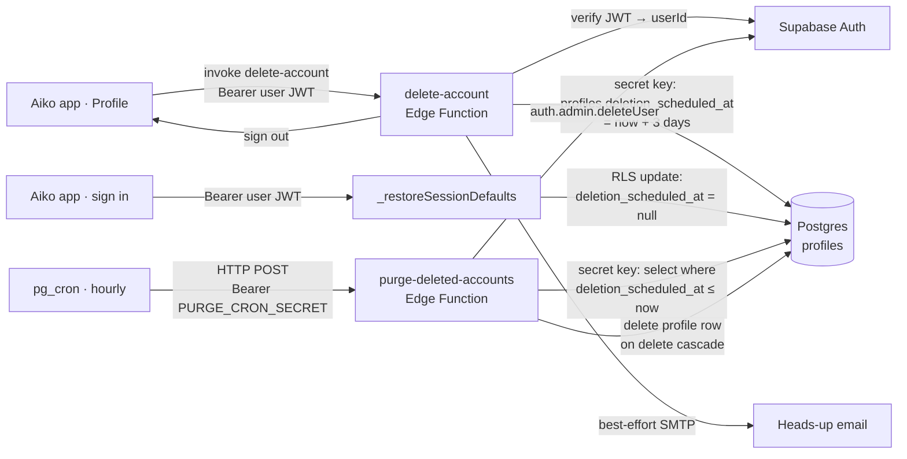

# Account deletion — how it works

"Delete account" in the Aiko app does **not** delete immediately. It schedules a hard delete **3 days** out, emails the user, and signs them out. Logging back in within those 3 days cancels it. The actual purge runs server-side, on a schedule, because removing the `auth.users` login requires a **secret (RLS-bypassing) key** that never ships in the app.

This document explains the three steps (request → cancel → purge), what data crosses which boundary, the key model, and where to look when something goes wrong.

---

## At a glance



Three things to notice:

- **The app never holds a secret key.** It only asks the `delete-account` function to schedule the deletion; the function derives the user id from the JWT and uses its own secret key to write the schedule.
- **Cancel is just a sign-in.** There is no dedicated "cancel deletion" endpoint — every successful sign-in/restore clears `deletion_scheduled_at` via the user's own RLS-scoped client.
- **The purge job runs without a user.** `pg_cron` calls `purge-deleted-accounts` hourly with a shared secret, not a user JWT. It uses the secret key to delete the profile row (which cascades all finance data) and then the auth user.

---

## Why a grace period

A deferred delete protects against two scenarios the app cannot defend against on its own:

1. **A misclick** on a destructive action with no undo.
2. **A compromised session** that requests deletion. The victim gets an email and can recover by simply logging back in within 3 days.

Hard-deleting immediately would make either case irreversible. The 3-day window is the safety net; the trade-off is that data lingers for up to 3 days after a user "deletes" their account, plus up to one hour until the next purge run.

---

## Components

| Component | What it is | Where |
| --- | --- | --- |
| **Profile screen** | Confirms the destructive action, calls `AuthRepository.deleteAccount`, then routes to `/`. | `lib/features/settings/presentation/profile_screen.dart` |
| **`AuthRepository`** | `deleteAccount()` invokes the function and signs out; `_cancelPendingDeletion()` clears the schedule on every sign-in/restore. | `lib/features/auth/data/auth_repository.dart` |
| **`delete-account`** | Supabase Edge Function. Verifies the caller's JWT, derives the user id from the token (never the body), sets `deletion_scheduled_at = now + 3 days` with a secret-key client, emails the user (best-effort). | `supabase/functions/delete-account/index.ts` |
| **`purge-deleted-accounts`** | Supabase Edge Function. Called hourly by `pg_cron` over `pg_net` with a shared secret. For each due profile: deletes the profile row (cascades finance data), then deletes the auth user. | `supabase/functions/purge-deleted-accounts/index.ts` |
| **`profiles.deletion_scheduled_at`** | `timestamptz`, NULL by default. Set when deletion is scheduled, cleared on cancel, filtered on by the purge job. Partial index on non-NULL rows. | `supabase/migrations/20260615040000_profile_deletion_schedule.sql` |
| **pg_cron schedule** | Hourly job (`0 * * * *`) that POSTs to the purge function with the cron secret from Vault. | `supabase/migrations/20260615040001_purge_deleted_accounts_cron.sql` |
| **`_shared/email.ts`** | Minimal SMTP sender (denomailer). Best-effort — returns `false` instead of throwing so a mail outage never blocks the schedule. | `supabase/functions/_shared/email.ts` |

---

## The three steps

### 1. Request (schedule)

User taps **Delete account** in Profile and confirms. The dialog states the 3-day window and the cancel-by-logging-in path.

- `AuthRepository.deleteAccount()` (`lib/features/auth/data/auth_repository.dart:141`) requires an active session and invokes `delete-account` via `functions.invoke`, then signs out.
- `delete-account` (`supabase/functions/delete-account/index.ts`):
  1. Rejects non-POST and missing tokens.
  2. Builds a **publishable-key** client carrying the caller's `Bearer <jwt>` and calls `auth.getUser(jwt)` to derive the user id from the token — never from the body.
  3. Builds a separate **secret-key** (RLS-bypassing) client and sets `profiles.deletion_scheduled_at = now + 3 days` for exactly that user id.
  4. Sends the heads-up email via `_shared/email.ts`. SMTP is best-effort: a mail outage returns `emailed: false` but does **not** undo the schedule.
  5. Returns `{ scheduled, scheduledAt, graceDays, emailed }`.
- The client signs out and routes to `/`. Local Brick data is intentionally **left in place** so a cancel-login is seamless.

### 2. Cancel (sign in)

There is no dedicated cancel endpoint. Every successful sign-in or session restore clears the schedule:

- `signIn` and `signUp` (`auth_repository.dart:81`, `:105`) call `_cancelPendingDeletion(user.id)` after the session is established.
- `restoreSession` → `_restoreSessionDefaults` (`auth_repository.dart:180`) also calls it, so returning to the app from a cached session cancels a pending deletion.
- `_cancelPendingDeletion` (`auth_repository.dart:158`) runs an RLS-scoped update: `profiles` set `deletion_scheduled_at = null` where `id = userId`. It is wrapped in try/catch and logs in debug mode — a failure here must not block sign-in.

Idempotent: clearing an already-NULL column is a no-op.

### 3. Purge (scheduled hard delete)

`pg_cron` runs the `purge-deleted-accounts` job at the top of every hour (`0 * * * *`). The job POSTs to the function URL with `Authorization: Bearer <PURGE_CRON_SECRET>` (both read from Vault, so neither the URL nor the secret is in git).

`purge-deleted-accounts` (`supabase/functions/purge-deleted-accounts/index.ts`):

1. Rejects non-POST and any request whose bearer token ≠ `PURGE_CRON_SECRET`. This is the only auth gate — there is no user JWT here.
2. Builds a **secret-key** admin client and selects `profiles.id` where `deletion_scheduled_at <= now()`.
3. For each due id:
   - Deletes the **profile row** first. Because every finance table has `on delete cascade` from `profiles`, this removes accounts, transactions, categories, budgets, goals, etc. in one statement.
   - Then deletes the **auth user** via `auth.admin.deleteUser(id)`.
   - If the profile delete succeeds but the auth delete fails, the row is already gone — the failure is recorded in the response (`failures: [{id, error}]`) for retry/visibility, and the loop continues.
4. Returns `{ purged, due, failures }`.

> **Schema quirk:** `profiles.id` is **not** FK'd to `auth.users`, so deleting the auth user alone would orphan all the finance data. That is why the function deletes the profile row explicitly first, and only then the auth user. The order matters: profile-first means a mid-run failure leaves the auth login intact but the data gone, which is the safer half-failure (the user can't sign in to empty data; they'd need to re-sign-up).

The comment at `purge-deleted-accounts/index.ts:75` notes a deliberate choice: the re-check inside the loop is skipped because a cancel-on-login would have cleared `deletion_scheduled_at` before this run (the SELECT already filtered on `<= now()`).

---

## Data lifecycle

| State | `deletion_scheduled_at` | What exists |
| --- | --- | --- |
| Active | `NULL` | All data, auth login. |
| Scheduled (within 3 days) | `now + 3d` | All data, auth login, local Brick cache. User is signed out. Recoverable by sign-in. |
| Purged | row gone | Nothing — profile + cascaded finance data + auth login all deleted. Local Brick cache may linger on the device until the app is reinstalled. |

Soft-delete (`deleted_at`) was removed in migration `20260616120000_drop_deleted_at.sql` — deletes are now hard and propagate a remote `DELETE` through Brick, so the tombstone column is unused. `version` is kept for last-writer-wins conflict resolution.

---

## Key model

Two key tiers are in play, read from the new **JWT Signing Keys** env vars with a fallback to the deprecated legacy keys during migration:

| Purpose | New (preferred) | Legacy (deprecated) |
| --- | --- | --- |
| Verify caller JWT (delete-account) | `SUPABASE_PUBLISHABLE_KEYS['default']` (`sb_publishable_…`) | `SUPABASE_ANON_KEY` |
| Admin / schedule / purge | `SUPABASE_SECRET_KEYS['default']` (`sb_secret_…`) | `SUPABASE_SERVICE_ROLE_KEY` |

`SUPABASE_*_KEYS` are JSON maps keyed by name (e.g. `{"default":"sb_secret_…"}`), injected by the runtime — never expose the secret map to client code. Both functions resolve the key the same way (`resolveApiKey` / `resolveSecretKey`): parse the JSON map, take `default` (or the first entry), fall back to the legacy plain-string env var, then to `null`.

Rules:

- The **publishable key** verifies the JWT and derives the user id. Note the `profiles` RLS policy is `for all using (id = auth.uid())` — it scopes rows but does **not** restrict columns, so a user *could* in principle update their own `deletion_scheduled_at` directly. The schedule is still written by the **secret-key** client inside `delete-account` so the 3-day window, the heads-up email, and the sign-out are enforced server-side rather than trusted to the caller.
- The **secret key** never ships in the app, `.env`, or dart-defines. It lives only in the two Edge Functions.
- The app never deletes the auth user with the publishable/anon client — `auth.admin.*` always fails there by design.

---

## Configuration

```sh
# 1. Deploy both functions
supabase functions deploy delete-account
supabase functions deploy purge-deleted-accounts

# 2. SMTP for the heads-up email (reuse the Auth SMTP server):
supabase secrets set SMTP_HOST=smtp.example.com SMTP_PORT=465 \
  SMTP_USERNAME=apikey SMTP_PASSWORD=... \
  SMTP_FROM="Aiko <noreply@yourdomain.com>"

# 3. Shared secret the cron job presents to purge-deleted-accounts:
supabase secrets set PURGE_CRON_SECRET=<random-long-string>

# 4. pg_cron reads the function URL + that secret from Vault (keeps them out of git):
#    select vault.create_secret('https://<ref>.supabase.co/functions/v1', 'edge_base_url');
#    select vault.create_secret('<same-random-long-string>', 'purge_cron_secret');
```

The runtime injects the key env vars for deployed functions. For local dev, add `SUPABASE_SECRET_KEYS` / `SUPABASE_PUBLISHABLE_KEYS` (or the legacy keys) and the SMTP/cron secrets to `supabase/functions/.env.local` (git-ignored).

The schema migrations (`20260615040000_…` adds the column + partial index, `20260615040001_…` schedules the cron job) are applied with `supabase db push`. The cron job tolerates missing Vault secrets — it simply errors on each run until they exist, then starts working.

---

## API: `delete-account`

| Method | Path | Auth |
| --- | --- | --- |
| `POST` | `/functions/v1/delete-account` | `Authorization: Bearer <supabase_user_jwt>` |

Request body: none (the user id comes from the JWT).

Response (200):

```json
{ "scheduled": true, "scheduledAt": "2026-06-21T00:00:00.000Z", "graceDays": 3, "emailed": true }
```

Errors (JSON with `code`):

| Status | `code` | Meaning |
| --- | --- | --- |
| 405 | `METHOD_NOT_ALLOWED` | Non-POST request |
| 401 | `NO_TOKEN` | Missing `Authorization` header |
| 401 | `BAD_TOKEN` | JWT rejected by Supabase Auth |
| 500 | `MISCONFIGURED` | Function missing Supabase URL or keys |
| 500 | `SCHEDULE_FAILED` | Secret-key update of `deletion_scheduled_at` failed |

`emailed: false` is **not** an error — it means SMTP isn't configured or the send threw; the schedule still succeeded.

## API: `purge-deleted-accounts`

| Method | Path | Auth |
| --- | --- | --- |
| `POST` | `/functions/v1/purge-deleted-accounts` | `Authorization: Bearer <PURGE_CRON_SECRET>` |

Request body: none.

Response (200):

```json
{ "purged": 2, "due": 2, "failures": [] }
```

A `failures` entry like `{"id":"…","error":"auth: …"}` means the profile row was deleted but the auth user was not — the auth login lingers and the user could still attempt to sign in (to empty data). The next hourly run will retry the auth delete (the SELECT won't return the id again, since the profile row is gone, so in practice these need manual follow-up).

Errors:

| Status | `code` | Meaning |
| --- | --- | --- |
| 405 | `METHOD_NOT_ALLOWED` | Non-POST request |
| 401 | `UNAUTHORIZED` | `PURGE_CRON_SECRET` unset or bearer token mismatch |
| 500 | `MISCONFIGURED` | Function missing Supabase URL or secret key |
| 500 | `QUERY_FAILED` | SELECT of due profiles failed |

---

## Troubleshooting

| Symptom | Likely cause |
| --- | --- |
| "Unable to delete account right now." in the app | `delete-account` returned non-200 — check function logs for `BAD_TOKEN`, `MISCONFIGURED`, or `SCHEDULE_FAILED`. |
| User scheduled deletion but never got the email | SMTP not configured, or send threw. The schedule still succeeded; `emailed` is `false` in the response. Configure SMTP and re-test. |
| User logged back in but deletion still happens | `_cancelPendingDeletion` threw and was swallowed (it logs in debug mode). Check that the user is actually signed in (not just restoring a cached session that failed), and that the RLS policy `"profiles own rows"` (`for all using (id = auth.uid())`) is in place so the self-update reaches the row. |
| Accounts not getting purged | pg_cron job not scheduled, or `edge_base_url` / `purge_cron_secret` not in Vault, or `PURGE_CRON_SECRET` mismatch. Run `select * from cron.job;` and check the purge function logs for `UNAUTHORIZED`. |
| `failures` entries with `auth: …` | Profile row deleted but `auth.admin.deleteUser` failed. The auth login lingers; the next run won't retry it (the profile SELECT won't return it). Manually delete the auth user or re-run the purge manually for that id. |
| User can sign in after purge completed | The auth user wasn't deleted (see `auth:` failures above), but the profile row was — sign-in succeeds to empty data. Either delete the auth user manually or leave it; the user has no finance data to access. |
| Deletion happened before 3 days | Should not happen — the purge filters on `deletion_scheduled_at <= now()`, and the schedule is set to `now + 3 days`. If observed, check that `delete-account` computed `scheduledAt` correctly and that the server clock isn't skewed. |
| Local data still on device after purge | Expected — the purge is server-side. Brick's local SQLite cache is left intact so a cancel-login is seamless; after a real purge it lingers until the app is reinstalled. |

---

## Security review checklist

- [x] User id is derived from the JWT in `delete-account`, never from the request body.
- [x] The schedule write uses a **separate** secret-key client, not the caller's publishable-key client — so the 3-day window, email, and sign-out are enforced server-side. (The `profiles` RLS policy is row-scoped, not column-scoped; a determined caller could set the column directly, but only to *their own* row and without the email/sign-out side effects, which is an accepted trade-off for not over-restricting the profile table.)
- [x] The secret key never ships in the app, `.env`, dart-defines, or any client-visible config.
- [x] `purge-deleted-accounts` is gated by `PURGE_CRON_SECRET`, not a user JWT — end users cannot trigger a purge.
- [x] The purge deletes the profile row first (cascading finance data), then the auth user — order chosen so a half-failure leaves the safer half-state.
- [x] SMTP send is best-effort and cannot block or undo the schedule.
- [x] Cancel-on-login uses the user's own RLS-scoped client, so a user can only clear their own schedule.
- [x] `auth.admin.deleteUser` is only ever called from server-side functions with the secret key, never from the app with the publishable key.
