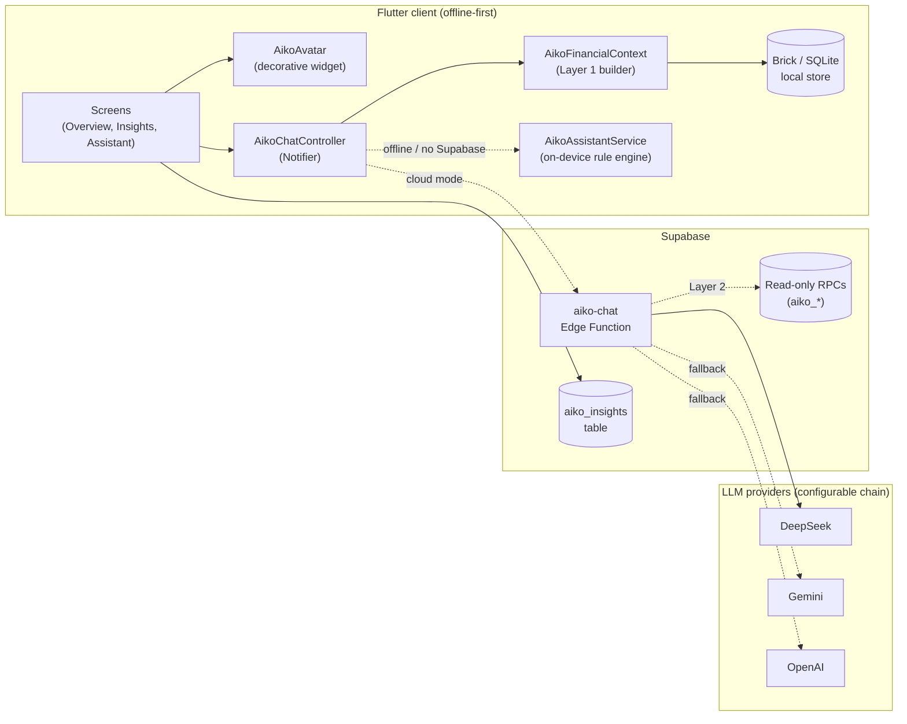
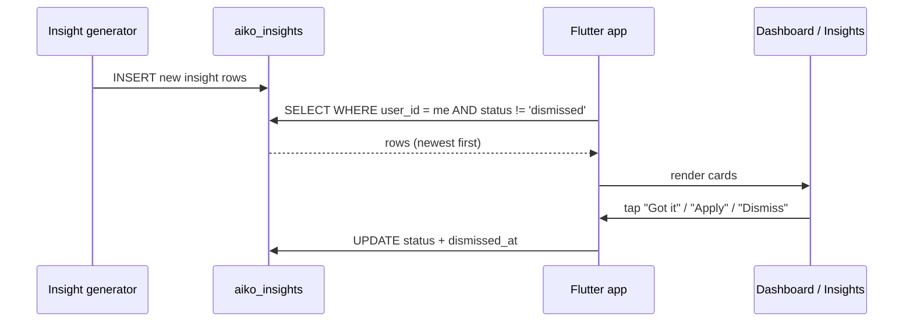
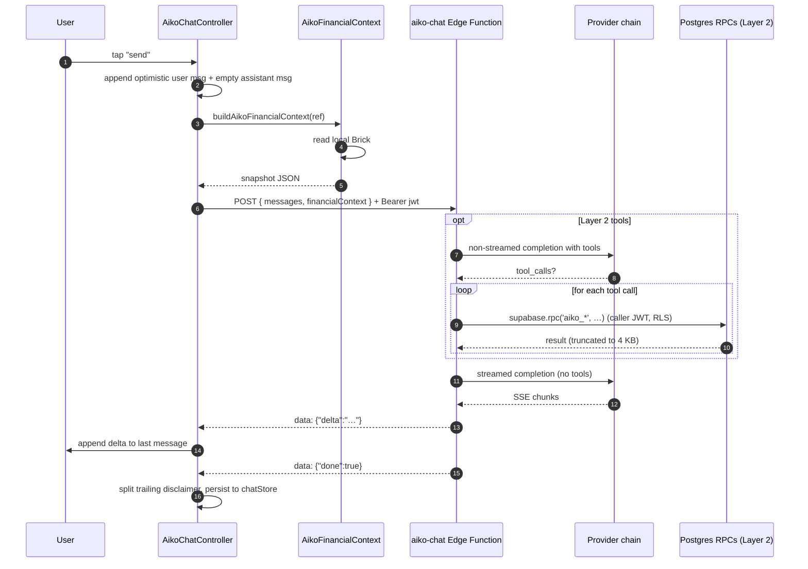
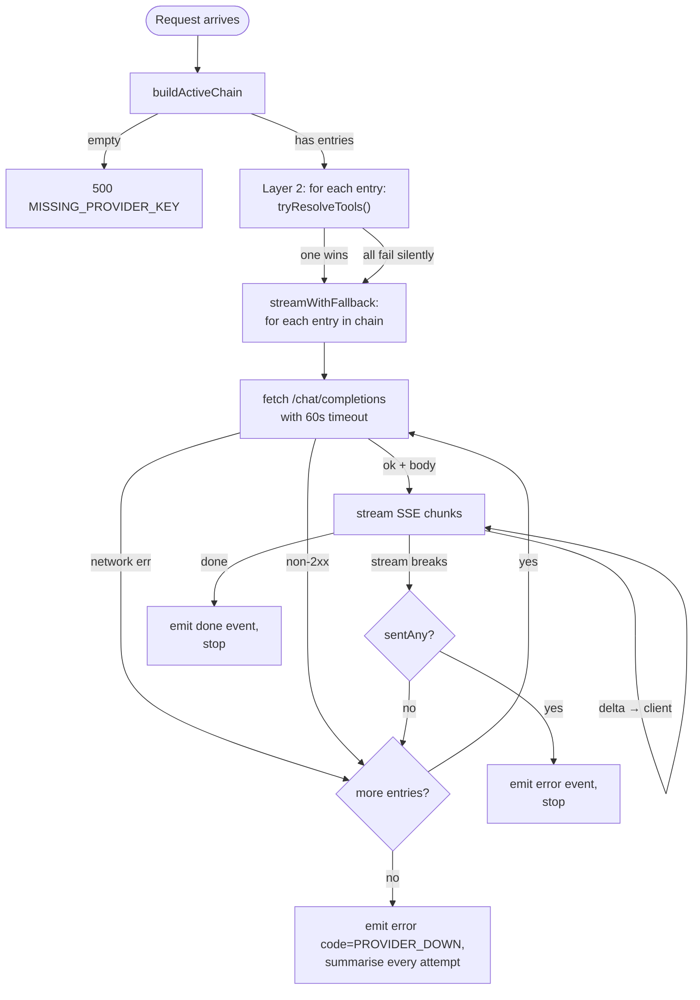
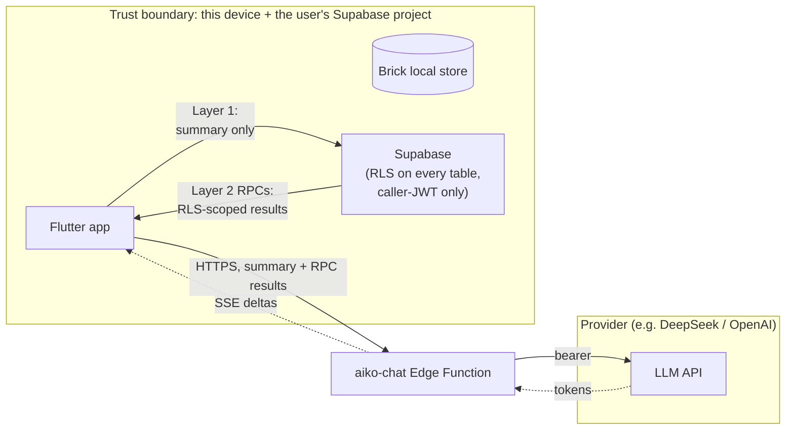

# How AI Works in Aiko

Aiko uses three AI surfaces that share a single set of guardrails:

| Surface | What it is | Where it runs | Always on? |
| --- | --- | --- | --- |
| **Aiko Insights** | Pre-generated tips stored in the `aiko_insights` Supabase table, surfaced on the dashboard / insights screens | Generated server-side (out of scope here); **read** by the Flutter client via `AikoInsightRepository` | Yes, in cloud mode |
| **Ask Aiko chat** | Conversational Q&A about the user's money | Client assembles a **Layer 1** snapshot locally; the `aiko-chat` Edge Function handles provider routing, optional **Layer 2** tool calls, and streaming | Falls back to an **on-device rule-based engine** when Supabase is not configured |
| **Aiko character** | Blue-haired avatar that gives greetings, nudges, and review intros | Pure Flutter widget — no network, no model call | Yes |

A separate **`PredictionService`** (rule-based) and **`MonteCarloEngine`**
(`lib/core/prediction/`) power forecasts and goal success probabilities.
They don't call an LLM — they're local numerics — but they **feed** both
the insight pipeline and the chat snapshot.

---

## 1. The three surfaces at a glance



Key invariants:

- The **provider key never leaves the Edge Function** — the client only
  talks to `${SUPABASE_URL}/functions/v1/aiko-chat`.
- The **model only sees data the caller is allowed to see**: Layer 1 is a
  client-side aggregate, Layer 2 runs as the caller's JWT (RLS-scoped).
- The **client never depends on a provider** — `OfflineChatEngine`
  answers from local rules when Supabase is missing or the network is
  down, and the Edge Function returns a graceful `PROVIDER_DOWN` event
  if every chain entry fails.

---

## 2. Aiko Insights

Stored rows in the `aiko_insights` table, classified along four
dimensions (`AikoInsightType`):

| Type | Question it answers | Example |
| --- | --- | --- |
| **descriptive** | "What happened?" | "You spent $450 on dining out this month." |
| **diagnostic** | "Why did it happen?" | "Dining out increased 20% from weekend restaurants." |
| **predictive** | "What will happen?" | "At this pace you'll exceed your dining budget in 5 days." |
| **prescriptive** | "What should I do?" | "Limit weekend spending to $15/day to stay on track." |

Each row carries `confidence_score` (0–1) and a `source_data_summary`
list of the data points that produced it. The client never calls an
LLM to render an insight — it reads the table, applies the user's
status (`new` / `viewed` / `applied` / `dismissed` / `muted`), and
renders the four fields.



**Files**: `lib/features/insights/domain/aiko_insight.dart`,
`lib/features/insights/data/aiko_insight_repository.dart`. **Disclaimer
required** on every numeric or recommendation insight: *"Aiko provides
estimates, not certified financial advice."*

---

## 3. Ask Aiko chat — the full path

A chat turn goes through five stages. The two data layers (1 and 2)
are the **only** ways the model ever sees user data.



### 3.1 Layer 1 — on-device snapshot (always on)

`AikoFinancialContext` (`lib/features/aiko_assistant/application/financial_context.dart`)
is a pure builder over already-loaded domain data. It runs in the
client, reads from Brick, and ships as a JSON blob in the request body.
The function folds it into the system prompt — the model can answer
"how am I doing?" in one round-trip with no Supabase reads.

| Field | Source | Cap |
| --- | --- | --- |
| `baseCurrency`, `asOf` | profile, clock | — |
| `netWorth` | sum of active non-goal accounts (loans negative) | — |
| `accounts[]` | active accounts | 12 |
| `thisMonth.income / spending / net` | posted tx in current month | — |
| `budgets[]` | categories with `hasBudget` | 12 |
| `goals[]` | accounts with `type = goal` | 8 |
| `recentTransactions[]` | newest posted first | 15 |

The snapshot is **deliberately a summary, not the ledger** — keeps
tokens bounded and limits how much raw financial data leaves the
device for the LLM provider. Ad-hoc, deeper questions are Layer 2's
job, not this snapshot's.

### 3.2 Layer 2 — server-side tools (always on)

Before the streamed answer the Edge Function lets the model call a
fixed allow-list of read-only RPCs:

```
aiko_account_summary     — net worth + per-account balance/type
aiko_budget_status       — per-budget limit/spent for a date range
aiko_spending_by_category — total expense per category
aiko_cashflow_summary    — total income vs expense
aiko_recent_transactions — most recent N (1–50) transactions
aiko_goal_progress       — current/target + % complete
```

All six are `SECURITY INVOKER` Postgres functions, so RLS scopes every
result to the caller's `auth.uid()`. The function never runs
model-supplied SQL and never uses the service-role key. **Tool
resolution itself falls back across the chain** — if provider 1 can't
service tools, the runtime tries provider 2.

### 3.3 On-device fallback (offline / no Supabase)

If `aikoSupabaseConfigProvider.isConfigured` is `false`, the client
injects `OfflineChatEngine` (`AikoAssistantService`) instead of
`HttpChatEngine`. The service answers rule-based questions:

- **safe to spend** — uses the dashboard's safe-to-spend estimate
- **optimize / recommend** — surfaces the top new `AikoInsight` from
  the local store
- **goal / saving** — summarises `AccountType.goal` accounts
- everything else — falls back to a generic "check the screen" pointer

This is the same path used when the network is up but Supabase isn't
configured (local-only mode in `flutter run`). No LLM is called, no
data leaves the device.

---

## 4. The provider chain & auto-fallback

The Edge Function never assumes one provider is up. It walks an
**ordered chain** of `(providerId, model)` entries. Code-defined
presets live in `supabase/functions/aiko-chat/index.ts`:

```ts
// DEFINE PROVIDER 1
PROVIDER_DEEPSEEK = { baseUrl, apiKeyEnv: "AI_KEY_DEEPSEEK", models: [...] }
// DEFINE PROVIDER 2
PROVIDER_GEMINI   = { baseUrl, apiKeyEnv: "AI_KEY_GEMINI",   models: [...] }
// DEFINE PROVIDER 3
PROVIDER_OPENAI   = { baseUrl, apiKeyEnv: "AI_KEY_OPENAI",   models: [...] }

// ACTIVE CHAIN — fixed fallback order, edit the list to change providers/models
ACTIVE_CHAIN = [deepseek-flash, gemini-flash, openai-gpt-oss-120b]
```

`buildActiveChain()` walks `ACTIVE_CHAIN`, drops any entry whose
`AI_KEY_*` is unset, and returns the remaining entries.

### 4.1 Fallback rules

| Failure mode | Retry next entry? |
| --- | --- |
| Network error / DNS / TLS | Yes |
| 4xx or 5xx response | Yes |
| 60s `AbortController` timeout | Yes |
| Stream breaks **before any token** sent | Yes |
| Stream breaks **after tokens** already flowed | **No** — emit `error` event, stop |

The "no fallback after tokens flow" rule exists because the client has
already started rendering — a clean restart would duplicate or drop
text the user is reading.



### 4.2 Adding a provider

1. Declare a new `PROVIDER_*` constant (id, baseUrl, apiKeyEnv,
   `supportsTools`, models list).
2. Register it in `PROVIDERS` so the chain can resolve it.
3. Add an entry to the `ACTIVE_CHAIN` list.
4. Set the matching `AI_KEY_<id>` Supabase secret.

`supportsTools: false` opts a provider out of Layer 2 — `tryResolveTools`
skips it.

---

## 5. Aiko character

`AikoAvatar` is a small `StatelessWidget` (`lib/features/aiko_character/presentation/aiko_avatar.dart`)
that paints a gradient circle (purple → blue) over `assets/icons/aiko_aiko.svg`,
with an optional `pulse` animation and `semanticLabel`. It is **purely
decorative** — no network call, no model interaction, no state.

The character is used purposefully for warmth and reassurance:
onboarding welcome, dashboard greeting, insight explanations, assistant
chat, and (eventually) the monthly review. It is **not** rendered over
tables, charts, balances, forms, or critical actions — see
[Brand Identity & Voice](./README.md#brand-identity--voice) in
`README.md` for the full ruleset.

Six expression variants ship as SVG assets — `happy`, `thinking`,
`encouraging`, `warning`, `celebrating`, `welcome` — selectable by
parent screen.

---

## 6. Privacy & trust model

- **Keys stay server-side.** Provider API keys live only in the Edge
  Function's environment. The client never sees them.
- **The model only sees RLS-scoped data.** Layer 1 is a client-built
  summary the user already owns; Layer 2 runs as the caller's JWT
  through `SECURITY INVOKER` functions, so RLS scopes every RPC result
  to that user. The function never uses the service-role key and never
  executes model-supplied SQL.
- **The disclaimer is mandatory.** Every numeric or recommendation
  answer — chat or insight — must end with the standard line. The chat
  controller splits that line out of the message body and renders it
  compactly below a divider.
- **Personality** lives on the profile (`aiko_personality_setting`,
  default `supportive`) and is preserved on Brick and Supabase. The
  Edge Function can fold it into the system prompt to steer tone
  without changing provider code.



The provider receives: the system prompt (with Layer 1 summary, base
currency, persona), the last 20 user/assistant messages, and any
sanitised RPC results. The provider does **not** receive: the user's
auth token, RLS-bypassing keys, the full transaction ledger, or any
other user's data.

---

## 7. Configuration cheatsheet

| Env / setting | Where | Default | Purpose |
| --- | --- | --- | --- |
| `AI_KEY_DEEPSEEK` | Edge Function | — | Provider 1 key (skipped if unset) |
| `AI_KEY_GEMINI` | Edge Function | — | Provider 2 key (skipped if unset) |
| `AI_KEY_OPENAI` | Edge Function | — | Provider 3 key (skipped if unset) |
| `ACTIVE_CHAIN` (code constant) | `aiko-chat/index.ts` | DeepSeek → Gemini → OpenAI | Fixed fallback order; edit the list to change |
| `aiko_personality_setting` | `profiles` row | `supportive` | Tone knob the system prompt can read |
| Supabase config (`SUPABASE_URL` + anon key) | Flutter app | — | Switches between `HttpChatEngine` and `OfflineChatEngine` |

For the full deploy commands, see
[Ask Aiko Chat Backend](./README.md#ask-aiko-chat-backend-aiko-chat-edge-function)
in `README.md`.

---

## 8. Where to look when changing AI behaviour

| Change | File(s) |
| --- | --- |
| Provider / active chain / fallback logic | `supabase/functions/aiko-chat/index.ts` |
| System prompt or disclaimer copy | `supabase/functions/aiko-chat/index.ts` (`SYSTEM_PROMPT`) |
| Financial snapshot fields / caps | `lib/features/aiko_assistant/application/financial_context.dart` |
| On-device rule-based answers | `lib/features/aiko_assistant/application/aiko_assistant_service.dart` |
| Insight types / states | `lib/features/insights/domain/aiko_insight.dart` |
| Chat UI streaming / errors / retry | `lib/features/aiko_assistant/application/aiko_chat_controller.dart`, `chat_engine.dart` |
| Character widget / expression SVGs | `lib/features/aiko_character/presentation/aiko_avatar.dart`, `assets/icons/aiko_*.svg` |
| Forecast / Monte Carlo numbers | `lib/core/prediction/monte_carlo_engine.dart` |
| Personality setting plumbing | `lib/features/auth/data/auth_repository.dart`, `lib/brick/models/profile.model.dart` |
