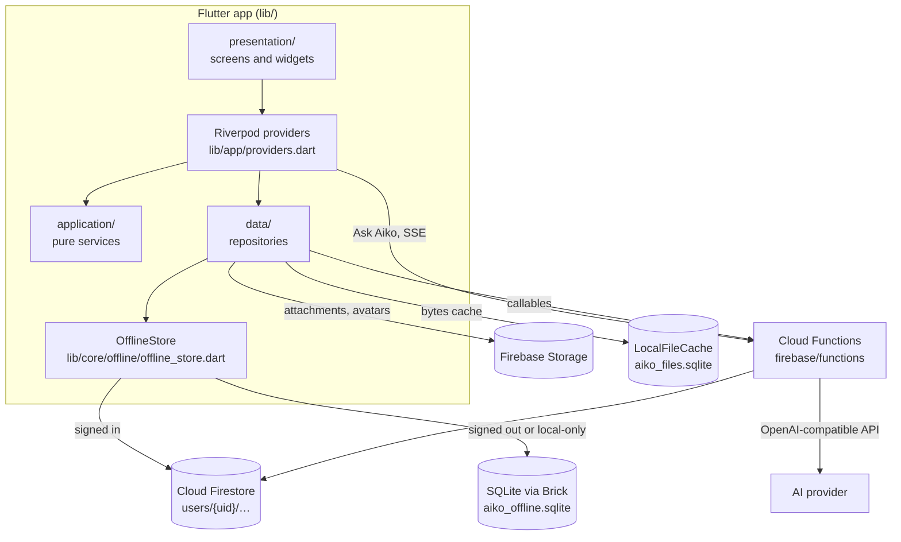
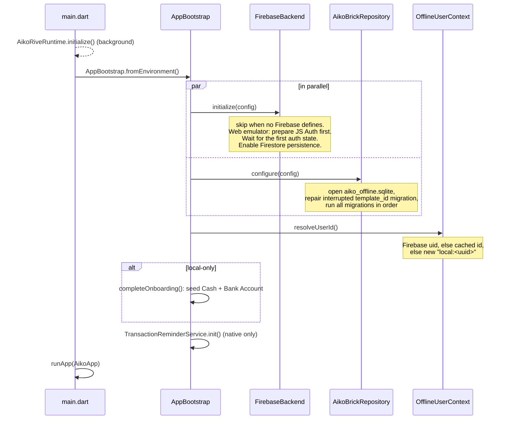

# Architecture

Aiko is one Flutter codebase for web, Android and iOS, backed by Firebase. All platforms share the domain models, repositories, routes and Firestore documents. This page explains how the app starts, where data lives, and how a change on one device reaches another.

## Big picture

| Layer | Folder | Rule |
| --- | --- | --- |
| Presentation | `lib/features/*/presentation/` | Screens compose UI and watch providers. Never call Firebase, Brick or SQLite directly. |
| Providers | `lib/app/providers.dart`, feature `application/*_provider.dart` | `AsyncNotifier`s own list state and write-through; `FutureProvider`s derive summaries. |
| Application | `lib/features/*/application/` | Pure `*Service` function objects with `const` constructors: no Riverpod, no I/O. Unit-tested. |
| Data | `lib/features/*/data/` | `*Repository` classes resolve the current user and go through `OfflineStore` or Firebase SDKs. |
| Domain | `lib/features/*/domain/` | Immutable models and enums. Money is `Money` (`Decimal`), never `double`. |
| Core | `lib/core/` | Config, Firebase wiring, offline store, storage, money, formatting, prediction, notifications. |
| Local schema | `lib/brick/` | SQLite models, codecs shared with Firestore, migrations. |

## Runtime modes

`AppConfig.fromEnvironment()` (`lib/core/config/app_config.dart`) reads compile-time `--dart-define`s. The combination decides the mode:

| Mode | Defines | Sign-in | Finance data | Cloud features |
| --- | --- | --- | --- | --- |
| Local-only | No `FIREBASE_PROJECT_ID`, no `FIREBASE_EMULATOR_HOST` | None; opens on `/home` | SQLite on device (IndexedDB-backed on web) | Off: chat shows "Connect to Aiko cloud to chat", OCR returns an empty draft, no sync |
| Emulator | `FIREBASE_EMULATOR_HOST` (+ a `demo-` project ID) | Auth emulator | Firestore emulator | Functions emulator; providers unconfigured unless `.secret.local` is set |
| Production | `FIREBASE_PROJECT_ID` and the web options | Firebase Auth (email/password, Google) | Firestore | Functions with Secret Manager secrets |

`FirebaseBackend.initialize` refuses emulator builds whose project ID does not start with `demo-`, so an emulator build can never write to a real project. Deployed builds never receive `FIREBASE_EMULATOR_HOST` ([Deployment](deployment.md)).

## Startup sequence

If any startup step throws, `main.dart` runs `StartupErrorApp` (`lib/app/startup_error_app.dart`) instead: an error screen in the device language with a **Retry** button that runs startup again.

`AikoApp` (`lib/app/aiko_app.dart`) builds the router with initial location `/home` in local-only mode and `/` (Welcome) otherwise. After the first frame it restores the session: an active session goes to `/home`; a device that has signed in before goes to `/auth`. Routes have no redirect guard. A signed-out deep link renders the shell, but signed-out reads come from local SQLite only, and Security Rules protect all cloud data. `AikoApp` also listens for the session ending while the app is open ([Signing out and switching users](#signing-out-and-switching-users)).

## Navigation

All routes live in `lib/app/app_router.dart` (GoRouter, hash URL strategy on the web, for example `/#/home`). Every screen except Welcome and Login renders inside `AuthenticatedShell` (`lib/app/authenticated_shell.dart`). The window width picks the layout, not the platform ([Web and mobile](design-system.md#web-and-mobile)): under 840px a 60dp bottom bar; from 840px `AikoSidebar` (`lib/app/aiko_sidebar.dart`, an icon rail, labeled from 1200px) beside a centered content column.

Both are built from `aikoPrimaryDestinations` in `lib/app/aiko_navigation.dart`. The bottom bar orders them by `aikoBottomBarPaths` (Overview in the middle); the sidebar lists Overview first, then the Tools from `aikoNavigationItems`, then Settings and Profile. `aikoSelectedPath` picks the highlighted entry: the longest matching path, else the route's owner (for example `/transaction-rules` → Transactions, `/profile` → Aiko), else Overview.

| Tab | Path | Screen |
| --- | --- | --- |
| Accounts | `/accounts` | `AccountsScreen` |
| Categories | `/categories` | `CategoryManagementScreen` |
| Overview | `/home` | `HomeDashboardScreen` |
| Transactions | `/transactions` | `TransactionListScreen` (tapping the active tab or sidebar entry again resets filters via `?reset=`, `aikoNavigationTarget`) |
| Aiko | `/aiko` | `AikoAssistantScreen` (also opens Settings) |

| Secondary route | Screen | Owner |
| --- | --- | --- |
| `/` | `WelcomeScreen` | auth |
| `/auth` | `LoginScreen` | auth |
| `/notifications` | `NotificationsCenterScreen` | overview |
| `/transaction-rules` | `TransactionRulesScreen` | transactions |
| `/transaction-capture` | `TransactionCaptureScreen` | transaction_capture |
| `/settings` | `SettingsScreen` | settings |
| `/settings/chance-of-success` | `ChanceOfSuccessScreen` (`extra`: goal `Account`) | overview |
| `/reports/monthly` | `MonthlyReportScreen` (`?month=YYYY-MM`) | overview |
| `/export` | `ExportScreen` | export |
| `/account-form` | `AccountFormScreen` (`extra`: `Account` to edit) | accounts |
| `/calculators` | `CalculatorLibraryScreen` | calculators |
| `/profile` | `ProfileScreen` | settings |
| `/connect-line` | `ConnectLineScreen` | settings |
| `/portfolio` | `InvestmentsScreen` | investments |
| `/portfolio/allocation` | `AssetAllocationScreen` | overview |
| `/portfolio/holding` | `HoldingDetailScreen` (`?id=`, or `extra`: `InvestmentHolding`) | overview |
| `/learning-hub` | `LearningHubScreen` | learning_hub |
| `/travel-mode` | `TravelModeScreen` | travel_mode |

Unknown paths render `AikoScreenState.error` ("Route not found") with a button home: `/` when a cloud build is signed out, otherwise `/home`. Two routes take query parameters so links survive a reload: `/reports/monthly?month=YYYY-MM` and `/portfolio/holding?id=<holding id>`. Detail screens such as `TransactionFormScreen`, `TransactionDetailScreen`, `AccountDetailScreen`, `AccountFormScreen`, `CalculatorDetailScreen`, `LessonScreen` and `LessonQuizScreen` have no path of their own: they open with `openAikoPage` (`lib/shared/layout/adaptive_presentation.dart`), a full-screen page on phones and, on wide screens, a dialog that a click outside or Escape doesn't close by default ([Design system → Dialogs and forms](design-system.md#dialogs-forms-and-messages)).

On wide screens the page area of `AuthenticatedShell` is its own `Semantics` container. Each page route paints a modal barrier that hides earlier-painted semantics in the same container, so without it the sidebar would vanish for screen readers and keyboard users. Sidebar and bottom-bar entries are announced once (their label, with `excludeSemantics`) and keep a semantic tap action. The Tools list is defined in `aikoNavigationItems`; its order is the on-screen order in Settings and in the sidebar.

## State management

Riverpod 3. App-wide providers live in `lib/app/providers.dart`.

| Provider | Kind | Holds |
| --- | --- | --- |
| `accountsProvider` | `AsyncNotifier` | Accounts, including goal accounts; `saveAccount`; `deleteAccount` turns off limit sharing on cards that shared the deleted card's limit, deletes the account's transactions, then the account, and returns the deleted transactions so the caller can cancel their reminders |
| `transactionsProvider` | `AsyncNotifier` | Transactions. `build` converts legacy opening balances to adjustments, then reconciles every balance from its transactions. `saveTransaction`/`saveTransactions` (both legs of a transfer) adjust account balances and update the list in place, with no loading state; `deleteTransaction` also deletes a linked transfer leg's partner |
| `categoriesProvider` | `AsyncNotifier` | 81 defaults (per-user clones) plus active custom categories; pickers, lists and budgets use it |
| `allCategoriesProvider` | `FutureProvider` | `categoriesProvider` plus archived custom categories, for looking up the name of a category a transaction still points at (transaction list, detail, export) |
| `categoryGroupsProvider` | `AsyncNotifier` | User groups plus the 13 default groups; `deleteGroup` ungroups its categories |
| `profileProvider` | `FutureProvider` | `Profile` (theme, base currency, personal fields). Signed in, loading never writes: the profile document is created at sign-in |
| `fxRatesProvider(baseCurrency)` | `FutureProvider` | Exchange rates against the base currency from `ExchangeRateService.fetchRates`: one request per session, made only by callers holding another currency; empty offline |
| `investmentsProvider` | `AsyncNotifier` (`lib/features/investments/application/investments_provider.dart`) | Holdings; `saveHolding`, `deleteHolding`, `refreshPrices` via `marketFeed` |
| `dashboardSummaryProvider`, `monthlyReportProvider(month)`, `cashFlowOverviewProvider`, `cashFlowSankeyProvider`, `safeToSpendProvider`, `portfolioAllocationProvider`, `goalForecastProvider(goalId)`, `dashboardDueItemsProvider`, `allNotificationsProvider`, `notificationsProvider` | `FutureProvider` | Derived views computed by pure services ([Calculations](calculations.md)); `notificationsProvider` is `allNotificationsProvider` minus dismissed ids |
| `transactionRulesProvider`, `storedTravelProvider`, `appLocaleControllerProvider`, `notificationDismissalsProvider`, `lessonProgressProvider` | Various | Small preferences stored as synced key/value documents |
| `aikoChatControllerProvider`, `lineLinkedProvider` | Various | Per-user session state (Ask Aiko transcript, LINE link status), reset when the user changes |
| `firebaseSyncProvider` | `Provider<void>` | One Firestore listener per collection (see below) |

Long-lived list and summary providers call `ref.keepAlive()` only after a successful load, so tab switches reuse cached data and failures retry on the next visit. Errors are rethrown so screens can render `AikoScreenState.error`.

## Data flow and sync

### Reads and writes

Repositories call `OfflineStore` (`lib/core/offline/offline_store.dart`) with Brick models (`OfflineAccount`, `OfflineTransaction`, …):

- **Signed in** (`FirebaseBackend.userId != null`): `get` turns the Brick query into a Firestore query on `users/{uid}/{collection}`. It supports exact `where` and `orderBy`; camelCase fields map to snake_case. `upsert` writes the document after checking that `user_id` (or `id` for profiles) matches the signed-in user. `delete` deletes the document.
- **Signed out / local-only**: the same calls go to `AikoBrickRepository` (SQLite).

Signed-in reads are **cache-first**: once a collection's listener has synced with the server, `FirestoreSyncState` (`lib/core/offline/firestore_sync_state.dart`) serves reads from the SDK cache the listener keeps current, so they aren't billed. A read that starts before its listener syncs waits up to 3 seconds and then uses the cache. An empty cache before the first sync falls back to the server, so a new device never mistakes "not cached yet" for "doesn't exist". See [Cost](cost.md).

Each model has one codec, a `FirestoreAdapter` in `lib/brick/adapters/`, which handles both the SQLite row and the Firestore document. The Firestore collection name is the adapter's `collectionName`.

### Offline writes

The Firestore SDK persists writes locally before acknowledging them and replays them when the device reconnects. `OfflineStore.acceptWrite` waits up to 3 seconds for the server; after that the write is treated as accepted, so offline saves never hang. If the server later rejects a write (Security Rules, auth), the error goes to `OfflineStore.errors`, and the shell shows "A change could not sync. Check your connection and sign-in, then try again."

### Listeners

`firebaseSyncProvider` (`lib/app/firebase_sync.dart`) is watched by the shell. On each auth change it cancels old listeners, registers the collections with `FirestoreSyncState`, and (when signed in) opens one `snapshots(includeMetadataChanges: true)` listener per collection. When the user changed, it also invalidates every dependent provider and the per-user session state; the first auth event, which repeats the user the app started with, reloads nothing (`authEventChangesUser`). The first server-confirmed snapshot marks a collection synced. The initial snapshot and metadata-only events don't reload providers, because readers already read that data from the cache. Data changes are debounced by 150 ms and invalidate the matching providers, except while `FirebaseSyncPause` holds them back (during account deletion, so a refresh can't re-read and re-create the profile):

| Collection | Invalidates |
| --- | --- |
| `profiles` | `profileProvider` |
| `accounts` | `accountsProvider` |
| `categories`, `category_groups` | `categoriesProvider`, `categoryGroupsProvider` |
| `transactions` | `transactionsProvider` |
| `investment_holdings` | `investmentsProvider` |
| `preferences` | `transactionRulesProvider`, `storedTravelProvider`, `appLocaleControllerProvider` |

Conflicts are last-write-wins per document. There is no custom outbox and no transactional double-entry ledger. Account balances are recalculated from transactions on load. While signed in, recalculated balances are only written once both accounts and transactions are server-synced, so a stale cache never overwrites a newer balance.

### Sign-in and anonymous data

Before sign-in, records are owned by a `local:<uuid>` user ID (`OfflineUserContext`). After sign-in, `AuthRepository`:

1. **`ensureProfileAndDefaultsExist`**: in one Firestore transaction, creates the profile, 13 category groups and 81 category clones only where missing. It never resets existing data. `DefaultsSeedMarker` makes it run once per user on each device, plus again when new defaults ship, rather than on every launch.
2. **`OfflineDataMigrator.claimAnonymousData`**: re-saves every `local:` row (accounts, groups, categories, transactions, holdings) under the real uid in batches, re-points default category IDs to the user's clones, and deletes the local copies.

A new account (sign-up, or a first Google sign-in) also gets the default Cash and Bank accounts from `completeOnboarding` ([Features → Onboarding](features.md#onboarding)). The login screen then calls `invalidateUserData` (`lib/app/user_session.dart`) so nothing from a previous user stays loaded, and opens `/home`.

### Signing out and switching users

| Event | What happens | Then opens |
| --- | --- | --- |
| **Log out** (Profile) | `AuthRepository.signOut` cancels every reminder, signs out and starts a fresh anonymous `local:` owner; `invalidateUserData` reloads everything | `/auth` |
| **Delete account** | `deleteAccount` runs inside `FirebaseSyncPause.during`, then signs out like Log out and forgets the known-account flag | `/` |
| Session ends elsewhere (token revoked, password changed, account deleted on another device) | `AikoApp`'s auth listener calls `AuthRepository.handleSessionEnded`: cancels reminders and, if the stored owner is still the old uid, switches to a fresh anonymous owner (`OfflineUserContext.leaveSignedInOwner`) | `/auth` on a device that knows the account, else `/` (`signedOutRedirect`); nothing when already on either |

Whenever the signed-in user changes, `invalidateUserSessionState` resets the Ask Aiko transcript and the LINE link status, so the next user never sees or sends the previous user's conversation.

### Files

Attachment and avatar bytes are cached in `LocalFileCache` (`aiko_files.sqlite`) before metadata is saved, so they survive offline use and page reloads. Uploads go to `users/{uid}/receipts/{id}/{fileName}` and `users/{uid}/avatars/…`. A failed upload keeps a local `aiko-cache:` path and is retried the next time that transaction's attachments are listed. Remote files download through authenticated Storage access and are cached locally.

## Platform differences

| Capability | Web | Android | iOS |
| --- | --- | --- | --- |
| Local SQLite | `sqflite_common_ffi_web` (IndexedDB; needs HTTPS or localhost) | sqflite | sqflite |
| Firestore cache | Persistent, multi-tab | Persistent | Persistent |
| Google sign-in | `signInWithPopup` | `google_sign_in` + `GOOGLE_WEB_CLIENT_ID` | `google_sign_in` + `GOOGLE_IOS_CLIENT_ID` |
| Reminders | Stored only; no OS notification | Local notifications (exact alarms) | Local notifications |
| SMS / notification capture | No | Yes (opt-in) | No |
| Export | Browser download / share | Share sheet | Share sheet |

Minimum iOS version is 15 (Firebase requirement). The Android application ID is `dev.pepo.aiko`.

## Cloud side

See [Backend](backend.md) for the Functions API, Security Rules and the AI pipeline, and [Data model](data-model.md) for every collection and field.
