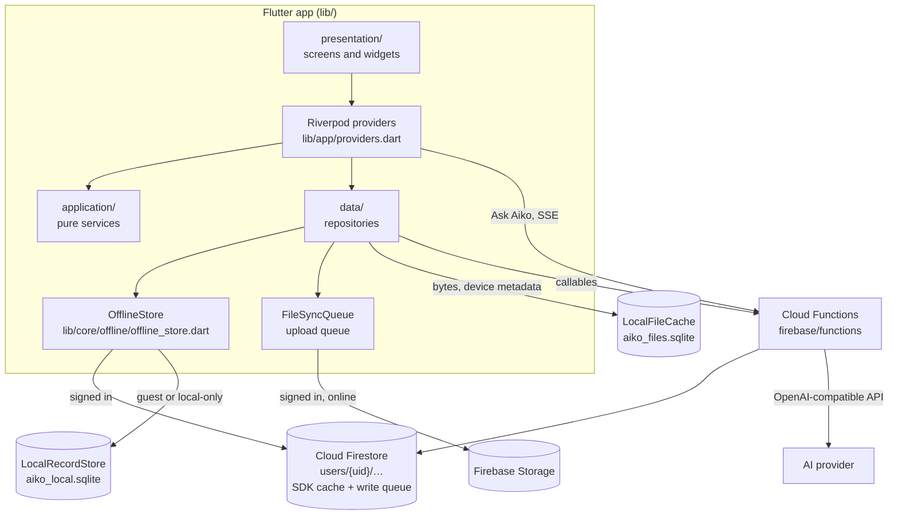
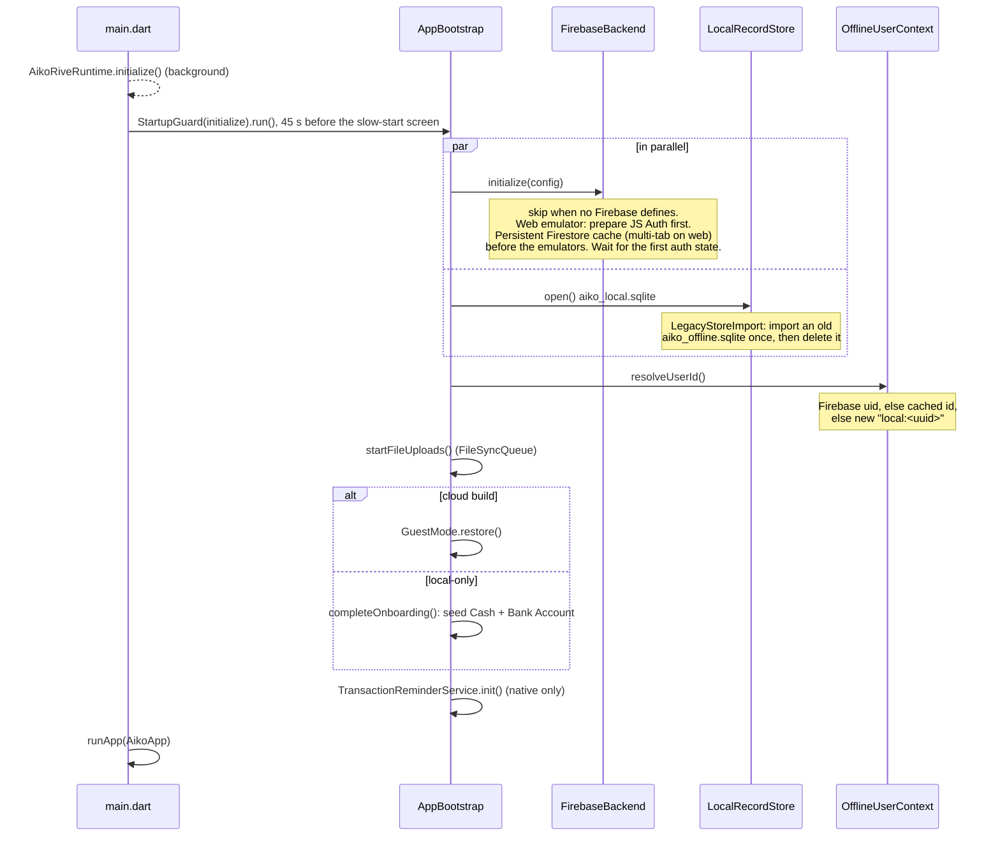

# Architecture

Aiko is one Flutter codebase for web, Android and iOS, backed by Firebase. All platforms share the domain models, repositories, routes and Firestore documents. This page explains how the app starts, where data lives, how it works offline, and how a change on one device reaches another.

## Big picture

| Layer | Folder | Rule |
| --- | --- | --- |
| Presentation | `lib/features/*/presentation/` | Screens compose UI and watch providers. Never call Firebase or SQLite directly. |
| Providers | `lib/app/providers.dart`, feature `application/*_provider.dart` | `AsyncNotifier`s own list state and write-through; `FutureProvider`s derive summaries. |
| Application | `lib/features/*/application/` | Pure `*Service` function objects with `const` constructors: no Riverpod, no I/O. Unit-tested. |
| Data | `lib/features/*/data/` | `*Repository` classes resolve the current user and go through `OfflineStore` or Firebase SDKs. |
| Domain | `lib/features/*/domain/` | Immutable models and enums. Money is `Money` (`Decimal`), never `double`. |
| Core | `lib/core/` | Config, Firebase wiring, offline store and sync state, local stores and the upload queue, connectivity, money and exchange rates, formatting, prediction, notifications. |
| Records | `lib/core/offline/records/` | Stored record types and their codecs (`RecordCodecs`): one per collection, whose row is the Firestore document. |

## Runtime modes

`AppConfig.fromEnvironment()` (`lib/core/config/app_config.dart`) reads compile-time `--dart-define`s. The combination decides the mode:

| Mode | Defines | Sign-in | Finance data | Cloud features |
| --- | --- | --- | --- | --- |
| Local-only | No `FIREBASE_PROJECT_ID`, no `FIREBASE_EMULATOR_HOST` | None; opens on `/home` | `LocalRecordStore` on the device (IndexedDB on web) | Off: chat shows "Connect to Aiko cloud to chat", OCR says reading receipts needs Aiko cloud, no sync |
| Emulator | `FIREBASE_EMULATOR_HOST` (+ a `demo-` project ID) | Auth emulator | Firestore emulator | Functions emulator; providers unconfigured unless `.secret.local` is set |
| Production | `FIREBASE_PROJECT_ID` and the web options | Firebase Auth (email/password, Google) | Firestore | Functions with Secret Manager secrets |
| Guest | A cloud build (emulator or production) after **Continue without an account** | None until the guest signs in; opens on `/home` | `LocalRecordStore`, claimed into Firestore at sign-in | Ask Aiko, receipt OCR and live prices ask the guest to sign in and send nothing ([Guest mode and sign-in](#guest-mode-and-sign-in)) |

`FirebaseBackend.initialize` refuses emulator builds whose project ID does not start with `demo-`, so an emulator build can never write to a real project. Deployed builds never receive `FIREBASE_EMULATOR_HOST` ([Deployment](deployment.md)).

## Startup sequence

`main.dart` runs startup through `StartupGuard` (`lib/app/startup_guard.dart`). If a step throws, it runs `StartupErrorApp` (`lib/app/startup_error_app.dart`): "Aiko couldn't start" in the device language with **Retry**. If startup is still running after 45 s, the same app shows a slow-start screen (hourglass) that continues by itself when startup finishes, or switches to the error screen (logged as `[aiko] startup failed after the slow-start screen`) when it fails. Retry waits for a start that is only slow, up to 90 s in all. On the web, a start that failed or is still running then reloads the page, since a failed SDK download or database worker can't be retried in place; Android and iOS run startup again in place. A failed import of the old local database stops startup with Retry for the first three starts, then the app starts without it and retries the import at every start ([Records and the local store](#records-and-the-local-store)).

`AikoApp` (`lib/app/aiko_app.dart`) builds the router with initial location `/home` in local-only builds and for guests, and `/` (Welcome) otherwise (`initialAppLocation`). After the first frame it restores the session: an active session goes to `/home`, a guest still on Welcome to `/home`, and a device that has signed in before to `/auth` (`returningUserRedirect`). Routes have no redirect guard. A signed-out deep link renders the shell, but signed-out reads come from the local record store only, and Security Rules protect all cloud data. `AikoApp` also listens for the session ending while the app is open ([Signing out and switching users](#signing-out-and-switching-users)); for a guest, Firebase's "no user" is not a session end.

## Navigation

All routes live in `lib/app/app_router.dart` (GoRouter, hash URL strategy on the web, for example `/#/home`). Every screen except Welcome and Login renders inside `AuthenticatedShell` (`lib/app/authenticated_shell.dart`). The window width picks the layout, not the platform ([Web and mobile](design-system.md#web-and-mobile)): under 840px a 60dp bottom bar; from 840px `AikoSidebar` (`lib/app/aiko_sidebar.dart`, an icon rail, labeled from 1200px) beside a centered content column.

Both are built from `aikoPrimaryDestinations` in `lib/app/aiko_navigation.dart`. The bottom bar orders them by `aikoBottomBarPaths` (Overview in the middle); the sidebar lists Overview first, then the Tools from `aikoNavigationItems`, then Settings and Profile. `aikoSelectedPath` picks the highlighted entry: the longest matching path, else the route's owner (for example `/transaction-rules` → Transactions, `/profile` → Aiko), else Overview.

| Tab | Path | Screen |
| --- | --- | --- |
| Accounts | `/accounts` | `AccountsScreen` |
| Categories | `/categories` | `CategoryManagementScreen` |
| Overview | `/home` | `HomeDashboardScreen` |
| Transactions | `/transactions` | `TransactionListScreen` (tapping the active tab or sidebar entry again resets filters via `?reset=`, `aikoNavigationTarget`) |
| Aiko | `/aiko` | `AikoAssistantScreen` (also opens Settings) |

| Secondary route | Screen | Owner |
| --- | --- | --- |
| `/` | `WelcomeScreen` | auth |
| `/auth` | `LoginScreen` | auth |
| `/notifications` | `NotificationsCenterScreen` | overview |
| `/transaction-rules` | `TransactionRulesScreen` | transactions |
| `/transaction-capture` | `TransactionCaptureScreen` | transaction_capture |
| `/settings` | `SettingsScreen` | settings |
| `/settings/chance-of-success` | `ChanceOfSuccessScreen` (`extra`: goal `Account`) | overview |
| `/reports/monthly` | `MonthlyReportScreen` (`?month=YYYY-MM`) | overview |
| `/export` | `ExportScreen` | export |
| `/account-form` | `AccountFormScreen` (`extra`: `Account` to edit) | accounts |
| `/calculators` | `CalculatorLibraryScreen` | calculators |
| `/profile` | `ProfileScreen` | settings |
| `/connect-line` | `ConnectLineScreen` | settings |
| `/portfolio` | `InvestmentsScreen` | investments |
| `/portfolio/allocation` | `AssetAllocationScreen` | overview |
| `/portfolio/holding` | `HoldingDetailScreen` (`?id=`, or `extra`: `InvestmentHolding`) | overview |
| `/learning-hub` | `LearningHubScreen` | learning_hub |
| `/travel-mode` | `TravelModeScreen` | travel_mode |

Unknown paths render `AikoScreenState.error` ("Route not found") with a button home: `/` when a cloud build is signed out and not a guest, otherwise `/home`. Two routes take query parameters so links survive a reload: `/reports/monthly?month=YYYY-MM` and `/portfolio/holding?id=<holding id>`. Detail screens such as `TransactionFormScreen`, `TransactionDetailScreen`, `AccountDetailScreen`, `AccountFormScreen`, `CalculatorDetailScreen`, `LessonScreen` and `LessonQuizScreen` have no path of their own: they open with `openAikoPage` (`lib/shared/layout/adaptive_presentation.dart`), a full-screen page on phones and, on wide screens, a dialog that a click outside or Escape doesn't close by default ([Design system → Dialogs and forms](design-system.md#dialogs-forms-and-messages)).

On wide screens the page area of `AuthenticatedShell` is its own `Semantics` container. Each page route paints a modal barrier that hides earlier-painted semantics in the same container, so without it the sidebar would vanish for screen readers and keyboard users. Sidebar and bottom-bar entries are announced once (their label, with `excludeSemantics`) and keep a semantic tap action. The Tools list is defined in `aikoNavigationItems`; its order is the on-screen order in Settings and in the sidebar.

## State management

Riverpod 3. App-wide providers live in `lib/app/providers.dart`.

| Provider | Kind | Holds |
| --- | --- | --- |
| `offlineStoreProvider` | `Provider` | The app's `OfflineStore`; tests override it together with the repositories |
| `accountsProvider` | `AsyncNotifier` | Accounts, including goal accounts. `saveAccount(account, adjustment:)` writes the account and its opening-balance or balance-edit adjustment together; `deleteAccount` deletes the account's transactions, turns off limit sharing on cards that shared the deleted card's limit and deletes the account in one write, and returns the deleted transactions so the caller can cancel their reminders and delete their attachments |
| `transactionsProvider` | `AsyncNotifier` | Transactions. `build` converts legacy opening balances to adjustments, then reconciles every balance from its transactions. `saveTransaction`/`saveTransactions` (both legs of a transfer) write the rows and the account balances they change as one atomic write and update the list in place, with no loading state; `deleteTransaction` also deletes a linked transfer leg's partner, in the same write |
| `categoriesProvider` | `AsyncNotifier` | 81 defaults (per-user clones) plus active custom categories; pickers, lists and budgets use it |
| `allCategoriesProvider` | `FutureProvider` | `categoriesProvider` plus archived custom categories, for looking up the name of a category a transaction still points at (transaction list, detail, export) |
| `categoryGroupsProvider` | `AsyncNotifier` | User groups plus the 13 default groups; `deleteGroup` ungroups its categories in the same write |
| `profileProvider` | `FutureProvider` | `Profile` (theme, base currency, personal fields). Signed in, loading never writes: the profile document is created at sign-in, and until it is on the device a stand-in is shown ([Offline reads](#offline-reads)) |
| `fxRatesProvider(baseCurrency)` | `AsyncNotifier` family (`lib/app/exchange_rates_provider.dart`) | `ExchangeRates` against the base currency: the copy saved on the device at once, refreshed live in the background ([Exchange rates](#exchange-rates)); only callers holding another currency read it |
| `investmentsProvider` | `AsyncNotifier` (`lib/features/investments/application/investments_provider.dart`) | Holdings; `saveHolding`, `deleteHolding`, `refreshPrices` via `marketFeed` |
| `dashboardSummaryProvider`, `monthlyReportProvider(month)`, `cashFlowOverviewProvider`, `cashFlowSankeyProvider`, `safeToSpendProvider`, `portfolioAllocationProvider`, `goalForecastProvider(goalId)`, `dashboardDueItemsProvider`, `allNotificationsProvider`, `notificationsProvider` | `FutureProvider` | Derived views computed by pure services ([Calculations](calculations.md)); `notificationsProvider` is `allNotificationsProvider` minus dismissed ids |
| `transactionRulesProvider`, `storedTravelProvider`, `appLocaleControllerProvider`, `notificationDismissalsProvider`, `lessonProgressProvider` | Various | Small preferences stored as synced documents ([Preferences](#preferences)). Rules, dismissals and lesson progress don't auto-retry, so offline they show their defaults instead of spinning |
| `aikoChatControllerProvider`, `lineLinkedProvider` | Various | Per-user session state (Ask Aiko transcript, `LineLinkStatus`), reset when the user changes |
| `syncStatusProvider`, `deviceOnlineProvider` | `Notifier`, `StreamProvider` (`lib/core/connectivity/`) | Offline, changes waiting to upload, last sync time; the device's network from `connectivity_plus` ([Sync status](#sync-status)) |
| `firebaseSyncProvider` | `Provider<void>` | One Firestore listener per collection (see below) |

Long-lived list and summary providers call `ref.keepAlive()` only after a successful load, so tab switches reuse cached data and failures retry on the next visit. Errors are rethrown so screens can render `AikoScreenState.error`.

## Data flow and sync

### Records and the local store

Records live in `lib/core/offline/records/`: `OfflineAccount`, `OfflineTransaction`, `OfflineCategory`, `OfflineCategoryGroup`, `OfflineInvestmentHolding` and `OfflineProfile` are plain Dart classes implementing `OfflineRecord` (`id`, `ownerId`). Each type has one `RecordCodec`, registered in `RecordCodecs`, whose row is exactly the Firestore document and whose `collection` is the Firestore collection name, so both stores hold the same shape. Domain mapping is `record.toDomain()` and `domain.toOffline(userId:)` in `record_mappers.dart`. There is no Brick package and no generated code.

Signed out (guests and local-only builds), records live in `LocalRecordStore` (`lib/core/storage/local_record_store.dart`): one SQLite database, `aiko_local.sqlite` (IndexedDB on the web through `sqflite_common_ffi_web`), with a `records` table that keeps each row as JSON and a `meta` table ([Data model](data-model.md#local-record-store)). Before anything reads records, `LegacyStoreImport` (`lib/core/offline/legacy_store_import.dart`) imports the database earlier versions wrote with Brick, `aiko_offline.sqlite`, once: every readable row plus an "imported" mark in one transaction that never replaces a record already in the store, then it deletes the old database.

### Reads and writes

Repositories call `OfflineStore` (`lib/core/offline/offline_store.dart`) with records and an optional `RecordQuery` (`ownerId`, `id`, `orderBy` on a row field, `descending`, `limit`):

- **Signed in** (`FirebaseBackend.userId != null`): `get` turns the query into a Firestore query on `users/{uid}/{collection}` (another owner's query returns nothing) and reads it through `FirestoreSyncState.readQuery` ([Offline reads](#offline-reads)). Writes first check that every record's `user_id` (or `id` for profiles) is the signed-in user.
- **Signed out / local-only**: the same calls go to `LocalRecordStore`; sorting and limits run in Dart. `localOnly: true` reaches the local store while signed in (claiming guest data).

`upsert`, `delete` and `upsertBatch` are shorthands for `commit(RecordBatch)`, which applies every write of the batch or none: one Firestore `WriteBatch` signed in (at most 500 writes; `allowChunks` splits a larger one in order) or one SQLite transaction otherwise. Multi-document operations are single batches: a transaction save or delete with the balances it changes (both legs of a transfer; a deleted leg's partner), an account with its opening or balance-edit adjustment, an account delete with its transactions and released shared-limit cards (chunked, account delete last), a group delete with its ungrouped categories, and the legacy opening-balance conversion and balance reconcile (chunked). A failure leaves nothing half-written. Notifiers then update their lists in memory instead of reading them back.

### Offline writes

Signed-in writes never wait for the server. `OfflineStore.acceptWrite` hands each write to the Firestore SDK, which applies it to its persistent cache at once and uploads it when the device is online, also after a restart, and returns immediately. If the server later rejects a write (Security Rules, auth), the server applies none of its batch, the error goes to `OfflineStore.errors`, and the shell shows "A change could not sync. Check your connection and sign-in, then try again." `FirebaseBackend.initialize` turns the persistent cache on before anything touches Firestore, emulator setup included; on the web, settings applied later would keep offline changes only in memory.

### Offline reads

`FirestoreSyncState` (`lib/core/offline/firestore_sync_state.dart`) decides where signed-in reads come from:

- Once a collection's listener has delivered any snapshot (cache or server), reads use the SDK cache straight away: not billed, never waiting.
- Before that, a read waits for the first snapshot until 2 s after the listeners started. All collections share that one deadline, so waits never add up. There is no wait when the device reports no network.
- An empty cache that no listener has confirmed (a new device) asks the server for at most 3 s, so "not downloaded yet" isn't mistaken for "doesn't exist". If the collection's listener is still downloading, the read waits for it instead of sending a second, billed query. After a server read times out, reads skip the server for a minute, or until a listener hears from it or the network comes back.
- A failed listener sends reads to the server so its error surfaces; `unavailable` falls back to the cache.
- Reads served before a listener's first snapshot (the app root's profile and language) are refreshed when it arrives.

**Profile stand-in.** Signed in, when the profile document isn't on the device and no listener has confirmed it missing (offline right after sign-in, a reinstall that kept the session), `ProfileRepository` shows a default profile marked as a stand-in. Saving it writes nothing to Firestore: only the changed fields are kept on the device (`<uid>:profile_changes_v1`), shown on top of the stand-in, and applied over the real profile when it loads. The Profile screen always saves only the fields changed on its form, over the stored profile.

### Listeners

`firebaseSyncProvider` (`lib/app/firebase_sync.dart`) is watched by the shell. On each auth change it cancels old listeners, registers the collections with `FirestoreSyncState`, and (when signed in) opens one `snapshots(includeMetadataChanges: true)` listener per collection and tracks `waitForPendingWrites()` for writes queued in earlier sessions or other browser tabs (`trackQueuedWrites`), until it completes or every listener reports the server's data with no local changes (a web tab that didn't queue those writes may never see it complete). When the user changed, it also invalidates every dependent provider and the per-user session state; the first auth event, which repeats the user the app started with, reloads nothing (`authEventChangesUser`). Snapshots mark collections delivered and server-synced and report pending writes ([Sync status](#sync-status)). The initial snapshot and metadata-only events don't reload providers, because readers already read that data from the cache. Data changes are debounced by 150 ms and invalidate the matching providers, except while `FirebaseSyncPause` holds them back (during account deletion, so a refresh can't re-read and re-create the profile):

| Collection | Invalidates |
| --- | --- |
| `profiles` | `profileProvider` |
| `accounts` | `accountsProvider` |
| `categories` | `categoriesProvider` |
| `category_groups` | `categoryGroupsProvider` |
| `transactions` | `transactionsProvider` |
| `investment_holdings` | `investmentsProvider` |
| `preferences` | Only the providers built from the changed documents (`transactionRulesProvider`, `storedTravelProvider`, `appLocaleControllerProvider`, `notificationDismissalsProvider`, `lessonProgressProvider`); an unknown document reloads them all |

**Reminders follow remote changes.** The transactions listener collects documents removed or modified elsewhere (not this device's pending writes), including deletions made while the app was closed: the server snapshot after the cached one lists them. `TransactionReminderService.followRemoteChanges` cancels or re-books only reminders booked on this device, so another device's edit never asks for notification permission. A reminder set on another device is not booked here.

Conflicts are last-write-wins per document. There is no custom outbox and no transactional double-entry ledger. Account balances are recalculated from transactions on load. While signed in, recalculated balances are only written once both accounts and transactions are server-synced, so a stale cache never overwrites a newer balance.

### Preferences

Small settings are synced documents `users/{uid}/preferences/{key}` through `SyncedPreferences` (`lib/core/storage/synced_preferences.dart`); signed out they live in device storage under the plain key. A single value is `{value: string}`. Lists that several devices may change offline (transaction rules, notification dismissals, lesson progress) are `ItemizedPreference`s, `{items: {<item>: string}}`: each change writes only its own items with `set(merge: true)` (`FieldValue.delete()` removes one), so changes made on two offline devices both survive. The old single-JSON `_v1` keys are read until the first `_v2` write carries them over, and are left in place for older app versions ([Data model](data-model.md#preferences)).

Reads try the Firestore cache, then this device's copy (`<uid>:<key>` in device storage, kept in step with every read and write), then the server for at most 3 s; a preference nobody can find is "no value", never an error. When the language can't be read, the app follows the device language. Signed in and offline with nothing cached, item changes wait on the device and upload at the first read or write that can tell whether the items exist; they don't count as waiting to sync. Rule saves, dismissals and lesson progress return without waiting for the server.

### Sync status

`syncStatusProvider` (`lib/core/connectivity/sync_status.dart`) combines the device's network (`deviceOnlineProvider`: `connectivity_plus`, `navigator.onLine` on the web; an unknown status counts as online), signed-in writes the server hasn't acknowledged (`acceptWrite`, `waitForPendingWrites` at session start until it completes or the listeners are caught up, and listeners' `hasPendingWrites`), and the signed-in user's files waiting in `FileSyncQueue`. It also tells `FirestoreSyncState` when the device is offline, so reads skip their waits. The shell (`AuthenticatedShell`) shows one slim line above the bottom bar on phones, or along the bottom on wide layouts, announced to screen readers as it changes:

| State | Banner |
| --- | --- |
| Signed in, offline | "You're offline. Changes are saved on this device and sync when you're back online." plus "Last synced {time}." when known (remembered per user in secure storage, `<uid>:sync_last_synced_at`) |
| Signed in, online, changes or files still uploading after 2 s | "Syncing…" |
| Guest or local-only, offline | "You're offline. Everything still works on this device; features that need the internet will be back when you reconnect." |
| In sync | Nothing |

Guests and local-only builds never see "Syncing…". Files that failed for good don't count; they are reported by the sync-failed snackbar.

### Guest mode and sign-in

Cloud builds can be used without an account. **Continue without an account** (every Welcome slide and the login screen) calls `GuestMode.enter` (`lib/features/auth/data/guest_mode.dart`): it switches to an anonymous `local:<uuid>` owner (replacing a previous account's owner id, and starting without the previous guest's preferences when the owner changes), stores `aiko_guest_mode` in secure storage, seeds Cash and Bank like a local-only build (`completeOnboarding`) and opens `/home`. `AppBootstrap` restores the flag before the first frame, so guests open on `/home`, and `AikoApp` ignores Firebase's "no user" for them. Guest records live in `LocalRecordStore` and work fully offline. Profile (a **Backup & sync** card, instead of email, linking, log out and delete) and Settings offer **Sign in to back up and sync** (`GuestSignInTile`).

After any sign-in, `AuthRepository._finish`:

1. **Seeds missing defaults** (`ensureProfileAndDefaultsExist`, `DefaultsSeeder` in `lib/features/auth/data/defaults_seeder.dart`): the profile and the 13 group and 81 category clones, with the same deterministic UUIDv5 ids older versions used. Each document is looked up in the cache, and on the server (10 s) only on a cache miss; only documents known to be missing are created, so an existing profile or budget is never overwritten. Online, they are checked again and created in one transaction; offline, they go in one batch handed to the SDK that skips any created on the device meanwhile. A brand-new account writes all 95 without reading. `DefaultsSeedMarker` is set only once every default is known to exist, so a run that couldn't tell is retried at the next start.
2. **Claims device data** (`OfflineDataMigrator.claimAnonymousData`): every `local:` record (accounts, groups, categories, transactions, holdings) is re-saved under the uid in batches of 500, default-category references are re-pointed to the user's clones, and the local copies are deleted. A guest budget on a default category or group goes on the account's clone only while that clone still has the default budget, and only the budget fields are written. Custom categories and groups named like the account's merge into them, and transactions, subcategories and rules follow; a merged one's budget goes on the account's (budget fields only) when that has none. A budget whose account record can't be read offline waits on the device for a later claim into the same account only (owner `claim:<uid>`), so another account signing in on the device never gets it. A chunk the server rejects is put back locally for the next claim. Guest attachments move to the account and their uploads are queued.
3. **Moves device preferences in** (`GuestPreferences.claim`; for any sign-in, so a language picked on Welcome counts too): the language and the travel trip only when the account is known to have none (while it can't be read, the account's stays and the trip waits on the device); a guest's transaction rules, lesson progress and dismissals are added to the account's, and none of the account's own dismissals is dropped. They are then deleted from the device, except the language, which Welcome and the login screen keep using after a log-out.
4. Leaves guest mode.

A guest who **signs up** keeps their latest local profile (name, settings, photo, whose upload is queued) and their default budgets, and gets no default Cash and Bank when records were claimed. A guest who signs in to an **existing account** leaves their never-used Cash and Bank behind, so the account gets no duplicates. If the app stops in the middle, `restoreSession` finishes the guest sign-in the same way at the next launch (`aiko_guest_claim:<uid>`). Any other new account (sign-up, or a first Google sign-in) gets the default Cash and Bank from `completeOnboarding` ([Features → Onboarding](features.md#onboarding)). The login screen then calls `invalidateUserData` (`lib/app/user_session.dart`) so nothing from a previous user stays loaded, reloads the preference providers, and opens `/home`.

Sign-in, sign-up and password reset need a connection; offline they say so ("You need a connection to sign in. You can keep using Aiko without an account."). A signed-in user stays signed in at an offline cold start: Firebase keeps the persisted user when a token refresh fails for want of a network.

### Signing out and switching users

| Event | What happens | Then opens |
| --- | --- | --- |
| **Log out** (Profile) | If writes are still waiting after 3 s (`waitForPendingWrites`) or files wait in the upload queue, a dialog says "Some changes haven't synced yet": they upload the next time this account signs in on this device, which needs a connection (Cancel / Log out anyway). `AuthRepository.signOut` then cancels every reminder, signs out, starts a fresh anonymous `local:` owner and clears guest data preferences from the device (the language stays); `invalidateUserData` reloads everything | `/auth` |
| **Delete account** | Needs a connection: one server read of the profile tells offline apart from other failures. The upload queue is suspended (`FileSyncQueue.suspend`: no job starts, and a running upload gets 15 s to finish), pending writes get 15 s to upload, and only then the `deleteAccount` callable runs, inside `FirebaseSyncPause.during`, so nothing queued re-creates a document after the server delete. Offline (or not done in time) it shows "Deleting your account needs a connection…" and the queue runs again. On success it forgets the uid's file jobs, the attachments kept on the device for it and its cached files (`forgetFilesOf`), forgets the known-account flag, signs out like Log out and resumes the queue | `/` |
| Session ends elsewhere (token revoked, password changed, account deleted on another device) | `AikoApp`'s auth listener calls `AuthRepository.handleSessionEnded`: cancels reminders, clears guest data preferences and, if the stored owner is still the old uid, switches to a fresh anonymous owner (`OfflineUserContext.leaveSignedInOwner`). Not for guests, who have no session | `/auth` on a device that knows the account, else `/` (`signedOutRedirect`); nothing when already on either |

Whenever the signed-in user changes, `invalidateUserSessionState` resets the Ask Aiko transcript and the LINE link status, so the next user never sees or sends the previous user's conversation. The Firestore SDK keeps a signed-out user's unsent writes on the device and uploads them when that user signs in there again; `FileSyncQueue` keeps their file jobs the same way.

### Files

Saving an attachment or a profile photo never waits for the network. The bytes go to `LocalFileCache` (`aiko_files.sqlite`) and the metadata points at them (an attachment row in the same database, or the profile's `avatar_path`, with an `aiko-cache:` path); signed in, an upload job is queued, for attachments in the same SQLite transaction. `FileSyncQueue` (`lib/core/storage/file_sync_queue.dart`) keeps jobs per owner, in order, across restarts, and runs the signed-in owner's: at launch and sign-in, on app resume, when `connectivity_plus` reports the device back online (backoff reset; an upload still running, most likely waiting between Storage's own retries, is cancelled and starts again at once), when work is queued, and on a backoff timer after a failure (30 s, doubling to 15 min). Passes never overlap, not even across browser tabs (Web Lock `aiko-file-sync`). A missing connection keeps the job and ends the pass. Any other failure counts as an attempt; after 5, an upload is kept as failed (skipped until the next launch, or until retried from its thumbnail) and reported on `OfflineStore.errors`, and a Storage delete is dropped. A job cut off by a sign-out waits, unchanged, for its owner; its upload, if one is running, is cancelled (`RemoteFileStore.cancelUploads`), so nothing uploads as them after they left. Firebase Storage gives up retrying after 30 s for uploads and 15 s for other operations; a download times out after 60 s plus 1 s per 25 KB.

- **Attachments** (`TransactionAttachmentRepository`): the upload puts the file at `users/{uid}/receipts/{id}/{fileName}`, writes the Firestore `attachments` document, then drops the device row; the cached bytes stay, under the cloud copy's key. A delete removes the metadata, bytes and any waiting upload at once and queues the Storage delete. Opening a file reads the device copy, else downloads and caches it. Cached copies of cloud files are trimmed oldest first to 100 MB (30 MB on the web); device-only bytes are never trimmed. Deleting a transaction or an account queues an `attachments-purge` job that finds their cloud attachments on the server, including ones this device never saw. The previous version's per-transaction metadata is imported once and its never-uploaded files queued.
- **Avatars** (`ProfileAvatarService`): each save gets its own cache path and Storage object, `users/{uid}/avatars/{microseconds}.{ext}`. The profile keeps its previous `avatar_url` until the upload finishes, then points at the new URL (if it still shows that photo) and the previous object is deleted. Removing the photo clears both fields at once and queues the cloud delete. A guest's photo stays on the device until they sign up.

### Exchange rates

`ExchangeRateRepository` (`lib/core/money/exchange_rate_repository.dart`) fetches live rates from `open.er-api.com` and saves the last good rates of the 8 newest base currencies on the device (`device:fx_rates_v1` in the local store's `meta` table; public data, not synced). A quote for the transaction form or Travel Mode reuses rates fetched this session for an hour. `fxRatesProvider` returns the saved copy at once and refreshes it in the background; with nothing saved it waits for the fetch. A failed fetch never sticks: it is retried on the next read (at most every 15 s), on pull-to-refresh (Overview, Investments), on a timer (30 s, 1, 2, 5, 5 and 5 min) and as soon as the device is back online. Totals converted with saved rates say "Rates as of {date}." The transaction form and Travel Mode rules are in [Features](features.md#transactions).

### Offline behavior

Everything that reads or writes your own records and preferences works offline on Android, iOS and the web (after one online visit), signed in or as a guest: accounts, transactions, categories and budgets, rules, the Overview and reports, investments, Travel Mode, calculators, the Learning Hub, export, attachments and photos (saved on the device, uploaded later), totals with saved exchange rates, reminders (native) and Android auto-capture. Signed-in changes upload by themselves when the device is online again; a guest's data reaches the cloud when they sign in.

What still needs the network, and what it says offline instead of hanging:

| Feature | Offline |
| --- | --- |
| Sign-in, sign-up, Google sign-in and linking, password reset | Says a connection is needed; guests can keep using the app |
| Delete account | "Deleting your account needs a connection…" |
| Ask Aiko | An offline message with Retry; timeouts and cut-off answers are marked ([Features → Ask Aiko](features.md#ask-aiko)) |
| Receipt OCR | Says it couldn't read the receipt; the photo stays attached |
| Live prices | "You're offline, so live prices can't refresh"; holdings keep their last prices |
| Live exchange rates | The saved rates with their date, else the rate stays empty and required |
| LINE | Linking shows an offline error; the status is the last one seen, else "Can't check LINE while offline"; it is checked again when the device is back online |
| File uploads, and opening a file not on the device | Uploads wait in the queue; opening says a connection is needed |

Known limitations:

- The web app's first visit must be online; the service worker caches the app then ([Web offline loading](#web-offline-loading)).
- A new device, or a reinstall, needs one online sync before a signed-in user's data is there; until then lists are empty and the profile is a stand-in.
- On the web, two tabs using the local record store (guests, local-only builds) don't see each other's changes until reloaded. Signed-in data syncs between tabs through Firestore.

## Web offline loading

`web/aiko_sw.js` is Aiko's own service worker; Flutter's is never registered (`web/flutter_bootstrap.js` calls `_flutter.loader.load()` with no service-worker settings). `web/index.html` shows a spinner in the app's light or dark background until Flutter's first frame. Then it asks for persistent storage (`navigator.storage.persist()`; Firefox prompts) so the browser doesn't evict the IndexedDB data (local records, Firestore's cache and unsent writes, file bytes), and registers the worker with `updateViaCache: 'none'`; registering after the first frame keeps the first visit's caching from slowing its start. Open tabs check for a new build when the browser comes online and every hour.

`npm run web:precache` (`tool/web_precache.mjs`) runs after `flutter build web` in the same checkout. It lists every build file with its SHA-256 (leaving out `canvaskit/`, symbols, source maps, the license `NOTICES`, dotfiles and both workers), the engine revision and the Firebase JS SDK files the app loads (from `.flutter-plugins-dependencies`; it fails if it can't list them). It writes that manifest into `build/web/aiko_sw.js` and tags `build/web/index.html` with `<meta name="aiko-build">`. Any changed file changes the manifest and so the worker's bytes, which is how browsers notice a new build. A worker without a manifest (`flutter run`, or a build that skipped the step) deletes its caches and unregisters itself.

| Cache | Holds | How it's served |
| --- | --- | --- |
| `aiko-precache-<version>` | One build's files, each checked against its hash at install; files unchanged since the last build are copied over, not downloaded | Each page load is pinned to one build: a page from the precache, or from the network carrying the precached build's tag, loads every file from the precache; a page of a newer build loads everything from the network, however slow, and only when the network fails gets the cached copies of files other than the app's code (`index.html`, `flutter.js`, `flutter_bootstrap.js`, `main.dart.*`, `canvaskit/`), such as images, fonts and the PDF viewer |
| `aiko-cdn` | Versioned `www.gstatic.com` CanvasKit and Firebase JS SDK files, and `fonts.gstatic.com` fallback fonts (successful CORS responses only) | Cache first |
| `aiko-runtime` | Other files from this site fetched while online, such as a locally served CanvasKit | When the network fails |

Navigations go to the network first and fall back to the cached `index.html` after 3 s or offline; for 10 s after a failed request, cached copies are served at once. Files of a page the worker doesn't know (it restarted or took the page over) use per-file strategies: network first with the same fallback for `no-cache` files, the cache for `assets/assets/**`. Non-GET and range requests, Hosting's `/__/` URLs and every other host (Firestore, Auth, Storage, Functions, `open.er-api.com`) are left to the browser. On the first visit the page posts the files it loaded before the worker took control, so CanvasKit and the SDK get cached too. A new CDN dependency works offline only once `isCdnUrl` in `web/aiko_sw.js` covers it.

**Updates.** A new worker installs only once everything its build needs is cached: its precache, its CanvasKit (at its engine revision), its Firebase SDK files and refreshed runtime files. A failed download fails the install and the current build stays until the browser's next update check. A new worker takes over at once (`skipWaiting`, `clients.claim`) and deletes the previous precache, Flutter's legacy caches and, once the current ones are complete, CDN versions no longer used. Open tabs are not reloaded and keep working.

Hanken Grotesk and Manrope are bundled with Noto Sans Thai (`assets/fonts/`) and `google_fonts` never fetches at runtime, so text looks the same offline ([Design system → Typography](design-system.md#typography)).

## Platform differences

| Capability | Web | Android | iOS |
| --- | --- | --- | --- |
| Local SQLite (record store, file cache) | `sqflite_common_ffi_web` (IndexedDB; needs HTTPS or localhost) | sqflite | sqflite |
| Firestore cache | Persistent, multi-tab | Persistent | Persistent |
| Offline start | After one online visit (service worker) | Always | Always |
| Network status | `navigator.onLine` | `connectivity_plus` | `connectivity_plus` |
| Google sign-in | `signInWithPopup` | `google_sign_in` + `GOOGLE_WEB_CLIENT_ID` | `google_sign_in` + `GOOGLE_IOS_CLIENT_ID` |
| Reminders | Stored only; no OS notification | Local notifications (exact alarms) | Local notifications |
| SMS / notification capture | No | Yes (opt-in; [Features → Auto-capture](features.md#auto-capture-android)) | No |
| Export | Browser download / share | Share sheet | Share sheet |

Minimum iOS version is 15 (Firebase requirement). The Android application ID is `dev.pepo.aiko`.

## Cloud side

See [Backend](backend.md) for the Functions API, Security Rules and the AI pipeline, and [Data model](data-model.md) for every collection and field.
