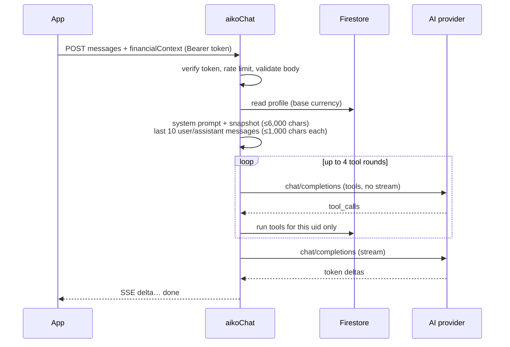
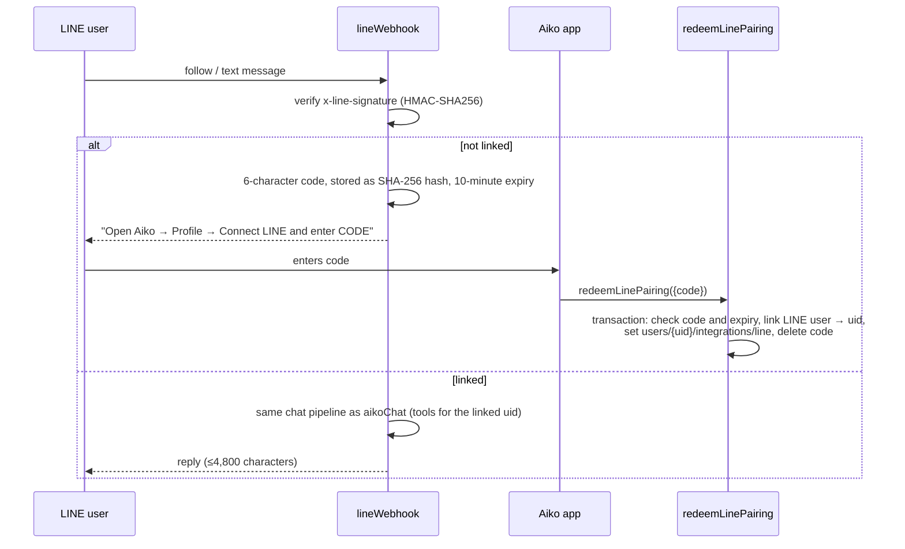

# Backend: Cloud Functions and Security Rules

The backend is Firebase: Auth, Firestore, Storage, and the Cloud Functions codebase `aiko` in `firebase/functions/` (TypeScript, Node 22, `firebase-functions` v2). Clients write finance data straight to Firestore under Security Rules. Functions handle only what must stay privileged: AI chat, account deletion, LINE linking, and the OCR and price providers.

| File | Contents |
| --- | --- |
| `firebase/functions/src/index.ts` | Function entry points, rate limiting, LINE, provider proxy |
| `firebase/functions/src/chat.ts` | System prompt, tool definitions, OpenAI-compatible client, SSE streaming |
| `firebase/functions/src/finance_tools.ts` | Read-only finance tools over the caller's own data (`decimal.js`, never floats) |
| `firebase/firestore.rules`, `firebase/storage.rules` | Security Rules |
| `firebase/firestore.indexes.json` | Composite indexes (currently none) |
| `firebase/tools/import_legacy.cjs` | Dry-run-first importer for legacy exports ([Firebase](firebase.md#import-an-existing-export)) |

Build with `npm run functions:build`. Tests are in [Testing](testing.md).

## Functions

All functions run in `FIREBASE_REGION` (default `us-central1`). Every privileged call derives the user from verified authentication, never from request data.

| Function | Type | Auth | Rate limit | Secrets |
| --- | --- | --- | --- | --- |
| `aikoChat` | HTTPS (`onRequest`, CORS on, 300 s) | Firebase ID token (`Authorization: Bearer`) | 30/min | `AI_API_KEY`, `AI_MODEL`, `AI_BASE_URL` |
| `deleteAccount` | Callable | Signed in within the last 5 minutes | none | none |
| `redeemLinePairing` | Callable | Signed in | 5/min | none |
| `lineWebhook` | HTTPS (300 s) | LINE HMAC signature | 30/min per linked user | AI secrets + `LINE_CHANNEL_SECRET`, `LINE_CHANNEL_ACCESS_TOKEN` |
| `ocrScanner` | Callable | Signed in | 10/min | `OCR_API_URL`, `OCR_API_KEY` |
| `marketFeed` | Callable | Signed in | 30/min | `MARKET_API_URL`, `MARKET_API_KEY` |

Rate limits are fixed one-minute windows stored in `rate_limits/{uid}:{action}`. Exceeding one returns `429` (HTTP) or `resource-exhausted` (callable). A secret that is unset or equals `local-unconfigured` makes its provider report unavailable rather than fail.

### `aikoChat`

Endpoint: `https://<region>-<project>.cloudfunctions.net/aikoChat`; with emulators, `http://<host>:5001/<project>/<region>/aikoChat` (`FirebaseBackend.chatUrl`).

Request (`POST`, JSON):

```json
{
  "messages": [{"role": "user", "content": "How am I doing this month?"}],
  "financialContext": {"…": "on-device snapshot, optional"}
}
```

| Status | Meaning |
| --- | --- |
| `405` | Not a POST |
| `401` | Missing or invalid ID token |
| `429` | Rate limited |
| `400` | `messages` missing or malformed |
| `503` | AI provider not configured |
| `200` | `text/event-stream` |

Stream events, one JSON object per `data:` line:

```text
data: {"delta":"You spent "}
data: {"delta":"฿4,210 on food…"}
data: {"done":true}
```

`{"error":"…"}` replaces `done` when the provider fails. `HttpChatEngine` (`lib/features/aiko_assistant/application/chat_engine.dart`) turns these into `ChatReplyDelta`, `ChatReplyDone` and `ChatReplyError`.

How a request is answered:



- **Layer 1, snapshot:** `buildAikoFinancialContext` (`lib/features/aiko_assistant/application/financial_context.dart`) sends aggregates and a short recent slice, never the full ledger.
- **Layer 2, tools:** `aiko_account_summary`, `aiko_budget_status`, `aiko_spending_by_category`, `aiko_cashflow_summary`, `aiko_recent_transactions` (1–50 rows), `aiko_goal_progress`. Each receives the verified uid and reads only `users/{uid}`. Results are capped at 4,000 characters; tool errors go back to the model as JSON instead of failing the chat.
- **Prompt rules:** warm, non-judgmental, base-currency amounts, no invented numbers, finance topics only. Answers with figures end with "Aiko provides estimates, not certified financial advice." The app shows that line as a separate disclaimer.
- **Provider:** any OpenAI-compatible Chat Completions API at `${AI_BASE_URL}/chat/completions`, temperature 0.4, 60 s timeout per request.

### `deleteAccount`

Requires a sign-in from the last 5 minutes (`auth_time`); otherwise it fails with `failed-precondition` ("Sign in again before deleting your account."). The Profile screen currently shows only a generic "Unable to delete account right now." for every failure ([Features → Known gaps](features.md#known-gaps)). It deletes the user's `line_links`, the whole `users/{uid}` subtree, every Storage object under `users/{uid}/`, and finally the Auth user. It is immediate and permanent. Returns `{deleted: true}`.

### LINE



No Firebase refresh token is stored for LINE. `line_links` and `line_pairings` are server-only.

### `ocrScanner` and `marketFeed`

Thin authenticated proxies to providers you configure. They `POST` JSON with `Authorization: Bearer <KEY>` and a 30 s timeout, and return the provider's JSON unchanged.

| Function | Request validated | Sent to provider | App reads |
| --- | --- | --- | --- |
| `ocrScanner` | `imageBytes`: array of 0–255 integers, 1 to 5,242,880 items; `fileName` | `{fileName, imageBytes}` | `recognizedText` (`ReceiptOcrService`) |
| `marketFeed` | `symbol` `^[A-Za-z0-9.^=-]{1,24}$`; `currency` three capital letters | `{symbol, currency}` | `price` (`InvestmentsNotifier.refreshPrices`) |

## Security Rules

### Firestore (`firebase/firestore.rules`)

| Path | Read | Create / update | Delete |
| --- | --- | --- | --- |
| `users/{uid}/{finance}/{id}` (accounts, categories, category_groups, transactions, investment_holdings, attachments, transaction_splits) | Owner | Owner; `id` and `user_id` must match the path; decimal strings where required | Owner; default-category clones cannot be deleted |
| `users/{uid}/profiles/{uid}` | Owner | Owner; document ID and `id` = uid | No |
| `users/{uid}/preferences/{key}` | Owner | Owner; only a string `value` field | Owner |
| `users/{uid}/integrations/{id}` | Owner | No (server only) | No |
| Everything else | No | No | No |

Field validation:

- `transactions`: `amount` matches `^-?[0-9]+([.][0-9]+)?$`; `currency` and `account_id` are strings.
- `accounts`: `current_balance` is a decimal string.
- `investment_holdings`: `quantity`, `average_cost` and `current_price` are decimal strings.
- Default category and group clones (`template_id` set): updates may touch only `budget_amount`, `budget_currency`, `budget_period`, `budget_rollover`, `budget_enabled`, `alert_thresholds`, `updated_at` and `version`.

### Storage (`firebase/storage.rules`)

`users/{uid}/{kind}/**`: only the owner can read or delete. Writes require `kind` in `avatars`, `receipts`, `documents`, `exports`; a size from 1 byte to 10 MiB; and an `image/*`, `application/pdf`, `text/*` or Word content type.

### Changing rules

Update the rules, the client codec and `firebase/test/rules.test.cjs` together, then run the emulator tests ([Testing](testing.md)). Merging to `main` deploys `firestore` (rules and indexes) automatically, and `storage`/`functions` once enabled in `FIREBASE_DEPLOY_ONLY` ([Deployment](deployment.md)).

## Secrets and configuration

| Where | What |
| --- | --- |
| `firebase/functions/.secret.local` (gitignored) | Emulator values; created from `.secret.local.example` by `npm run firebase:start` |
| Secret Manager | Production values, set with `firebase functions:secrets:set NAME` |
| `--dart-define`s | Public web/app config only (`FIREBASE_*`, `GOOGLE_*_CLIENT_ID`); never secrets |

Provider credentials and Admin credentials never belong in the Flutter build.
