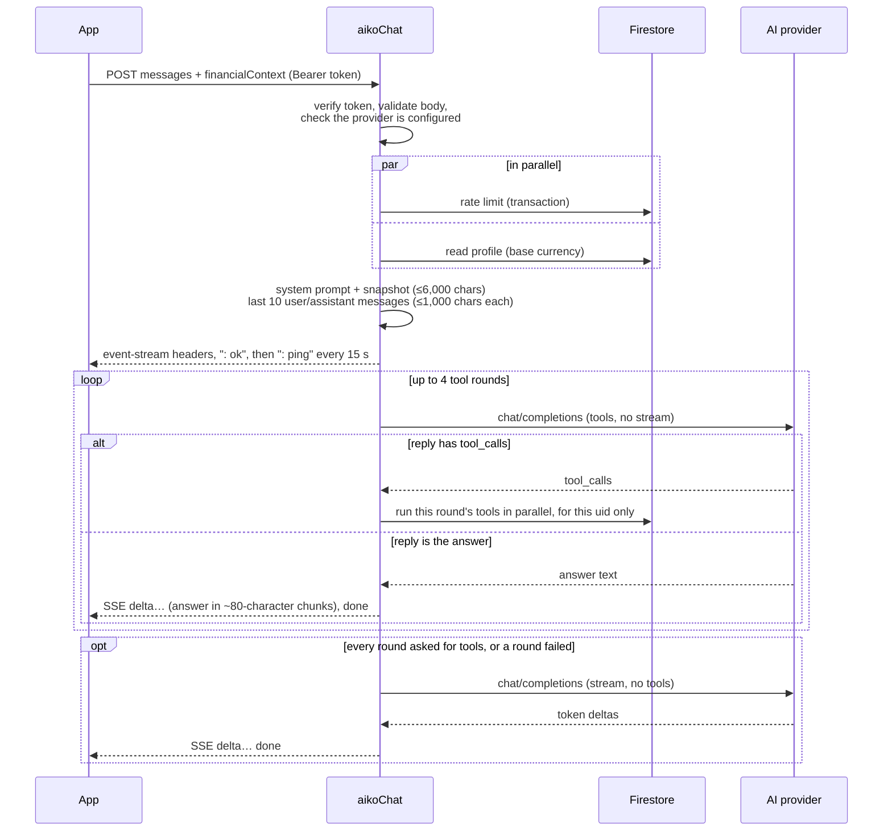
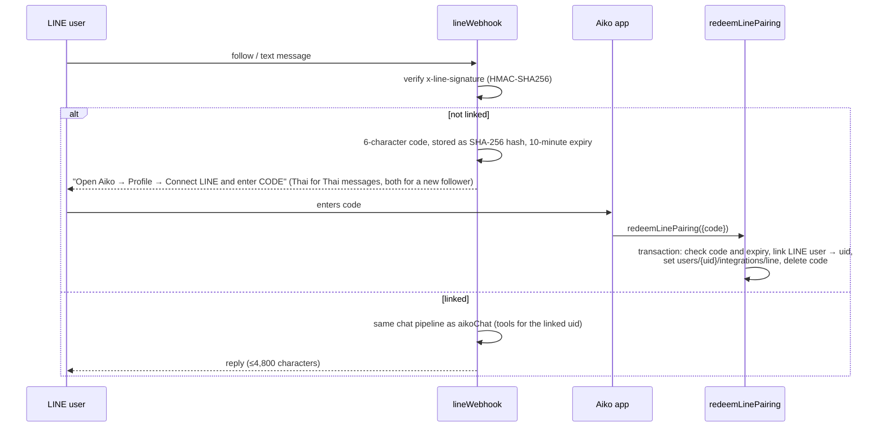

# Backend: Cloud Functions and Security Rules

The backend is Firebase: Auth, Firestore, Storage, and the Cloud Functions codebase `aiko` in `firebase/functions/` (TypeScript, Node 22, `firebase-functions` v2). Clients write finance data straight to Firestore under Security Rules. Functions handle only what must stay privileged: AI chat, account deletion, LINE linking, and the OCR and price providers.

| File | Contents |
| --- | --- |
| `firebase/functions/src/index.ts` | Function entry points, rate limiting, LINE, provider proxy |
| `firebase/functions/src/chat.ts` | System prompt, tool definitions, OpenAI-compatible client, tool rounds and answer streaming (`answerChat`) |
| `firebase/functions/src/http.ts` | CORS for `aikoChat` (`applyCors`), receipt image validation and the OCR provider body |
| `firebase/functions/src/finance_tools.ts` | Read-only finance tools over the caller's own data (`decimal.js`, never floats) |
| `firebase/firestore.rules`, `firebase/storage.rules` | Security Rules |
| `firebase/firestore.indexes.json` | Composite indexes (currently none) |
| `firebase/tools/import_legacy.cjs` | Dry-run-first importer for legacy exports ([Firebase](firebase.md#import-an-existing-export)) |

Build with `npm run functions:build`. Tests are in [Testing](testing.md).

## Functions

The functions set no region, so they deploy to Firebase's default, `us-central1`. The app's `FIREBASE_REGION` define (default `us-central1`) only says where to call them (`FirebaseBackend`), so it must match: leave it unset or `us-central1` unless you also set a region in `index.ts`. Functions scale to zero when idle and are capped at 10 instances (`setGlobalOptions({maxInstances: 10})` in `index.ts`; each instance serves up to 80 concurrent requests). Every privileged call derives the user from verified authentication, never from request data.

| Function | Type | Auth | Rate limit | Secrets |
| --- | --- | --- | --- | --- |
| `aikoChat` | HTTPS (`onRequest`, CORS in the function, 300 s) | Firebase ID token (`Authorization: Bearer`) | 30/min | `AI_API_KEY`, `AI_MODEL`, `AI_BASE_URL` |
| `deleteAccount` | Callable (300 s) | Signed in within the last 5 minutes | none | none |
| `redeemLinePairing` | Callable | Signed in | 5/min | none |
| `lineWebhook` | HTTPS (300 s) | LINE HMAC signature | 30/min per linked user | AI secrets + `LINE_CHANNEL_SECRET`, `LINE_CHANNEL_ACCESS_TOKEN` |
| `ocrScanner` | Callable (512 MiB, 60 s, 4 requests per instance) | Signed in | 10/min | `OCR_API_URL`, `OCR_API_KEY` |
| `marketFeed` | Callable | Signed in | 30/min | `MARKET_API_URL`, `MARKET_API_KEY` |

Rate limits are fixed one-minute windows stored in `rate_limits/{uid}:{action}`. Exceeding one returns `429` (HTTP) or `resource-exhausted` (callable). A secret that is unset or equals `local-unconfigured` makes its provider report unavailable rather than fail.

### `aikoChat`

Endpoint: `https://<region>-<project>.cloudfunctions.net/aikoChat`; with emulators, `http://<host>:5001/<project>/<region>/aikoChat` (`FirebaseBackend.chatUrl`).

CORS is handled in the function by `applyCors` (`http.ts`) rather than `cors: true`: any origin is allowed (the ID token, not the origin, authorizes a request), and a preflight (`OPTIONS`, answered `204`) carries `Access-Control-Max-Age: 3600`, so browsers don't send a preflight before every message.

Request (`POST`, JSON):

```json
{
  "messages": [{"role": "user", "content": "How am I doing this month?"}],
  "financialContext": {"…": "on-device snapshot, optional"}
}
```

Checks run in this order:

| Status | Meaning |
| --- | --- |
| `204` | CORS preflight (`OPTIONS`) |
| `405` | Not a POST |
| `401` | Missing or invalid ID token |
| `400` | `messages` missing or malformed |
| `503` | AI provider not configured |
| `429` | Rate limited |
| `200` | `text/event-stream` |

Stream events, one JSON object per `data:` line:

```text
data: {"delta":"You spent "}
data: {"delta":"฿4,210 on food…"}
data: {"done":true}
```

When the provider fails, an error event replaces `done`, with a stable code; provider details go to the function logs only:

| Event | Meaning |
| --- | --- |
| `{"error":"PROVIDER_DOWN"}` | No answer text was sent: provider unreachable, non-2xx, timed out, or the stream broke at once |
| `{"error":"STREAM_FAILED"}` | The stream broke after some text was sent |

The function sends its headers as soon as the checks pass, then an SSE comment (`: ok`) and a keep-alive `: ping` every 15 s until the answer ends, because the first words can take minutes of tool rounds; clients skip lines that don't start with `data:`. Deploy Functions with or before the app, since the app's timeouts expect this ([Deployment](deployment.md#storage-and-functions)).

`HttpChatEngine` (`lib/features/aiko_assistant/application/chat_engine.dart`) turns these into `ChatReplyDelta`, `ChatReplyDone` and `ChatReplyError`, and maps HTTP statuses to `ChatFailure` values (`401` sign-in expired, `403` forbidden, `429` rate limited, others unavailable). It allows 15 s to connect (Android/iOS), 60 s for the response headers (an ID-token refresh included) and 45 s between chunks. A transport failure is `network`, a timeout `timedOut`, and a stream that ends without `done` after some text `cutOff` (the text is kept); all three are retryable. Guests and local-only builds send nothing.

How a request is answered:



- **One provider call when no tool is needed.** A tool round whose reply asks for no tools already holds the answer, so the function sends that text as a few `delta` events instead of asking the provider again (`answerChat`). It streams a separate final answer only when all 4 rounds asked for tools, the model wrote nothing, or a round failed (tool resolution is then dropped silently).
- **Time limits.** Each provider request, including reading its whole body or stream, times out after 60 s. The whole answer (tool rounds plus the final answer) has a 240 s deadline, so a slow provider ends with an error event before the 300 s function timeout. If the client disconnects, the function aborts its provider requests, so no more tokens are billed.
- **Layer 1, snapshot:** `buildAikoFinancialContext` (`lib/features/aiko_assistant/application/financial_context.dart`) sends aggregates and a short recent slice, never the full ledger.
- **Layer 2, tools:** `aiko_account_summary`, `aiko_budget_status`, `aiko_spending_by_category`, `aiko_cashflow_summary`, `aiko_recent_transactions` (1–50 rows), `aiko_goal_progress`. Each receives the verified uid and reads only `users/{uid}`, and only what it needs (`FinanceReader`). Date-ranged tools query just that `date` range; recent transactions read the newest rows; category names are fetched by ID; account tools never read transactions. Reads are memoized for the whole message ([Cost](cost.md#cloud-functions)). Results are capped at 4,000 characters; tool errors go back to the model as JSON instead of failing the chat.
- **Prompt rules:** warm, non-judgmental, base-currency amounts, no invented numbers, finance topics only. Answers with figures end with a disclaimer line, which the app shows separately.
- **Language:** the app sends `systemContext.locale` (`en` or `th`); `languageInstruction` makes Aiko reply in that language with the matching disclaimer ("Aiko provides estimates, not certified financial advice." / "Aiko ให้ข้อมูลเชิงประมาณการ ไม่ใช่คำแนะนำทางการเงินจากผู้เชี่ยวชาญที่ได้รับอนุญาต"). Without a locale (LINE) Aiko mirrors the language of the user's message.
- **Provider:** any OpenAI-compatible Chat Completions API at `${AI_BASE_URL}/chat/completions`, temperature 0.4.

### `deleteAccount`

Requires a sign-in from the last 5 minutes (`auth_time`); otherwise it fails with `failed-precondition`, and the Profile screen asks the user to sign out, sign in again and retry within 5 minutes (`profileDeleteNeedsRecentSignIn`); other failures show a generic message. It deletes the user's `line_links`, the whole `users/{uid}` subtree and every Storage object under `users/{uid}/` in parallel, then the Auth user. The timeout is 300 s, for large accounts. It is immediate and permanent. Returns `{deleted: true}`. Before calling it, the app reads the profile once from the server to tell offline apart from other failures (offline: "Deleting your account needs a connection…"), takes the account's queued file uploads off the queue, and gives pending writes 15 s to upload, so nothing queued on the device re-creates a document afterwards. While it runs, the app pauses collection refreshes (`FirebaseSyncPause`) so nothing re-creates the profile ([Architecture](architecture.md#signing-out-and-switching-users)).

### LINE



The webhook returns `503` when LINE isn't configured and `401` for a bad signature. Otherwise it handles each event on its own: an event that fails (deleted account, rate limit, LINE API error) is logged and skipped, and the webhook still answers `200`, so LINE doesn't retry the batch and the other events get their replies. The reply call to LINE times out after 10 s.

`redeemLinePairing` errors map to `LineLinkError` in the app (`lineLinkErrorForCode`): `invalid-argument` (malformed code), `not-found` (unknown or expired code), `already-exists` (LINE account linked to another user), `resource-exhausted` (too many attempts), `unauthenticated`. A call that gets no answer (offline, or the app's 15 s timeout) is `offline` (`lineLinkErrorFor`).

No Firebase refresh token is stored for LINE. `line_links` and `line_pairings` are server-only.

### `ocrScanner` and `marketFeed`

Thin authenticated proxies to providers you configure. They `POST` JSON with `Authorization: Bearer <KEY>` and a 30 s timeout, and return the provider's JSON unchanged.

| Function | Request validated | Sent to provider | App reads |
| --- | --- | --- | --- |
| `ocrScanner` | `imageBase64`: base64 of 1 to 5,242,880 bytes (`receiptImage`); `fileName` (up to 255 characters) | `{fileName, imageBytes}` with `imageBytes` as an array of 0–255 integers, unchanged from before | `recognizedText` (`ReceiptOcrService`) |
| `marketFeed` | `symbol` `^[A-Za-z0-9.^=-]{1,24}$`; `currency` three capital letters | `{symbol, currency}` | `price` (`InvestmentsNotifier.refreshPrices`) |

The app sends receipts as `imageBase64`, about a third larger than the image; the integer array older apps send as `imageBytes` was 3–4 times larger. `ocrScanner` still accepts `imageBytes` for one release. An older function rejects `imageBase64`, so deploy Functions before the app ([Deployment](deployment.md#storage-and-functions)).

In the app, an OCR call times out after 45 s and each price quote after 35 s, and neither is sent for a guest. Only a failure in the SDK before the function answered counts as offline (`isCallableTransportFailure` in `lib/core/network/network_errors.dart`: web status 0, Android `unavailable`, iOS `unknown`, a bare `deadline-exceeded`); an error the function raises, `unavailable` included, shows as a normal failure.

## Security Rules

### Firestore (`firebase/firestore.rules`)

| Path | Read | Create / update | Delete |
| --- | --- | --- | --- |
| `users/{uid}/{finance}/{id}` (accounts, categories, category_groups, transactions, investment_holdings, attachments, transaction_splits) | Owner | Owner; `id` and `user_id` must match the path; decimal strings where required | Owner; default-category clones cannot be deleted |
| `users/{uid}/profiles/{uid}` | Owner | Owner; document ID and `id` = uid | No |
| `users/{uid}/preferences/{key}` | Owner | Owner; only a string `value`, or an `items` map that clients change with merges | Owner |
| `users/{uid}/integrations/{id}` | Owner | No (server only) | No |
| Everything else | No | No | No |

Field validation:

- `transactions`: `amount` matches `^-?[0-9]+([.][0-9]+)?$`; `currency` and `account_id` are strings.
- `accounts`: `current_balance` is a decimal string.
- `investment_holdings`: `quantity`, `average_cost` and `current_price` are decimal strings.
- Default category and group clones (`template_id` set): updates may touch only `budget_amount`, `budget_currency`, `budget_period`, `budget_rollover`, `budget_enabled`, `alert_thresholds`, `updated_at` and `version`, plus `created_at` once: a clone seeded without it may get a string value, after which it is fixed. Clients keep a clone's stored `created_at` and never stamp one.

### Storage (`firebase/storage.rules`)

`users/{uid}/{kind}/**`: only the owner can read or delete. Writes require `kind` in `avatars`, `receipts`, `documents`, `exports`; a size from 1 byte to 10 MiB; and an `image/*`, `application/pdf`, `text/*` or Word content type.

### Changing rules

Update the rules, the client codec and `firebase/test/rules.test.cjs` together, then run the emulator tests ([Testing](testing.md)). Merging to `main` deploys `firestore` (rules and indexes) automatically, and `storage`/`functions` once enabled in `FIREBASE_DEPLOY_ONLY` ([Deployment](deployment.md)).

## Secrets and configuration

| Where | What |
| --- | --- |
| `firebase/functions/.secret.local` (gitignored) | Emulator values; created from `.secret.local.example` by `npm run firebase:start` |
| Secret Manager | Production values, set with `firebase functions:secrets:set NAME` |
| `--dart-define`s | Public web/app config only (`FIREBASE_*`, `GOOGLE_*_CLIENT_ID`); never secrets |

Provider credentials and Admin credentials never belong in the Flutter build.
