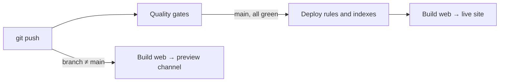

# Deployment: Firebase Hosting

GitHub Actions builds the Flutter web app and publishes it to Firebase Hosting in the same Firebase project that provides Auth, Firestore, Storage and Functions. One service account deploys everything.

| Push to | `.github/workflows/ci.yml` does |
| --- | --- |
| Any branch except `main` | Quality gates, plus a **preview channel** for that branch, deployed in parallel. The URL appears as a `Hosting (preview)` check (Details link) on the commit, branch and any pull request, and in the run summary. |
| `main` | Quality gates. If they pass: deploy Firebase rules/indexes, then the **live site** (`https://<project>.web.app`). |

Quality gates: `dart format`, `flutter analyze`, `flutter test`, Functions unit tests, and the rules/storage/functions emulator tests ([Testing](testing.md)). Re-run any branch from **Actions → CI → Run workflow**. Previews deploy even when a gate fails, so you can see the change; the live site never does. Until the `FIREBASE_PROJECT_ID` variable is set ([GitHub settings](#3-github-settings)), CI runs the quality gates only and skips every deploy; once it is set, a missing secret or variable fails the deploy with its name.



## Preview channels

- Each branch maps to one channel, so its URL stays the same across pushes: `https://<project>--<channel>-<hash>.web.app`. The channel ID is the branch name in lowercase with other characters replaced by `-`, cut to 20 characters (`Feature/New_Login` → `feature-new-login`).
- A channel expires 7 days after its last deploy. Hosting allows a limited number of channels per site, and expiry keeps old branches from using them up.
- The deploy adds each channel's domain to Firebase Auth **authorized domains** and removes expired ones, so Google sign-in works on previews too.
- Previews are public, unlisted URLs. They use the production Firebase project, so they read and write real accounts. Use a test account.

## One-time setup

### 1. Firebase project

1. In the [Firebase console](https://console.firebase.google.com), create a project, for example `aiko-prod`.
2. **Authentication → Get started:** enable **Email/Password** and **Google**. `<project>.web.app` and `<project>.firebaseapp.com` are authorized by default; add any custom domain under **Settings → Authorized domains**.
3. **Firestore Database → Create database** in production mode. CI deploys `firebase/firestore.rules` and indexes.
4. **Project settings → General → Your apps → Add app → Web.** Copy `apiKey`, `appId`, `messagingSenderId`, `storageBucket`, `authDomain` and `projectId` for step 3. Hosting needs no separate setup; the first deploy creates the site.
5. Optional, Blaze plan only: Storage and Cloud Functions. See [Storage and Functions](#storage-and-functions).

### 2. CI service account

In [Cloud Shell](https://console.cloud.google.com/?cloudshell=true), create a deploy-only service account and key:

```sh
PROJECT=aiko-prod
SA=github-deploy@$PROJECT.iam.gserviceaccount.com
gcloud iam service-accounts create github-deploy --project "$PROJECT"
for role in roles/firebasehosting.admin roles/firebaseauth.admin roles/run.viewer \
    roles/serviceusage.serviceUsageConsumer roles/serviceusage.apiKeysViewer \
    roles/firebaserules.admin roles/datastore.indexAdmin; do
  gcloud projects add-iam-policy-binding "$PROJECT" --member "serviceAccount:$SA" --role "$role" --condition None
done
gcloud iam service-accounts keys create key.json --iam-account "$SA"
cat key.json   # paste into the FIREBASE_SERVICE_ACCOUNT secret, then: rm key.json
```

The first five roles are the set `firebase init hosting:github` grants for Hosting deploys; `firebaseauth.admin` syncs preview domains. The last two deploy Firestore rules and indexes. A failed deploy log names any missing permission; grant the role that contains it.

### 3. GitHub settings

Add these under **Settings → Secrets and variables → Actions**, or with `gh secret set NAME` / `gh variable set NAME --body VALUE`:

| Kind | Name | Value |
| --- | --- | --- |
| Secret | `FIREBASE_SERVICE_ACCOUNT` | Contents of `key.json` |
| Variable | `FIREBASE_PROJECT_ID` | `projectId` |
| Variable | `FIREBASE_API_KEY` | `apiKey` |
| Variable | `FIREBASE_APP_ID` | `appId` |
| Variable | `FIREBASE_MESSAGING_SENDER_ID` | `messagingSenderId` |
| Variable | `FIREBASE_STORAGE_BUCKET` | `storageBucket` |
| Variable | `FIREBASE_AUTH_DOMAIN` | `authDomain` |
| Variable (optional) | `FIREBASE_REGION` | Region the app calls Functions in; default `us-central1`. Functions deploy to `us-central1`, so leave it unset ([Backend → Functions](backend.md#functions)) |
| Variable (optional) | `FIREBASE_DEPLOY_ONLY` | Backend targets for `firebase deploy --only`; default `firestore` |

The Firebase web options are public client configuration, so they are variables, not secrets. Then push a branch for a preview, or push `main` for the live site.

## Storage and Functions

Both require the Blaze plan. Then:

1. **Storage → Get started** to create the default bucket.
2. Create every Functions secret. Use `local-unconfigured` for providers you do not use; they report "unavailable" instead of failing:

   ```sh
   for name in AI_API_KEY AI_MODEL AI_BASE_URL LINE_CHANNEL_SECRET LINE_CHANNEL_ACCESS_TOKEN \
       OCR_API_URL OCR_API_KEY MARKET_API_URL MARKET_API_KEY; do
     npx firebase functions:secrets:set "$name" --project aiko-prod
   done
   ```

3. Grant the service account `roles/firebasestorage.admin` for Storage rules. For Functions also grant `roles/cloudfunctions.admin`, `roles/iam.serviceAccountUser`, `roles/secretmanager.admin` and `roles/artifactregistry.admin`, then add more if the deploy log asks for them.
4. Set `FIREBASE_DEPLOY_ONLY` to `firestore,storage,functions`. Functions deploy in a separate `--force` call so CI can set the Artifact Registry cleanup policy and remove functions deleted from the `aiko` codebase. Rules and indexes deploy without `--force`, so indexes created in the console are kept. Hosting is not a valid value here; the web job deploys it after building the app.

**Deploy Functions before the app.** On `main`, CI deploys Functions (when listed in `FIREBASE_DEPLOY_ONLY`) before the live site, which is the right order. If you deploy by hand, run `firebase deploy --only functions` first. A release can change a function's request format: the app now sends receipts to `ocrScanner` as `imageBase64`, which older `ocrScanner` versions reject, while the new function still accepts the old `imageBytes` from apps already open ([Backend](backend.md#ocrscanner-and-marketfeed)). Preview channels call the production Functions, so a preview of such a change works only once `main` has deployed them.

## Hosting configuration

`firebase.json` serves `build/web` except `canvaskit/` (the app loads CanvasKit from Google's CDN) and rewrites unknown paths to `index.html`. Cache headers:

| Files | `Cache-Control` | Why |
| --- | --- | --- |
| Everything (`**`) | `no-cache` | Flutter's `main.dart.js` and `flutter_bootstrap.js` are not content-hashed, so browsers revalidate them after each release; unchanged files still return `304 Not Modified` |
| `/assets/assets/**` (bundled fonts, images, SVGs) | `public, max-age=3600, stale-while-revalidate=86400` | They rarely change; a new version can take up to an hour to appear |

The web job builds with `flutter build web --release --pwa-strategy=none`, so the page loads `main.dart.js` right away instead of first registering Flutter's deprecated service worker. The flag is itself deprecated; if Flutter drops it, the comment in `.github/workflows/deploy-web.yml` gives the replacement (a custom bootstrap script in `web/`). The same Hosting config powers the local Hosting emulator ([Getting started](getting-started.md)).

Rollback: **Hosting → Release history → Roll back** in the Firebase console, or redeploy an earlier commit with **Actions → CI → Run workflow** on `main`.

## Notes

- Free (Spark) Hosting includes 10 GB storage and 360 MB/day transfer. A first visit downloads roughly 2–5 MB from Hosting; Flutter's CanvasKit renderer comes from Google's CDN. Blaze bills extra transfer at $0.15/GB.
- Set the cost guardrails once: a billing budget alert and a Hosting release-retention limit ([Cost → One-time guardrails](cost.md#one-time-guardrails)).
- To use a custom domain for Google sign-in pop-ups, connect it under **Hosting → Add custom domain** and set `FIREBASE_AUTH_DOMAIN` to it; Hosting serves the `/__/auth/*` handler on every domain it hosts.
- Only pushes trigger CI, so pull requests from forks get no preview and never receive secrets.
- Mobile builds use the same `FIREBASE_*` defines ([Getting started](getting-started.md)); this pipeline only ships the web app.
