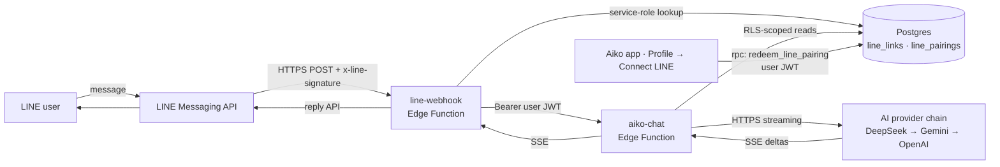
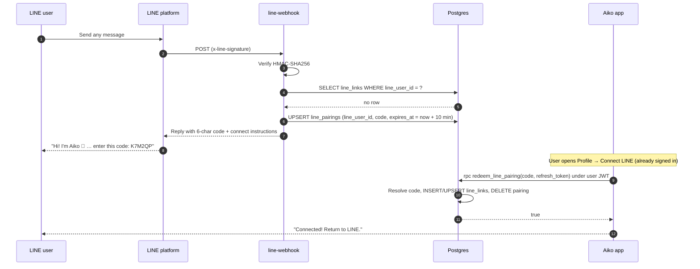
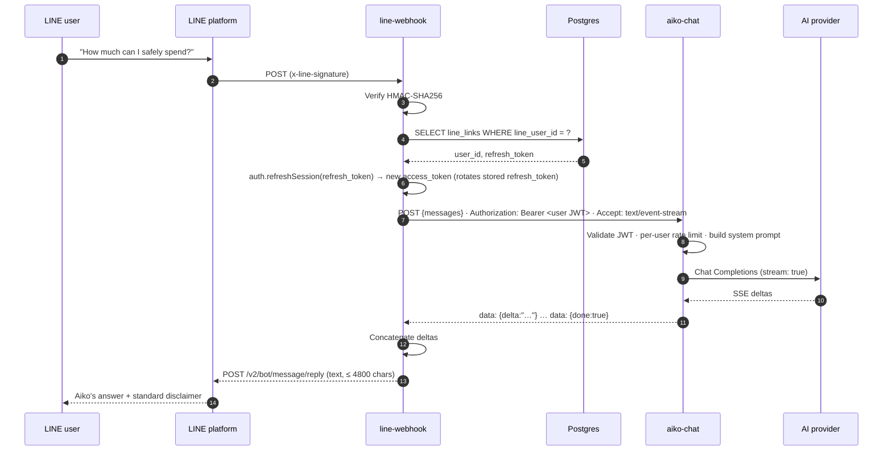

# Aiko × LINE bot — how it works

The Aiko LINE bot lets a user chat with Aiko from LINE using **their own** financial data. Under the hood it is a small Supabase Edge Function (`line-webhook`) that bridges the LINE Messaging API to the existing `aiko-chat` function. No web page, no LIFF, no separate LINE Login channel — the bot hands out a short pairing code and the user finishes the link from inside the Aiko app (where they are already signed in).

This document explains how the pieces fit together, what data crosses which boundary, and where to look when something goes wrong.

---

## At a glance



Three things to notice:

- The bot, the webhook, and the Aiko app are **separate**; the only shared state is two Postgres tables.
- The webhook holds **no user data** — it borrows the user's JWT on every message to call `aiko-chat`, so the AI only ever sees rows RLS allows.
- The provider API key lives only in `aiko-chat`; the webhook never sees it. The service-role key lives only in the webhook.

---

## Components

| Component | What it is | Where |
| --- | --- | --- |
| **LINE channel** | The Messaging API bot the user adds as a friend. Sends webhooks to our URL, receives replies from the reply API. | https://developers.line.biz |
| **`line-webhook`** | Supabase Edge Function. Verifies LINE's HMAC signature, looks up the link, refreshes the user's access token, proxies to `aiko-chat`, posts the reply back. | `supabase/functions/line-webhook/index.ts` |
| **`aiko-chat`** | Existing Aiko streaming chat function (DeepSeek → Gemini → OpenAI with auto-fallback, rate limiting, financial context, Aiko persona + disclaimer). | `supabase/functions/aiko-chat/index.ts` |
| **`line_links`** | The link table: `line_user_id → user_id + refresh_token`. Read/written by the service-role webhook; user-scoped RLS lets the app read/write its own row. | `supabase/migrations/20260615020000_line_links.sql` |
| **`line_pairings`** | Short-lived pairing codes (~10 min). Written by the webhook with the service-role key; consumed by the `redeem_line_pairing` RPC. Not client-readable. | `supabase/migrations/20260617010000_line_pairings.sql` + `20260617030000_redeem_line_pairing.sql` |
| **Aiko app** | Flutter app. "Profile → Connect LINE" lets a signed-in user paste the pairing code; the app calls `redeem_line_pairing` with its own refresh token. | `lib/features/settings/presentation/connect_line_screen.dart`, `lib/features/settings/data/line_link_repository.dart` |

---

## Lifecycle

There are three flows: **pairing** (one-time), **chat** (every subsequent message), and **re-link** (when the refresh token expires).

### 1. Pairing — first contact



Why a code instead of a hosted page: a pairing code keeps linking inside the Aiko app, where the user is already authenticated. The password never leaves the app, no LIFF channel is needed, and the `line_pairings` table is not client-readable (codes cannot be enumerated — only guessed, which the 6-char alphabet + 10 min TTL + single-use cover).

### 2. Chat — every subsequent message



Key points:

- The webhook does **not** hold a long-lived access token. It trades the stored refresh token for a fresh one on every message and rotates the stored refresh token, so a stolen DB row is only briefly useful.
- `aiko-chat` runs with the **caller's JWT**, so every Postgres read goes through RLS. The model can only see what the user could see in the Aiko app.
- The LINE reply is sent as **one** text message, not streamed, because LINE's reply tokens are short-lived and a single message is the simplest contract. The 4800-char cap mirrors LINE's 5000-char message limit.
- The "Aiko provides estimates, not certified financial advice." footer is enforced by `aiko-chat`'s system prompt, so it carries over to LINE automatically.

### 3. Re-link

If the stored refresh token can no longer be exchanged (rotation gap, revoked session, etc.) the webhook falls back to the pairing flow on the next message — the user just messages the bot again, gets a fresh code, and re-links from Profile → Connect LINE. `line_links` is upserted on `line_user_id`, so re-linking overwrites the old link rather than creating a duplicate.

---

## Security model

| Boundary | What crosses it | What's protected |
| --- | --- | --- |
| LINE → webhook | HTTPS POST + `x-line-signature` HMAC of the raw body with `LINE_CHANNEL_SECRET` | The webhook rejects unsigned/forged posts (`401 Bad signature`). |
| Webhook → `line_links` / `line_pairings` | Service-role key (server-side only) | The link table contains refresh tokens; only the webhook reads it. The pairing table is *not* client-readable — codes are redeemed through a `SECURITY DEFINER` RPC. |
| Webhook → `aiko-chat` | The **user's** JWT (borrowed via refresh) | The chat function is the same one the app calls, so RLS scopes every read to the linked user. The webhook never widens this scope. |
| `aiko-chat` → AI provider | Streaming Chat Completions, *no* keys in the request body | The provider API key is read from `aiko-chat` env vars and is never sent to LINE, the webhook, or the client. |
| Aiko app → `redeem_line_pairing` | Code + the user's own refresh token, under their JWT | The user is already authenticated; the RPC verifies `auth.uid()`, resolves the code server-side, and consumes the pairing. |
| Everywhere | `SUPABASE_URL`, `SUPABASE_ANON_KEY` | Injected by the Supabase runtime. Never hard-coded, never sent in client-visible config. |

Why no `LINE_LIFF_ID`: a LIFF app would mean a separate LINE Login channel and a hosted page. The pairing-code flow removes both — linking happens in the Aiko app, where the user already has a session.

---

## Setup reference

For a fresh deploy. The web setup (Supabase project, AI provider key) follows the standard `aiko-chat` flow described in `AGENTS.md`.

```bash
# 1. Database (line_links + line_pairings + redeem_line_pairing RPC + RLS)
supabase db push

# 2. LINE channel (developers.line.biz → Messaging API)
#    - Copy Channel secret
#    - Issue a long-lived Channel access token
#    - Disable Auto-reply messages and Greeting messages
#    - Webhook URL: https://<project-ref>.functions.supabase.co/line-webhook
#    - Toggle "Use webhook" on

# 3. Supabase secrets
supabase secrets set LINE_CHANNEL_SECRET=...
supabase secrets set LINE_CHANNEL_ACCESS_TOKEN=...

# 4. Deploy (--no-verify-jwt is required: LINE carries a LINE signature, not a Supabase JWT)
supabase functions deploy line-webhook --no-verify-jwt
```

### Smoke test

1. Add the bot as a LINE friend (QR code in the Messaging API tab).
2. Send any message → the bot replies with a **6-char pairing code**.
3. Aiko app → **Profile → Connect LINE** → enter the code → "Connected!".
4. Back in LINE, ask *"How much can I safely spend?"* — Aiko answers from your data, ending with the standard estimates disclaimer.

---

## Troubleshooting

| Symptom | Likely cause |
| --- | --- |
| Bot never replies | Webhook URL wrong, "Use webhook" off, or `--no-verify-jwt` omitted on deploy. |
| `401 Bad signature` in function logs | `LINE_CHANNEL_SECRET` mismatch (rotated, wrong channel, trailing whitespace). |
| Bot replies with a pairing code every time | `line_links` row missing or its `refresh_token` is unusable — the user just re-links from Profile → Connect LINE. |
| "That code is invalid or expired" | Code is older than 10 min, or already consumed. Message the bot again. |
| "Aiko is having trouble" / "Aiko hit an error" | `aiko-chat` not deployed, or its active chain has no configured provider keys (`AI_KEY_DEEPSEEK` / `AI_KEY_GEMINI` / `AI_KEY_OPENAI`). |
| User says the bot answers about someone else's data | Almost certainly not — the webhook borrows *that user's* JWT on every message and RLS scopes the data. If you can reproduce, file a bug with the LINE user id, the user id, and the function logs. |

Reference implementation: `supabase/functions/line-webhook/README.md`, `lib/features/settings/data/line_link_repository.dart`.
