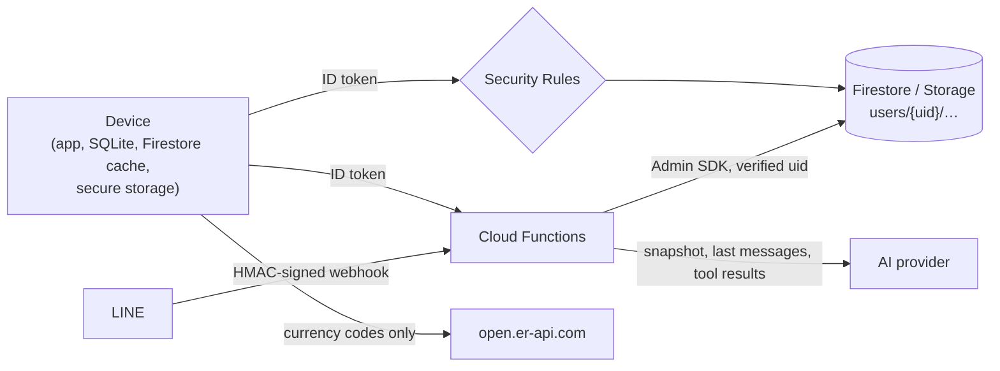

# Security and privacy

How Aiko protects financial data, what leaves the device, and the known limits. Treat the client as untrusted: every guarantee below is enforced by Security Rules or Cloud Functions, not by app code.

## Trust boundaries

## Authentication

- Firebase Auth with email/password and Google. Web sessions persist in IndexedDB (`Persistence.LOCAL`); mobile uses the platform default.
- Callable functions and `aikoChat` verify the Firebase ID token and use its uid; request bodies never choose the owner.
- Account deletion requires a sign-in within the last 5 minutes.
- When a session ends, by Log out or elsewhere (token revoked, account deleted on another device), the app cancels every scheduled reminder (they name merchants and amounts) and stops using that user's id as the local data owner ([Architecture](architecture.md#signing-out-and-switching-users)).

## Authorization

Summarized from [Backend → Security Rules](backend.md#security-rules):

- A user can only read and write `users/{their uid}/…`. Every finance document's `id` and `user_id` must match its path.
- Money fields must be decimal strings, which stops float values from slipping in.
- Default category clones keep their identity; only budget fields can change, and an empty `created_at` can be set once.
- `integrations`, `line_links`, `line_pairings`, `rate_limits` and any unlisted path are server-only or denied.
- Storage: owner-only, 10 MiB maximum, image/PDF/text/Word content types only.

Rules are tested against the emulator on every push ([Testing](testing.md)).

## Secrets

| Secret | Where it lives |
| --- | --- |
| AI, LINE, OCR and market provider keys | Firebase Secret Manager (production), `firebase/functions/.secret.local` (local, gitignored) |
| CI deploy credentials | GitHub secret `FIREBASE_SERVICE_ACCOUNT`, a deploy-only service account with the minimal roles in [Deployment](deployment.md#2-ci-service-account) |
| Firebase web options, Google client IDs | Not secrets. Compiled into the app and stored as GitHub variables |

Never put a provider key, service-account JSON or Admin credential in a `--dart-define`, `.env` committed to git, or client code. `.env`, `.env.*` (except `.env.example`) and `.secret.local` are gitignored.

## Data on the device

| Data | Storage | Protection |
| --- | --- | --- |
| Signed-in finance data | Firestore offline cache (IndexedDB on the web) | OS sandbox / browser origin isolation; not encrypted by the app |
| Local-only and anonymous finance data | `aiko_offline.sqlite` (IndexedDB on the web) | Same |
| Attachment and avatar bytes | `aiko_files.sqlite` | Same |
| Owner ID, known-account flag, capture settings | `flutter_secure_storage` (Keychain / Android Keystore). On the web, values are encrypted with a key kept in the same browser, so treat that as obfuscation | |
| Captured bank SMS/notifications (Android) | App-support `capture_inbox/` files | Deleted after processing |

Signing out clears the session but not the local caches. Clearing app or site data removes everything on the device. There is no app lock yet ([Known gaps](features.md#known-gaps)).

## What leaves the device

| Destination | Data | When |
| --- | --- | --- |
| Firebase | Your records, files and preferences | Signed in |
| AI provider (via `aikoChat`) | System prompt, an aggregate financial snapshot (≤ 6,000 characters), the last 10 messages (≤ 1,000 characters each), and tool results computed from your data | Each Ask Aiko message |
| LINE | Chat replies to your linked LINE account | Only after you pair LINE |
| OCR provider (via `ocrScanner`) | The receipt image (sent to the function as base64, to the provider as bytes) | When you scan a receipt |
| Market provider (via `marketFeed`) | Ticker symbol and currency | When you refresh prices |
| `open.er-api.com` | One base currency code | Currency conversion in the transaction form, foreign-currency totals (Overview, Investments) and Travel Mode rate refresh |
| Google (`fonts.gstatic.com`, `www.gstatic.com`) | Standard web requests for fonts, the Flutter renderer and the Firebase JS SDK | App load |

The snapshot is designed to send aggregates and a short recent slice, not the full ledger. Aiko answers carry the disclaimer *"Aiko provides estimates, not certified financial advice."*

## Abuse protection

- Per-user, per-minute rate limits on chat (30), LINE chat (30), pairing (5), OCR (10) and market prices (30).
- The LINE webhook verifies the `x-line-signature` HMAC with a constant-time comparison. Pairing codes are 6 characters from an unambiguous alphabet, stored only as SHA-256 hashes, expire after 10 minutes, and are consumed in a transaction.
- Provider proxies validate inputs (receipt images ≤ 5 MiB after decoding, ticker and currency patterns) and time out after 30 s.
- `aikoChat` allows any origin (CORS): the ID token, not the origin, authorizes a request. Errors reach the client as stable codes (`PROVIDER_DOWN`, `STREAM_FAILED`); provider details stay in the function logs.

## Account deletion

`deleteAccount` removes the user's LINE mapping, the entire `users/{uid}` Firestore subtree, all Storage objects under `users/{uid}/`, and the Auth user. It is immediate and permanent, with no grace period.

## Deployment exposure

- Preview channels are public, unlisted URLs that use the production Firebase project. Data stays protected by sign-in and Rules, but test with a test account.
- CI runs only on pushes, so forks never receive secrets.
- Emulator builds refuse non-`demo-` projects, and deploy builds never include `FIREBASE_EMULATOR_HOST`.

## Android permissions

`INTERNET`, `CAMERA` (receipts), `RECEIVE_SMS` and `READ_SMS` (opt-in auto-capture), notification-listener access (opt-in, granted in system settings), `POST_NOTIFICATIONS`, `SCHEDULE_EXACT_ALARM`/`USE_EXACT_ALARM` and `RECEIVE_BOOT_COMPLETED` (reminders). iOS asks for camera and photo-library access for receipts.
